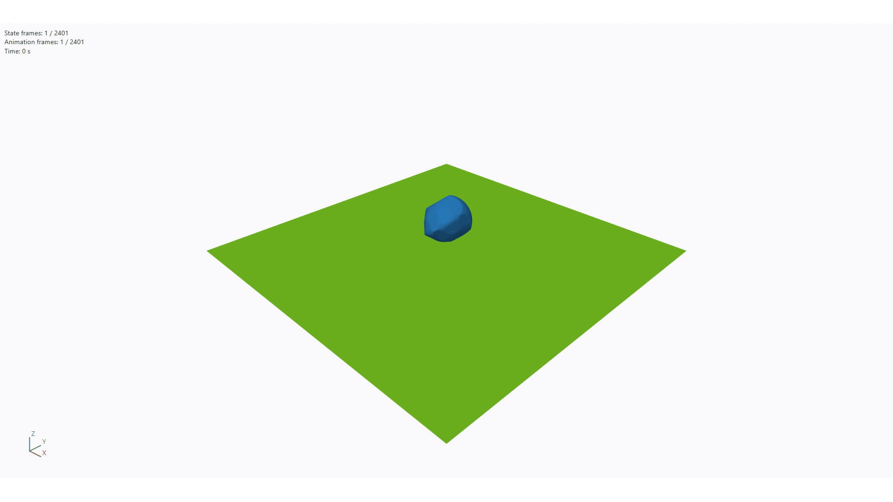
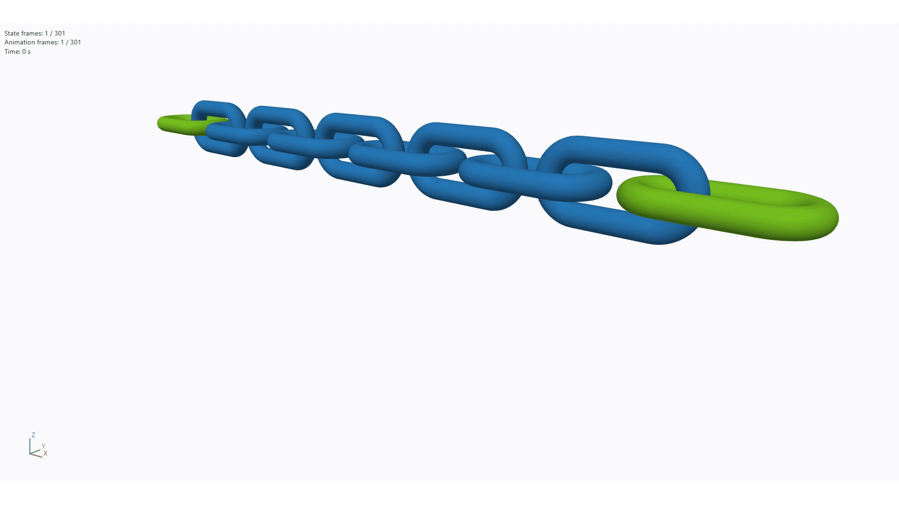
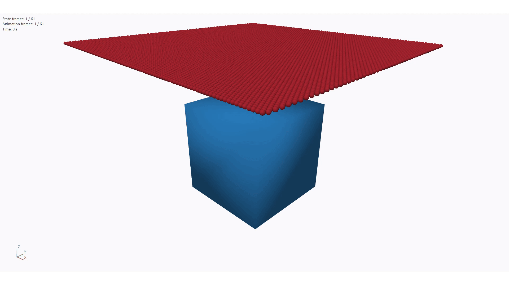
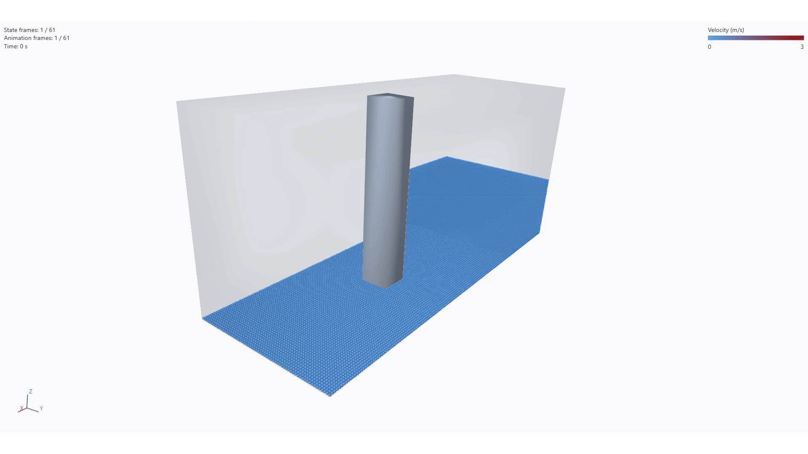
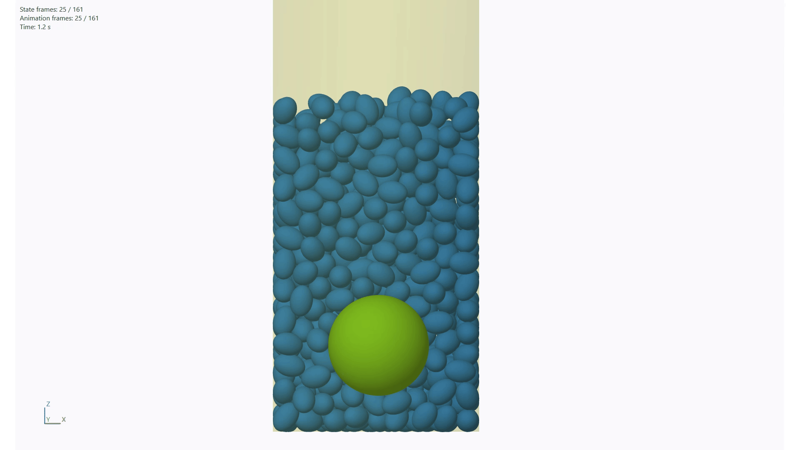
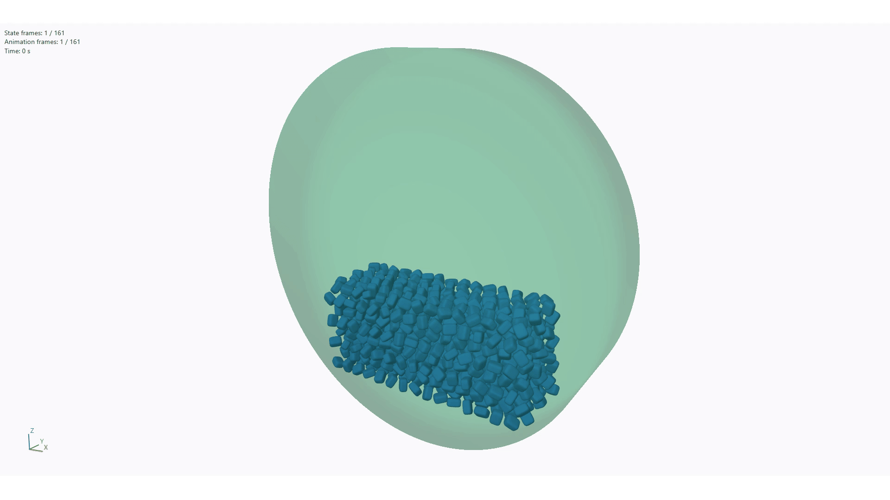

# FunDEM 1.0

FunDEM is a Windows x64 desktop workbench for spherical and level-set DEM,
including coupled LSDEM + SPH fluid–solid simulations.

## Features

- **Setup:** materials, contact material pairs, LS geometries and reusable
  Sphere/LS Particle Templates. Create single-particle, lattice and random
  populations with reproducible radius, shape and orientation settings.
- **Simulation:** named Events, particle instances, Bonds, free or periodic
  boundaries, motion constraints, force/torque, velocity resets, Global damping
  and sphere hydrodynamics.
- **Run control:** Submit accepts the pending Event prefix through the selected
  Event; Withdraw releases its unstarted submitted suffix. The first Submit
  selects CPU/GPU/Hybrid and an output folder. Choose an unlimited, 1, 10 or
  100-step budget, then Run/Pause/Resume or Reset.
  Particle, Contact, Bond and SPH state continues across Events.
  Existing LS boundary samples retain their local geometry during Event changes;
  newly introduced LS particles append their own samples on every backend.
- **Resources:** View > Resource Usage reports system memory, graphics memory
  and disk space, with automatic Result-frame and Render-data cache budgets.
  Preload and Clear cache preserve the accepted view. Capacity checks guard
  supported generation, import, rendering and recording operations.
- **Render View:** direct framing, standard-view, projection, coordinate-axis
  and reference-grid controls, with consistent CAD-style icons.
- **SPH:** shared fluid properties, regular Blocks and finite-duration Jets
  coupled to LS solids.
- **Results:** recorded-frame playback, synchronized particle State tables,
  independent particle/Contact/Bond displays, movable legends, Clip and Threshold.
- **Plot:** Time history, XY curve, Scatter, Histogram and uniaxial compression;
  configurable curves/axes, data tables, manual Reload, CSV and figure export.
- **Exchange:** solid-particle DAT and complete State transfer. Export State
  selects a saved State frame and particle instances, with optional Bonds.
- **Images/video:** recorded Animation-frame PNG and H.264 MP4 export with
  timestamps and responsive cancellation.

## Download

[Download FunDEM 1.0](https://github.com/kaiqideng/FunDEMSoftware/releases/tag/v1.0)

| Portable ZIP | Execution modes |
| --- | --- |
| CPU | CPU |
| CUDA | CPU; GPU/Hybrid with compatible NVIDIA hardware and an installed driver |

CPU is the default. Hybrid advances Sphere/SPH on GPU and LS on CPU.
The CUDA ZIP includes the application runtime libraries. Unavailable backends
produce an explicit error.

Verify `SHA256SUMS.txt`, extract the entire ZIP and run `Windows/FunDEM.exe`.
Keep matching libraries, plugins, examples, documentation and notices together.
Save projects and results outside the installation directory.

## Included examples

**File > Open Project > Examples** opens seven independent editable projects:

<!-- fundem-example-videos:start -->
### 1. Gömböc self-righting

Rocking and settling of a Gömböc-shaped level-set particle on a flat support.

[Download original MP4 · 2:00](https://github.com/kaiqideng/FunDEMSoftware/releases/download/v1.0/animation1.mp4)

### 2. Interlocked chain

A suspended chain assembled from individual interlocking level-set links.

[Download original MP4 · 0:15](https://github.com/kaiqideng/FunDEMSoftware/releases/download/v1.0/animation2.mp4)

### 3. Cloth drop into a box

A sheet of bonded particles drops onto a box and bends around its edges.

[Download original MP4 · 0:03](https://github.com/kaiqideng/FunDEMSoftware/releases/download/v1.0/animation3.mp4)

### 4. Dam break around a square column

SPH flow passes around a solid column, with particle colors showing velocity magnitude.

[Download original MP4 · 0:03](https://github.com/kaiqideng/FunDEMSoftware/releases/download/v1.0/animation4.mp4)

### 5. Brazil nut segregation

A large intruder rises through a bed of smaller grains during container vibration.

[Download original MP4 · 0:07](https://github.com/kaiqideng/FunDEMSoftware/releases/download/v1.0/animation5.mp4)

### 6. Superellipsoid mixing drum

Two colored populations of non-spherical particles tumble and redistribute inside a rotating drum.

[Download original MP4 · 0:08](https://github.com/kaiqideng/FunDEMSoftware/releases/download/v1.0/animation6.mp4)

### 7. Random-shape particle column

Irregular level-set particles settle within a confined column.
<!-- fundem-example-videos:end -->

Opening an example leaves calculation under user control. The inputs have
open/save, short native execution and recorded-replay checks. Physical
validation applies to each documented comparison and its stated criteria.

## Files and continuation

Projects use `.fundem.json`. Retain their required `.fundem-data` siblings.
JSON stores configuration; sidecars hold required numerical data.
State and Animation have independent recording intervals.

Current Results archives share fixed particle, Bond and SPH definitions across
frames. Dynamic states and interaction histories remain frame-specific.
Earlier archives without shared definitions are rejected. Exported State
projects embed their required definitions.

Recorded Results support replay and analysis. Export State creates a separate
continuation project with selected particles, their dependencies and retained
interaction histories. Contacts/Bonds require both endpoints within the
selected instances. Include bonds controls Bond export. Import restores a
protected, zero-time Imported state Event.

Before the first computing Submit, imported Bond recipes permit Name,
fracture/damage switches, strengths, internal friction and fracture-energy
edits. Saved stiffness, geometry, endpoint frames, damage and broken state
remain fixed. Broken Bonds retain their broken state. Strength and Damage
groups follow their fracture and progressive-damage choices.

The first computing Event shares its zero-time indexed frame with the imported
base. Results binds to the new recording and refreshes saved frame lists while
keeping the displayed frame selected. Playback and seeking remain available
during calculation. The decoded-frame cache accounts for retained SPH data.

DAT export selects a saved complete State frame and solid-particle instance.
It transfers geometry, material, pose and velocity data into editable authored
objects. State also preserves interaction history for
continuation. Filters control rendering; exports and Plot use explicit
data selections.

Read the [User Manual](USER_MANUAL.md) and [Example Guide](EXAMPLE_GUIDE.md).

## Numerical core and notices

[FunDEMBeta](https://github.com/kaiqideng/FunDEMBeta) is the separately open-source
numerical core. Its
[validation directory](https://github.com/kaiqideng/FunDEMBeta/tree/main/validation)
contains comparison inputs, reports and reproducibility instructions.

This repository distributes application packages and user documentation.
Desktop source is maintained privately. FunDEMBeta uses Apache-2.0;
desktop and third-party components retain their respective licenses.
Preserve the [core attribution](FUNDEM_CORE.md),
[third-party notices](THIRD_PARTY_NOTICES.md) and original license texts.
Microsoft Store submission and certification are separate release steps.

