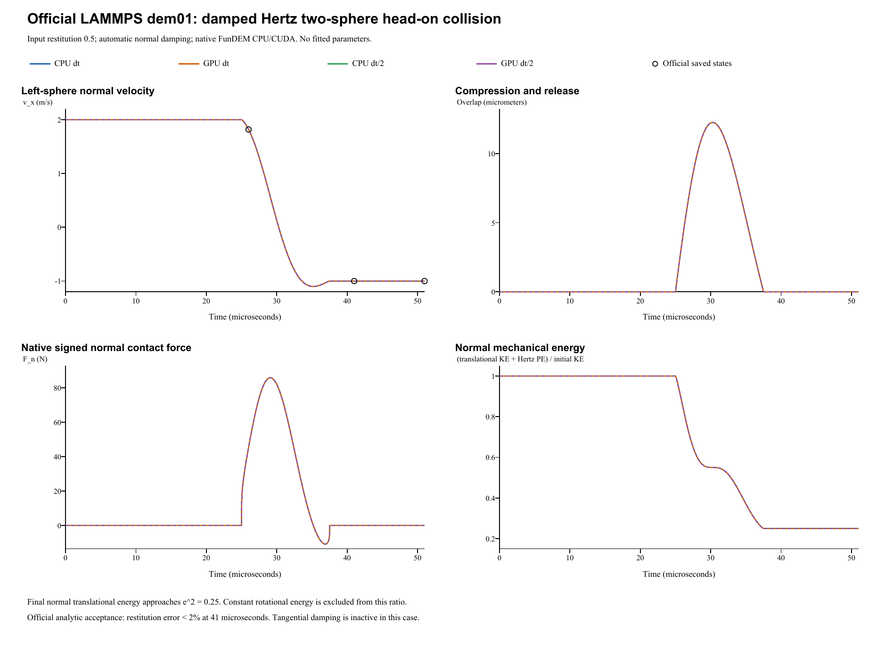

# Damped Hertz two-sphere collision: verification report

**Case:** LAMMPS official `dem01-hertz-twosphere-3d-si`  
**Date:** 28 October 2026  
**Outcome:** All four native runs pass the official 2% restitution criterion.

## Reference and model

The reference is the [official LAMMPS input and saved states](https://github.com/lammps/lammps/blob/f9720ce2d176d615495d1d6c31349b1f71be1c73/unittest/granular/tests/dem01-hertz-twosphere-3d-si.yaml), pinned to commit `f9720ce2d176d615495d1d6c31349b1f71be1c73`. The local YAML Git blob is `9029229be2a7123a3a5c9aef4d04e2df5a0bc9e0`. LAMMPS was not rerun locally: comparisons use the pinned official golden states and the official restitution target.

| Quantity | Official input / FunDEM configuration |
|---|---:|
| Two identical spheres | Diameter 0.005 m; density 2700 kg/m^3 |
| Initial centers | (-0.002550, 0, 0), (+0.002550, 0, 0) m |
| Initial x velocities | +2 and -2 m/s; incoming relative speed 4 m/s |
| Initial z spins | +22 and -22 rad/s |
| Young's modulus; Poisson ratio | 7.0e10 Pa; 0.33 |
| Effective modulus; reduced mass | 39277297721.9 Pa; 8.83572933822e-05 kg |
| Restitution; sliding friction | 0.5; 0.4 |
| Rolling / torsional friction; gravity / global damping | All 0 |
| Explicit contact damping override | Off; automatic restitution-based damping active |
| Official time step; duration | 1e-8 s; 51 us |
| Official checkpoints | 2600, 4100, 5100 cumulative steps |

FunDEM retains the nonlinear Hertz contact law and derives normal damping from restitution. No material or damping coefficient was fitted. The consecutive LAMMPS segments (2600 + 1500 + 1000 steps) are represented by one uninterrupted FunDEM event. This does not reproduce the LAMMPS driver's force re-evaluation at each run-segment setup; that protocol difference can affect finite-step velocity-dependent forces. It is not established here as the cause of any measured discrepancy. Half-step runs use 5e-9 s and preserve the physical endpoint.

## Restitution results

Measured restitution uses the official signed formula `e_measured = (v_right_after - v_left_after) / 4`. The official target is **0.5**; its saved LAMMPS states give **0.499941826448**. The official analytic check at cumulative step **4100** (41 us) accepts a relative error to the target below **2%**, together with its separate total x-momentum bound. Both checks pass in all four runs. Its regression epsilon of 1e-10 is not a universal cross-code tolerance.

| Run | Steps / frames | Measured e | Error to target (%) | Final left vx (m/s) | Normal KE fraction |
|---|---:|---:|---:|---:|---:|
| CPU dt | 5100 / 5101 | 0.499941672926 | 0.01166541 | -0.9998833459 | 0.2499416763 |
| GPU dt | 5100 / 5101 | 0.499941672926 | 0.01166541 | -0.9998833459 | 0.2499416763 |
| CPU dt/2 | 10200 / 10201 | 0.499982718075 | 0.00345639 | -0.9999654361 | 0.2499827184 |
| GPU dt/2 | 10200 / 10201 | 0.499982718075 | 0.00345639 | -0.9999654361 | 0.2499827184 |

At the official time step, maximum differences from the three official checkpoints are **4.59e-12 m** in position and **3.07e-07 m/s** in velocity. Pointwise agreement at the YAML's 1e-10 regression setting is not claimed. Across CPU/GPU pairs, maximum position and velocity differences are **0 m** and **4.441e-16 m/s**. The coarse and half-step absolute restitution errors to 0.5 are **5.83271e-05** and **1.72819e-05**. Refinement approaches the analytic target 0.5, rather than the coarse-step official golden trajectory. Maximum total momentum magnitude is **0 kg m/s**, below the official **1.41372e-05 kg m/s** bound. The normal translational energy fraction should approach `e^2 = 0.25`; constant rotational energy is excluded.

## Automatic normal damping check

The checked FunDEM relation is:

```text
beta = -ln(e) / sqrt(pi^2 + ln(e)^2) = 0.215453761966
S_n = 2 E* sqrt(R* delta)
c_n = 2 sqrt(5/6) beta sqrt(m* S_n)
F_n = (4/3) E* sqrt(R*) delta^(3/2) - c_n u_half
```

`c_n` has units N s/m and varies with overlap; beta is dimensionless. `dampingEnabled=false` disables manual overrides, not automatic contact damping. An independent audit reconstructs the assembly half-step normal velocity from completed native velocities and signed native contact force, then infers `c_n = (F_elastic - F_native) / u_half`. **The damping coefficient is reconstructed, not a direct native output.** Samples with overlap <= 1e-10 m or abs(u_half) <= 0.08 m/s are excluded from coefficient inference. Across four runs, maximum inferred coefficient error normalized by peak c_n is **2.265e-14**; maximum force reconstruction error normalized by peak force is **4.965e-16**. Full per-sample CSVs are in `../analysis/dem01/`.

| Run | Peak automatic c_n (N s/m) | Inference samples | Max. coefficient error / peak |
|---|---:|---:|---:|
| CPU dt | 11.5275681505 | 1233 | 1.88e-14 |
| GPU dt | 11.5275681505 | 1233 | 1.633e-14 |
| CPU dt/2 | 11.5278495510 | 2466 | 1.757e-14 |
| GPU dt/2 | 11.5278495510 | 2466 | 2.265e-14 |



## Retained results and scope

All complete native result directories, `run.json`, saved frames/contacts, input projects, per-run `trajectory.csv`, `contacts.csv`, and native/configuration audits are retained.

- CPU dt result (retained locally; not included): `run-20261028-033707-825-d4cbe0d9-71ab-4657-9bfe-a9ea3a79df94`
- GPU dt result (retained locally; not included): `run-20261028-033758-018-5614cf1d-bf48-46b2-9f6d-6b38b20fd470`
- CPU dt/2 result (retained locally; not included): `run-20261028-033834-165-61b3bee7-fe6c-4c89-b207-5e5b4b18160c`
- GPU dt/2 result (retained locally; not included): `run-20261028-033946-991-7b381bce-5717-4e49-9d37-ae4f1a1219db`

Run manifest (retained locally; not included) | Independent analysis JSON (retained locally; not included) | Checkpoint CSV (retained locally; not included) | [Contact-model audit](../tools/dem01-contact-audit.md)

The helper advances the real FunDEM `SimulationSession` using **0.4.3 native CPU/CUDA libraries**, not a separate collision integrator. No contact solver code was modified. Byte identity with the installed GUI executable was not established. Native signed normal force can become weakly tensile near release because damping is not clipped; the sign is retained in the comparison.

**Verified scope:** symmetric two-sphere normal collision, restitution and automatic normal contact damping. The official friction coefficient 0.4 and opposite spins are preserved, but relative tangential contact velocity cancels and contact torque is zero. The general tangential damping law differs (LAMMPS c_t/c_n = 0.5; FunDEM automatic ratio is approximately 0.895765 here), which is inactive in this collision. This case does not validate tangential damping, friction, rolling resistance or many-particle behavior.
