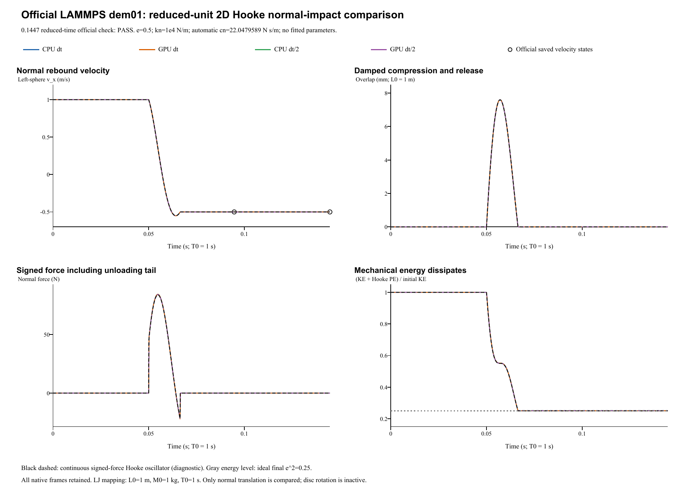

# Reduced-unit planar Hooke impact: verification report

**Case:** LAMMPS official dem01-hooke-2d-lj  
**Date:** 29 October 2026  
**Outcome: PASS.** All four runs pass official 2% restitution and momentum checks.

## Official reference and dimensional realization

The [official YAML and saved states](https://github.com/lammps/lammps/blob/f9720ce2d176d615495d1d6c31349b1f71be1c73/unittest/granular/tests/dem01-hooke-2d-lj.yaml) are pinned to commit f9720ce2d176d615495d1d6c31349b1f71be1c73; YAML Git blob 9bc3f60cd4c5059210c74c24a8bb40a5b822ed17. LAMMPS was not rerun locally. The reference uses `units lj`, `dimension 2`, `atom_style sphere`, ordinary `set ... diameter ... density ...`, `nve/sphere disc`, and `enforce2d`. Its force law is `pair_style granular`; **there is no Lennard-Jones pair potential**. The [official analytic checker](https://github.com/lammps/lammps/blob/f9720ce2d176d615495d1d6c31349b1f71be1c73/unittest/granular/test_analytic_models.cpp) supplies unchanged restitution and momentum acceptance.

Choose reduced-unit scales **L0 = 1 m, M0 = 1 kg, T0 = 1 s**. Consequently E0 = 1 J, force scale = 1 N, stiffness scale = 1 N/m, density scale = 1 kg/m^3 and damping scale = 1 N s/m. All official numeric inputs are unchanged. This is a dimensional realization of reduced-unit equations, not a claim of a particular real material.

| Quantity | Official value / native mapping |
|---|---|
| Particle radius / density | 0.5 / 1; mapped to 0.5 m / 1 kg/m^3 |
| Initial centers / velocities | x = -/+0.55; vx = +/-1 toward contact; mapped to m and m/s |
| Normal law | Hooke kn = 10000; material restitution e = 0.5 |
| Tangential / rotational terms | Zero stiffness, damping, friction, resistance and initial spin |
| External forces | No gravity, wall, global damping or constraints |
| Sphere mass / reduced mass | 0.523598775598 / 0.261799387799 kg |
| Automatic normal damping | cn = 22.0479588948 N s/m |
| Original time / segments | dt = 0.0001; 947 + 500 = 1447 steps; endpoint 0.1447 |
| Half-step / output | dt = 0.00005; 2894 steps; same endpoint; every step including t = 0 |

## Mass and inactive inertia: exact active equations, limited scope

The pinned [set.cpp](https://github.com/lammps/lammps/blob/f9720ce2d176d615495d1d6c31349b1f71be1c73/src/set.cpp) enables disk-volume mass only for the separate `density/disc` keyword. Ordinary `density` uses sphere volume even in dimension 2:

    m = (4/3) pi rho R^3 = pi/6
    m* = m/2 = pi/12

The pinned [fix_nve_sphere.cpp](https://github.com/lammps/lammps/blob/f9720ce2d176d615495d1d6c31349b1f71be1c73/src/fix_nve_sphere.cpp) changes the inertia factor from 0.4 to 0.5 for the `disc` option while translation still uses the same mass. Official disc inertia is **mR^2/2 = 0.0654498469498 kg m^2**. FunDEM sphere inertia is **2mR^2/5 = 0.0523598775598 kg m^2**. These values differ. This central zero-friction motion has exactly zero torque and spin, so the difference remains inactive; the translational equations and sphere mass map directly.

The official `enforce2d` subspace remains invariant without artificial constraints: transverse and out-of-plane motion remain zero, and the particles stay inside the official finite x/y domain. This verifies **normal translation in a planar invariant subspace**, not active 2D disc rotation, a general 2D solver, or LJ pair forces. [Independent source and unit audit](../tools/dem01-2d-lj-contact-audit.md) and full source manifest (retained locally; not included) retain the proof and hashes.

## Automatic damping and unchanged official acceptance

`linearStiffnessEnabled = true` preserves kn = 10000. `dampingEnabled = false` disables manual coefficient overrides, leaving automatic contact damping active. Stored manual coefficients are zero. E = 1e4 Pa and nu = 0.33 are inactive linear-branch schema fields. The normal coefficient is derived from the unchanged e = 0.5:

    beta = -ln(e) / sqrt(pi^2 + ln(e)^2)
    cn = 2 beta sqrt(m* kn)
    Fn = kn delta - cn vn_assembly

No coefficient was fitted and no solver source was changed. The signed negative normal-force unloading tail is retained; the official input does not request `limit_damping` clipping. This tail is viscous unloading rather than an adhesion model.

At cumulative **step 1447 = reduced time 0.1447** (mapped to 0.1447 s), zero-based analytic segment 1, the official checks are:

    e_measured = -(v_left,x - v_right,x) / (2 vin)
    abs(e_measured - 0.5) / 0.5 <= 0.02
    abs(m v_left,x + m v_right,x) <= 0.02 (2m) vin

The momentum bound is **0.0209439510239 kg m/s**. Ideal separated velocities are -/+0.5 m/s. The pinned saved-state restitution is **0.500425821332**; saved-state errors are supplemental. YAML epsilon 1e-10 is same-code regression precision, not universal cross-code acceptance.

| Run | Measured e | Relative error (%) | Left vx (m/s) | Right vx (m/s) | Both official checks |
|---|---:|---:|---:|---:|---|
| CPU dt | 0.5004258213 | 0.085164 | -0.500425821 | 0.500425821 | PASS |
| GPU dt | 0.5004258213 | 0.085164 | -0.500425821 | 0.500425821 | PASS |
| CPU dt/2 | 0.5014963946 | 0.299279 | -0.501496395 | 0.501496395 | PASS |
| GPU dt/2 | 0.5014963946 | 0.299279 | -0.501496395 | 0.501496395 | PASS |

## Native force and energy diagnostics

Saved velocities contain the final half-kick. Reconstruct the force-assembly velocity before inferring damping:

    vn_assembly = vn_saved - dt Fn / (2 m*)
    cn_inferred = (kn delta - Fn) / vn_assembly

Near-zero division is excluded by the audit's documented overlap and relative-speed thresholds; all usable contacts are checked by direct force reconstruction and independent position-drift velocity. Initial force is genuinely zero because the initial surface gap is 0.1. Both bodies' kinetic energy is counted; pair Hooke energy is counted once as U = kn delta^2/2.

| Run | Inferred cn (N s/m) | Minimum signed Fn (N) | Final KE / initial KE | Max pair momentum (kg m/s) |
|---|---:|---:|---:|---:|
| CPU dt | 22.047958895 | -21.974154 | 0.250426003 | 0 |
| GPU dt | 22.047958895 | -21.974154 | 0.250426003 | 0 |
| CPU dt/2 | 22.047958895 | -21.760073 | 0.251498634 | 0 |
| GPU dt/2 | 22.047958895 | -21.760073 | 0.251498634 | 0 |

Inferred automatic cn agrees with its analytic value to maximum relative error 7.22e-15; maximum signed-force reconstruction residual is 1.42e-14 N. This is an inferred coefficient, not a direct native output channel.

CPU/GPU whole-history maximum velocity / signed-normal-force differences are 2.22e-16 m/s / 2.84e-14 N. Halving dt changes CPU restitution by 0.00107057. Relative restitution error is 0.085164% / 0.299279%; this refinement does not show monotonic improvement, while both remain below 2%.

Maximum linear impulse-balance residual is 9.99e-16 kg m/s. Mechanical energy dissipates; the ideal final kinetic-energy fraction is e^2 = 0.25.

Base CPU initial/final mechanical energy is **0.523598775598 / 0.131122748368 J**. Negative normal-force samples: **23**. Energy conservation is not an acceptance condition for this dissipative contact. Continuous oscillator curves, peak compression and final e^2 energy ratio are supplemental diagnostics.

Analysis JSON (retained locally; not included) | Every-step force/energy CSV (retained locally; not included) | Checkpoint CSV (retained locally; not included) | Independent audit (retained locally; not included)

## Complete retained results and execution scope

All four runs were newly executed through real **FunDEM SimulationSession** using linked **0.4.3 CPU/CUDA native libraries**, not a separate collision integrator. Installed GUI executable byte identity is not established. Every native numerical step, initial frame, contact record, CSV, input and backend log is retained: **1448 frames per original-step run**, **2895 per half-step run**, **8686 native frames total**.

- **CPU dt**: input project (retained locally; not included), complete native result (retained locally; not included); 1,447 steps / 1,448 initial-inclusive native frames.
- **GPU dt**: input project (retained locally; not included), complete native result (retained locally; not included); 1,447 steps / 1,448 initial-inclusive native frames.
- **CPU dt/2**: input project (retained locally; not included), complete native result (retained locally; not included); 2,894 steps / 2,895 initial-inclusive native frames.
- **GPU dt/2**: input project (retained locally; not included), complete native result (retained locally; not included); 2,894 steps / 2,895 initial-inclusive native frames.

Run manifest (retained locally; not included) | Configuration audit (retained locally; not included) | Complete native ZIP (retained locally; not included) | Frame/hash retention audit (retained locally; not included)

**Verified scope:** active collinear Hooke translation under explicit reduced-unit scaling, sphere-volume mass, restitution-derived automatic normal damping, signed unloading, impulse/momentum balance, energy dissipation and CPU/CUDA consistency. Active disc inertia/rotation, 2D dynamics outside this invariant state, tangential friction/history, LJ forces and many-particle flows require other cases.
