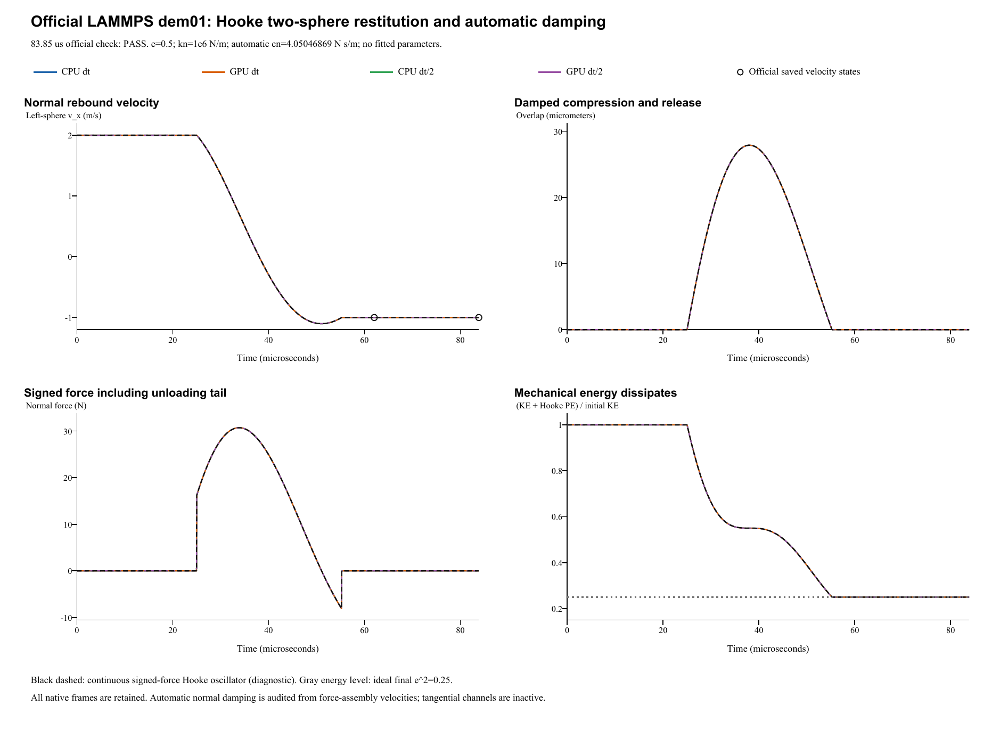

# Hooke two-sphere restitution: verification report

**Case:** LAMMPS official dem01-hooke-twosphere-3d-si  
**Date:** 28 October 2026  
**Outcome: PASS.** All four runs pass the official 2% restitution check and momentum bound at 83.85 us.

## Official reference and unchanged inputs

The reference is the [official LAMMPS YAML and saved states](https://github.com/lammps/lammps/blob/f9720ce2d176d615495d1d6c31349b1f71be1c73/unittest/granular/tests/dem01-hooke-twosphere-3d-si.yaml), pinned to commit f9720ce2d176d615495d1d6c31349b1f71be1c73. The local YAML Git blob is 57c2041792b5e3744e978e4a1834e46ceaaadb7b. LAMMPS was not rerun locally. Comparisons use the pinned saved states, the [official analytic checker](https://github.com/lammps/lammps/blob/f9720ce2d176d615495d1d6c31349b1f71be1c73/unittest/granular/test_analytic_models.cpp), a continuous Hooke oscillator diagnostic, and independent force/momentum checks. This is the linear Hooke variant, distinct from the previously tested dem01 Hertz case.

| Quantity | Official input / FunDEM configuration |
|---|---|
| Two free equal spheres | Radius 0.0025 m; density 2700 kg/m^3 |
| Initial centers | Left (-0.00255, 0, 0) m; right (+0.00255, 0, 0) m |
| Initial velocities | Left (+2, 0, 0) m/s; right (-2, 0, 0) m/s; relative speed 4 m/s |
| Initial spin | Zero for both spheres |
| Hooke stiffness / restitution | kn = 1e6 N/m; e = 0.5 |
| Actual pair friction / tangent | Zero friction; official linear_nohistory with zero tangential damping |
| Mass / reduced mass | 0.000176714586764 / 8.83572933822e-05 kg |
| Automatic normal damping | cn = 4.05046868715 N s/m; manual override off |
| Other forces | No gravity, wall, global damping, cohesion, constraints or rolling/torsional resistance |
| Base time step / segments | dt = 3e-8 s; 2068 + 727 = 2795 steps; 83.85 us endpoint |
| Refined time step | dt = 1.5e-8 s; 5590 steps; same physical endpoint |
| Output | Every integration step, including t = 0 |

Both particles integrate freely. Solid-sphere mass and inertia use the official radius and density. The official consecutive run segments are represented by one uninterrupted native event.

FunDEM uses **linearStiffnessEnabled = true** and **dampingEnabled = false**. The latter disables manual damping-coefficient overrides; automatic contact damping remains active. All explicit damping coefficient fields are zero and inactive. The material restitution is 0.5 for both spheres; the solver derives the normal Hooke dashpot without fitting:

    m* = m / 2
    beta = -ln(e) / sqrt(pi^2 + ln(e)^2)
    cn = 2 beta sqrt(m* kn) = 4.05046868715 N s/m
    Fn = kn delta - cn vn_assembly

The normal force is signed and preserves the unloading negative-force tail; the official model does not apply limit_damping clipping. Young's modulus E = 1e4 Pa and Poisson ratio nu = 0.33 are inactive schema placeholders under explicit Hooke stiffness. They are not additional official material constants or fitted values. No contact solver source was modified.

Only normal contact is active. Tangential stiffness, sliding/rolling/torsional friction and resistance fields are zero. The collision has zero transverse motion and zero spin, so this case does not establish equivalence between active tangential no-history/history laws or validate automatic tangential damping.

## Official restitution and momentum acceptance

The official **collision_restitution** checker is evaluated at cumulative step **2795 = 83.85 us**, the end of the second segment (analytic_segment = 1). Its two checks are:

    e_measured = -(v_left,x - v_right,x) / (2 vin)
    abs(e_measured - 0.5) / 0.5 <= 0.02
    abs(m v_left,x + m v_right,x) <= 0.02 (2m) vin

The momentum bound is **1.41371669412e-05 kg m/s**. Ideal separated velocities are -1 m/s (left) and +1 m/s (right). The fixed YAML regression epsilon 1e-10 is not a universal cross-code tolerance.

| Run | Measured e | Relative error (%) | Left vx (m/s) | Right vx (m/s) | Both official checks |
|---|---:|---:|---:|---:|---|
| CPU dt | 0.4996646896 | 0.067062 | -0.999329379 | 0.999329379 | PASS |
| GPU dt | 0.4996646896 | 0.067062 | -0.999329379 | 0.999329379 | PASS |
| CPU dt/2 | 0.4998413098 | 0.031738 | -0.999682620 | 0.999682620 | PASS |
| GPU dt/2 | 0.4998413098 | 0.031738 | -0.999682620 | 0.999682620 | PASS |

The pinned official saved result has e = **0.499664689634**. Golden-state differences are recorded separately from the unchanged analytic target e = 0.5 and official 2% acceptance criterion.

## Automatic damping, energy and numerical comparisons

For each native contact sample, the saved completed-step velocity contains the final half-kick. The force-assembly velocity is reconstructed before inferring cn:

    vn_assembly = vn_saved - dt Fn / (2 m*)
    cn_inferred = (kn delta - Fn) / vn_assembly

The inference uses overlap > 1e-10 m and abs(vn_assembly) > 0.08 m/s to avoid division near zero. An independent position-drift velocity cross-check and direct force reconstruction are also recorded.

| Run | Mean inferred cn (N s/m) | Minimum signed Fn (N) | Final KE / initial KE | Max total momentum (kg m/s) |
|---|---:|---:|---:|---:|
| CPU dt | 4.050468687 | -8.104974 | 0.249664802 | 0 |
| GPU dt | 4.050468687 | -8.104974 | 0.249664802 | 0 |
| CPU dt/2 | 4.050468687 | -8.092331 | 0.249841335 | 0 |
| GPU dt/2 | 4.050468687 | -8.092331 | 0.249841335 | 0 |

Automatic damping reconstructed from native force and force-assembly velocity agrees with the constant Hooke value to a maximum relative error of 7.44e-15; maximum force-reconstruction residual = 7.11e-15 N. Coefficients are inferred diagnostics, not a direct native output channel.

CPU/GPU whole-history maximum velocity / signed-normal-force differences are 4.44e-16 m/s / 7.11e-15 N. Halving dt changes measured CPU restitution by 0.00017662. Restitution improves at dt/2; the sampled peak-overlap error is slightly larger.

Base CPU mechanical energy changes from 0.000706858347058 J to 0.000176477649307 J. The final kinetic-energy fraction is compared with e^2 = 0.25; this is a dissipative collision. Maximum momentum-impulse balance residual across four runs = 2.93e-18 kg m/s.

The base CPU result includes **140 negative normal-force samples**, with minimum signed Fn **-8.104973868 N**. Signed force is used in momentum integration; it is not silently replaced by its magnitude or clipped to zero. Both spheres' force, impulse and kinetic energy are counted. Pair elastic energy is counted once as U = (1/2) kn delta^2.

The continuous normal diagnostic solves m* delta'' + cn delta' + kn delta = 0 from first contact until delta returns to zero. It predicts maximum overlap **27.891656519 um** and contact duration **30.240751637 us**. These curves and peak-compression comparisons are supplemental diagnostics, not extra official acceptance assertions.

Verified analysis JSON (retained locally; not included) | Every-step energy/force CSV (retained locally; not included) | Official checkpoint CSV (retained locally; not included)

## Complete retained results and scope

All four complete native result directories are retained with native run.json, project.json, every-step frames/contact records, input projects, CSVs, audits and CPU/CUDA backend logs. The base-step runs contain **2796 frames each**; the half-step runs contain **5591 frames each**: **16,774 native frames** total.

- **CPU dt**: input project (retained locally; not included), complete native result (retained locally; not included); 2,795 steps / 2,796 native frames.
- **GPU dt**: input project (retained locally; not included), complete native result (retained locally; not included); 2,795 steps / 2,796 native frames.
- **CPU dt/2**: input project (retained locally; not included), complete native result (retained locally; not included); 5,590 steps / 5,591 native frames.
- **GPU dt/2**: input project (retained locally; not included), complete native result (retained locally; not included); 5,590 steps / 5,591 native frames.

Run manifest (retained locally; not included) | Parameter mapping (retained locally; not included) | Configuration audit (retained locally; not included) | Full native archive ZIP (retained locally; not included)

The helper advances the real FunDEM **SimulationSession** using linked **0.4.3 CPU/CUDA native libraries**. It is not a separate impact integrator. This test does not establish byte identity with the installed GUI executable.

**Verified scope:** frictionless damped normal Hooke impact of equal spheres; prescribed restitution, constant automatic normal damping, signed unloading force, pair impulse/momentum balance, energy dissipation and CPU/CUDA consistency. Nonzero tangential contact, spin, unequal particles, sustained contacts and many-particle flows require separate cases.
