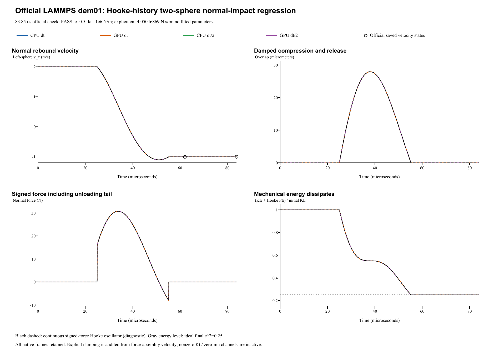

# Hooke/history two-sphere normal impact: verification report

**Case:** LAMMPS official dem01-hookehistory-twosphere-3d-si  
**Date:** 29 October 2026  
**Outcome: PASS.** All four runs pass official 2% restitution and momentum checks.

## Official reference and unchanged inputs

The [official LAMMPS YAML and saved states](https://github.com/lammps/lammps/blob/f9720ce2d176d615495d1d6c31349b1f71be1c73/unittest/granular/tests/dem01-hookehistory-twosphere-3d-si.yaml) are pinned to commit f9720ce2d176d615495d1d6c31349b1f71be1c73; local YAML Git blob 6900a6efd5cf80f862da2241c2b48e7d4cbaf7f1. LAMMPS was not rerun locally. Comparisons use the pinned saved states, the [official analytic checker](https://github.com/lammps/lammps/blob/f9720ce2d176d615495d1d6c31349b1f71be1c73/unittest/granular/test_analytic_models.cpp), a continuous damped Hooke oscillator diagnostic, and independent native force/momentum checks.

| Quantity | Official input / FunDEM mapping |
|---|---|
| Two equal free spheres | Each radius 0.0025 m; density 2700 kg/m^3; solid-sphere inertia |
| Initial centers / velocities | x = -/+0.00255 m; vx = +/-2 m/s toward contact; all other components zero |
| Spin / external forces | Zero initial spin; no gravity, wall, global damping or constraints |
| Stiffness / friction | kn = 1e6 N/m; kt = 2.8e5 N/m; sliding friction mu = 0 |
| Restitution | e = 0.5 for both materials; unchanged official normal input |
| Normal coefficient | Explicit cn = 4.05046868715 N s/m, derived analytically from e = 0.5 |
| Other damping / resistance | ct = 0; rolling/torsional damping and resistance = 0 |
| Mass / reduced mass | 0.000176714586764 / 8.83572933822e-05 kg |
| Time / output | 30 ns, 2795 steps; 15 ns, 5590 steps; same 83.85 us endpoint; every step including t = 0 |

Official consecutive segments (2068 + 727 steps) are one uninterrupted native event. **linearStiffnessEnabled = true** preserves explicit kn and kt. **dampingEnabled = true** selects manual damping coefficients: normal cn below, tangential ct = 0, and both rotational coefficients = 0. The explicit normal coefficient is derived without fitting:

    m* = m / 2
    beta = -ln(e) / sqrt(pi^2 + ln(e)^2)
    cn = 2 beta sqrt(m* kn) = 4.05046868715 N s/m
    Fn = kn delta - cn vn_assembly

The material e = 0.5 remains recorded. Selecting explicit damping preserves the official **nonzero kt with zero tangential damping** under FunDEM's pair-level damping switch. This case therefore audits the prescribed normal coefficient; it does **not** additionally verify the automatic-damping branch. That branch is covered by the separate dem01-hooke-twosphere report. E = 1e4 Pa and nu = 0.33 are inactive schema placeholders under explicit linear stiffness, not fitted physical constants. No contact solver source or old case was changed.

The official tangential law is history based. This collinear collision has mu = 0, zero transverse motion and zero initial spin, so nonzero kt remains inactive. It checks nonactivation of tangential force/history under this state; it does **not** validate active friction, tangential-history evolution or spin generation. The signed normal unloading tail is retained, matching the unclipped official normal law.

## Official restitution and momentum acceptance

The official **collision_restitution** checker runs at cumulative step **2795 = 83.85 us**, the end of segment 1 (zero-based). Its two checks are:

    e_measured = -(v_left,x - v_right,x) / (2 vin)
    abs(e_measured - 0.5) / 0.5 <= 0.02
    abs(m v_left,x + m v_right,x) <= 0.02 (2m) vin

The momentum bound is **1.41371669412e-05 kg m/s**. Ideal separated velocities are -1 m/s (left) and +1 m/s (right). The YAML epsilon 1e-10 is same-code regression precision, not a universal cross-code tolerance.

| Run | Measured e | Relative error (%) | Left vx (m/s) | Right vx (m/s) | Both official checks |
|---|---:|---:|---:|---:|---|
| CPU dt | 0.4996646896 | 0.067062 | -0.999329379 | 0.999329379 | PASS |
| GPU dt | 0.4996646896 | 0.067062 | -0.999329379 | 0.999329379 | PASS |
| CPU dt/2 | 0.4998413098 | 0.031738 | -0.999682620 | 0.999682620 | PASS |
| GPU dt/2 | 0.4998413098 | 0.031738 | -0.999682620 | 0.999682620 | PASS |

The pinned saved-state restitution is **0.499664689634**. Golden-state differences are supplemental; analytic acceptance still uses unchanged e = 0.5 and the official 2% bound.

## Prescribed damping and native histories

Native velocities are completed-step velocities. The final half-kick is removed before inferring the coefficient:

    vn_assembly = vn_saved - dt Fn / (2 m*)
    cn_inferred = (kn delta - Fn) / vn_assembly

Inference uses delta > 1e-10 m and abs(vn_assembly) > 0.08 m/s to avoid near-zero division; direct force reconstruction and position-drift velocity checks are also retained.

| Run | Mean inferred cn (N s/m) | Minimum signed Fn (N) | Final KE / initial KE | Max total momentum (kg m/s) |
|---|---:|---:|---:|---:|
| CPU dt | 4.050468687 | -8.104974 | 0.249664802 | 0 |
| GPU dt | 4.050468687 | -8.104974 | 0.249664802 | 0 |
| CPU dt/2 | 4.050468687 | -8.092331 | 0.249841335 | 0 |
| GPU dt/2 | 4.050468687 | -8.092331 | 0.249841335 | 0 |

Force-based inference agrees with prescribed cn to a maximum relative error of 7.44e-15; maximum force-reconstruction residual is 3.55e-15 N. The coefficient is an inferred diagnostic, not a direct native output channel.

CPU/GPU whole-history maximum velocity / signed-normal-force differences are 4.44e-16 m/s / 7.11e-15 N. Halving dt changes CPU restitution by 0.00017662.

Maximum pair momentum-impulse balance residual is 2.93e-18 kg m/s. Final KE is compared with e^2 times initial KE = 0.25; dissipative contact is not expected to conserve mechanical energy.

Maximum tangential force / sliding-spring component / spin are 0 N / 0 m / 0 rad/s. Newly executed trajectories differ from corresponding prior Hooke no-history runs by at most 4.44e-16 m/s in velocity; this is a zero-slip normal-response diagnostic.

Base CPU mechanical energy changes from **0.000706858347058 J** to **0.000176477649307 J**. There are **140 negative-force samples**; minimum signed Fn is **-8.104973868 N**. Momentum integration uses signed force without clipping. Both spheres' kinetic energy is counted; pair elastic energy is counted once, U = (1/2) kn delta^2.

The supplemental continuous oscillator m* delta'' + cn delta' + kn delta = 0 predicts maximum overlap **27.891656519 um** and contact duration **30.240751637 us**. It is not an extra official acceptance assertion. Normal-response equivalence with the prior no-history Hooke case is a degenerate, zero-slip comparison; all four current runs are newly executed.

Analysis JSON (retained locally; not included) | Every-step energy/force CSV (retained locally; not included) | Official checkpoint CSV (retained locally; not included)

## Complete retained results and execution scope

Complete native directories retain run.json, project.json, every-step frames/contact records, input projects, CSVs, audits and CPU/CUDA backend logs. There are **2796 frames per base-step run**, **5591 per half-step run**, and **16,774 native frames total**.

- **CPU dt**: input project (retained locally; not included), complete native result (retained locally; not included); 2,795 steps / 2,796 native frames.
- **GPU dt**: input project (retained locally; not included), complete native result (retained locally; not included); 2,795 steps / 2,796 native frames.
- **CPU dt/2**: input project (retained locally; not included), complete native result (retained locally; not included); 5,590 steps / 5,591 native frames.
- **GPU dt/2**: input project (retained locally; not included), complete native result (retained locally; not included); 5,590 steps / 5,591 native frames.

Run manifest (retained locally; not included) | Parameter mapping (retained locally; not included) | Configuration audit (retained locally; not included) | Full native archive ZIP (retained locally; not included)

The helper advances the real FunDEM **SimulationSession** with linked **0.4.3 CPU/CUDA native libraries**. It is not a separate collision integrator. Byte identity with the installed GUI executable was not established.

**Verified scope:** equal-sphere damped normal Hooke impact with an inactive history-based tangent, explicit normal damping derived from official restitution, signed unloading force, momentum/impulse balance, dissipation and CPU/CUDA consistency. Active tangent/history response, spin, unequal particles and many-particle flows require separate cases.
