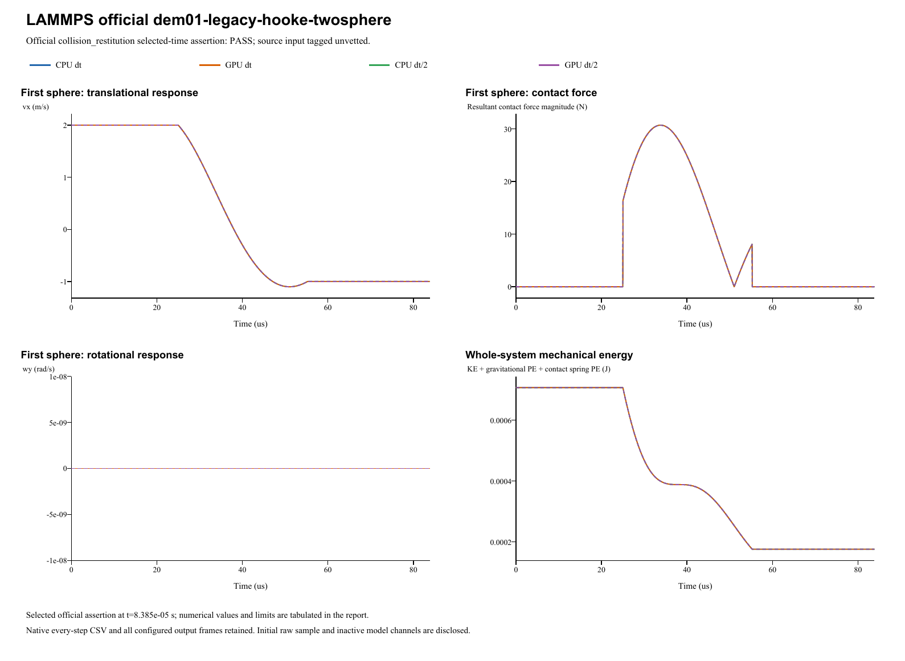

# LAMMPS official dem01-legacy-hooke-twosphere

**Normal collision: restitution and momentum**  
Date: 29 October 2026. Four main runs: **PASS**. Official input tag: `unvetted`.

## Source and official acceptance

[Pinned official YAML](https://github.com/lammps/lammps/blob/29dd3fd7642a6fe9e8b4dd99120df4068b221250/unittest/granular/tests/dem01-legacy-hooke-twosphere-3d-si.yaml) | [Analytic checker](https://github.com/lammps/lammps/blob/29dd3fd7642a6fe9e8b4dd99120df4068b221250/unittest/granular/test_analytic_models.cpp). Commit 29dd3fd7642a6fe9e8b4dd99120df4068b221250; input blob fcb49be715ccc2b5efd6ed6c005c33d47256842c. LAMMPS was not rerun locally. The YAML's same-code epsilon is not a cross-software tolerance.

Model `collision_restitution` is evaluated at original step 2795 and time 8.385e-05s. Half-step runs use twice the native check step at the same physical time. The exact reference, relative/absolute error type and unchanged limit are listed separately for each quantity. Whole histories and source golden states supplement these selected-time assertions.

| Run | Quantity | Reference | Native value | Error type | Error | Limit | Result |
|---|---|---:|---:|---|---:|---:|---|
| CPU dt | Total x momentum | 0 | 0 | absolute | 0 | 3.53429173529e-06 | PASS |
| CPU dt | Restitution | 0.49877 | 0.498528207808 | relative | 0.000484776935458 | 0.005 | PASS |
| GPU dt | Total x momentum | 0 | 0 | absolute | 0 | 3.53429173529e-06 | PASS |
| GPU dt | Restitution | 0.49877 | 0.498528207808 | relative | 0.000484776935458 | 0.005 | PASS |
| CPU dt/2 | Total x momentum | 0 | 0 | absolute | 0 | 3.53429173529e-06 | PASS |
| CPU dt/2 | Restitution | 0.49877 | 0.498705253092 | relative | 0.000129813155979 | 0.005 | PASS |
| GPU dt/2 | Total x momentum | 0 | 0 | absolute | 0 | 3.53429173529e-06 | PASS |
| GPU dt/2 | Restitution | 0.49877 | 0.498705253092 | relative | 0.000129813155979 | 0.005 | PASS |

## Inputs and constitutive mapping

- left: R=0.0025 m; position=(-0.00255, 0, 0) m; velocity=(2, 0, 0) m/s; spin=(0, 0, 0) rad/s.
- right: R=0.0025 m; position=(0.00255, 0, 0) m; velocity=(-2, 0, 0) m/s; spin=(0, 0, 0) rad/s.

- left: mass=0.000176714586764 kg; isotropic inertia=4.41786466911e-10 kg m^2.
- right: mass=0.000176714586764 kg; isotropic inertia=4.41786466911e-10 kg m^2.

Linear Hooke Fn_elastic=kn*delta, kn=1000000 N/m. Manual c_n=4.064435496 N s/m, c_t=0 N s/m; automatic restitution damping is inactive. Tangential inputs: kt=285714.3 N/m (explicit in linear mode), mu=0. Rolling/twist coefficients: kr=0, mu_r=0, ktwist=0, mu_twist=0.

Gravity=(0, 0, 0)m/s^2. Base/half dt=3e-08/1.5e-08s; base/half numerical steps=2795/5590. Initial poses, velocities and physical source coefficients are preserved. The parameter mapping translates the source model's coefficient definitions; it does not fit measured native results.

- Legacy normal cn=meff*gnorm exactly. NULL kt=2kn/7; NULL gt=gnorm/2 when tangential dampflag1, else0. Explicit native constants preserve these coefficients; tangential relative velocity is zero.

Native specification (retained locally; not included) | Parameter mapping (retained locally; not included) | Configuration round-trip (retained locally; not included)

## CPU/GPU and timestep refinement

| Quantity | CPU dt error | CPU dt/2 error | Error type and limit |
|---|---:|---:|---|
| Total x momentum | 0 | 0 | absolute: 3.534e-06 |
| Restitution | 0.00048478 | 0.00012981 | relative: 0.005 |

CPU/GPU whole-history maximum position / velocity / spin / force differences: 0 m / 2.82e-17 m/s / 0 rad/s / 3.55e-15 N.

Maximum individual impulse / position-drift / velocity-kick residuals: 2.6e-18 kg m/s / 2.17e-19 m / 2.18e-16 m/s. Gravity is added separately to saved native contact forces.

Energy histories are supplemental unless selected by the official analytic model. Wall/gravity cases exchange external momentum; total sphere momentum is not assumed conserved. The step-refinement table reports each error directly, without imposing monotonic convergence.

## Complete retained results

All 16,774 native output frames, every integration-step particle/contact CSV, projects, raw initial samples and backend logs are retained. Native output cadence is distinct from integration dt; exact counts/intervals are in the analysis and archive manifests. The four primary frame counts are [2796, 2796, 5591, 5591]. 0additional diagnostic run is retained.

- **CPU dt** (main CPU/GPU/time-step comparison): loadable project (retained locally; not included), complete native result (retained locally; not included); 2,795 integration steps, 2,796 stored frames.
- **GPU dt** (main CPU/GPU/time-step comparison): loadable project (retained locally; not included), complete native result (retained locally; not included); 2,795 integration steps, 2,796 stored frames.
- **CPU dt/2** (main CPU/GPU/time-step comparison): loadable project (retained locally; not included), complete native result (retained locally; not included); 5,590 integration steps, 5,591 stored frames.
- **GPU dt/2** (main CPU/GPU/time-step comparison): loadable project (retained locally; not included), complete native result (retained locally; not included); 5,590 integration steps, 5,591 stored frames.

Analysis JSON (retained locally; not included) | Official metrics CSV (retained locally; not included) | Source checkpoints (retained locally; not included) | Independent physics audit (retained locally; not included) | Run manifest (retained locally; not included) | Full native ZIP (retained locally; not included) | Frame/hash audit (retained locally; not included)

Source checkpoint states are supplemental regression diagnostics. Their differences are reported directly; the YAML same-code epsilon is not imposed as an independent cross-software acceptance limit.

A stable helper executable is statically linked to the current native CPU/CUDA libraries. Historical GUI/library byte identity is not asserted. Existing case reports and records are unchanged. Verified scope follows the active source model and the criteria above; a passing inactive channel does not validate every option of its contact family.
