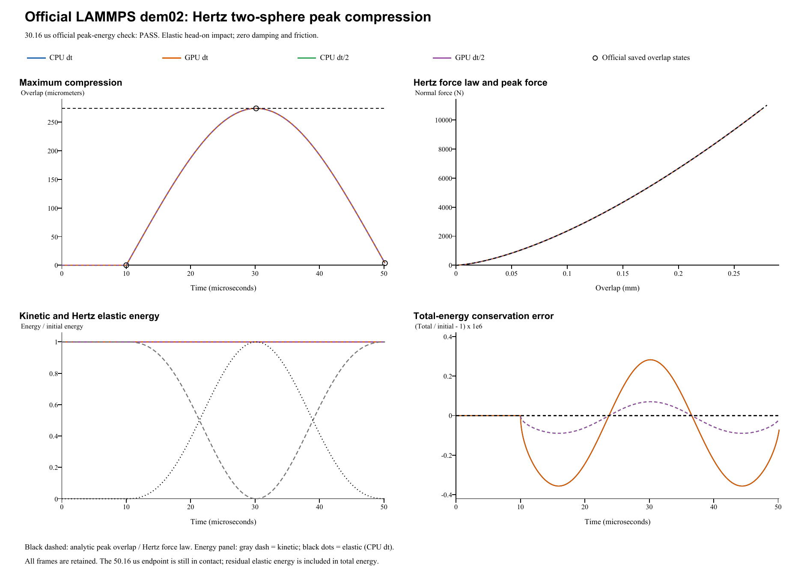

# Elastic Hertz two-sphere impact: verification report

**Case:** LAMMPS official dem02-hertz-twosphere-3d-si  
**Date:** 28 October 2026  
**Outcome: PASS.** 4 of 4 runs pass the official 1% peak-energy check at 30.16 us.

## Reference and unchanged inputs

The reference is the [official LAMMPS input and saved states](https://github.com/lammps/lammps/blob/f9720ce2d176d615495d1d6c31349b1f71be1c73/unittest/granular/tests/dem02-hertz-twosphere-3d-si.yaml), pinned to commit f9720ce2d176d615495d1d6c31349b1f71be1c73; the local YAML Git blob is b584c91ba91b7e32e305298195949dc572634114. LAMMPS was not rerun locally. Comparisons use these pinned golden states, the [official analytic checker](https://github.com/lammps/lammps/blob/f9720ce2d176d615495d1d6c31349b1f71be1c73/unittest/granular/test_analytic_models.cpp), and an independent Hertz solution.

| Quantity | Official input / FunDEM mapping |
|---|---|
| Two identical spheres | Diameter 0.020 m; density 2800 kg/m^3 |
| Initial centers | (-0.0101, 0, 0) m and (+0.0101, 0, 0) m |
| Initial velocities | (+10, 0, 0) m/s and (-10, 0, 0) m/s; relative speed 20 m/s |
| Initial spin | Zero for both spheres |
| LAMMPS Hertz coefficient | kn = 3.33333e10 Pa |
| FunDEM elastic representation | Both materials: nu = 0, E = 4.999995e10 Pa; E* = 3 kn / 4 |
| Damping and friction | Zero normal/tangential damping; sliding/rolling/torsional friction = 0 |
| Other forces / boundaries | No gravity or global damping; no wall; free boundaries |
| Base integration | dt = 2e-8 s; 500 + 1008 + 1000 = 2508 steps |
| Refined integration | dt = 1e-8 s; 5016 steps; same 50.16 us endpoint |
| Native output | Every integration step, including t = 0 |

The official pair command is **hertz kn 0.0 tangential linear_nohistory 0.0 0.0**. Its second Hertz parameter is zero damping, not a prescribed restitution. The YAML variable xmu = 0.35 is unused by the pair command, so the actual sliding coefficient is zero. In FunDEM, restitution 1 gives zero automatic contact damping. No coefficient was fitted.

The normal law is **F = K delta^(3/2)**, with **K = kn sqrt(R*) = (4/3) E* sqrt(R*)**, reduced radius **R* = R/2**, and effective mass **m* = m/2**. Equal materials with nu = 0 and E = 1.5 kn reproduce E* exactly. This is an equivalent elastic representation of the official Hertz coefficient; nu and E are derived configuration values, not separately specified LAMMPS material constants.

## Maximum compression, peak force and official energy criterion

For initial relative speed V = 20 m/s:

    E0 = (1/2) m* V^2
    U(delta) = (2/5) K delta^(5/2) = (2/5) F delta
    delta_max = [5 m* V^2 / (4 K)]^(2/5)
    F_max = K delta_max^(3/2)

The independent targets are **maximum overlap 274.112811734 um**, **peak force 10696.884705233 N**, and initial relative kinetic energy **1.17286125734 J**.

The official **hertz_normal_impact** checker compares E0 with **0.4 abs(F1) delta at cumulative step 1508 = 30.16 us**, the end of the second segment (analytic_segment = 1). It uses **1% relative tolerance**. This is the actual sampled near-peak state, not a search for separate maxima. Its formula omits the small remaining kinetic energy at that instant. The additional maximum-overlap and peak-force comparisons below use separately declared **1% diagnostic limits**; they are not extra assertions in the pinned official checker. The YAML regression epsilon 1e-10 is not a universal cross-code tolerance.

| Run | Max. overlap (um) | Overlap error (%) | Peak force (N) | Force error (%) | Official energy error (%) | Official 1% |
|---|---:|---:|---:|---:|---:|---|
| CPU dt | 274.112756 | 0.0000202 | 10696.881460 | 0.0000303 | 0.0000506 | PASS |
| GPU dt | 274.112756 | 0.0000202 | 10696.881460 | 0.0000303 | 0.0000506 | PASS |
| CPU dt/2 | 274.112819 | 0.0000028 | 10696.885152 | 0.0000042 | 0.0000718 | PASS |
| GPU dt/2 | 274.112819 | 0.0000028 | 10696.885152 | 0.0000042 | 0.0000718 | PASS |

4 of 4 runs pass the supplemental 1% maximum-overlap comparison; 4 of 4 pass the supplemental 1% peak-force comparison. All peak values use every native time step, without sparse sampling or post-run parameter adjustment. Maximum-overlap and force errors are measured against the independent continuum Hertz reference. Official golden checkpoint comparisons remain a separate diagnostic.

## Whole-event energy conservation and numerical comparisons

Whole-event conservation uses a separately declared 1% maximum relative-energy-error diagnostic; this is not an additional official YAML assertion. Total mechanical energy is recomputed as **E(t) = 0.5 m (abs(v1)^2 + abs(v2)^2) + 0.4 K delta^(5/2)**. Translational kinetic energy is counted for both particles; the single pair's elastic energy is counted once. Spin remains zero, so rotational kinetic energy is zero.

| Run | Maximum abs(E-E0)/E0 (%) | Final abs(E-E0)/E0 (%) | Endpoint relative speed ratio |
|---|---:|---:|---:|
| CPU dt | 0.0000356 | 0.0000071 | 0.9999901543 |
| GPU dt | 0.0000356 | 0.0000071 | 0.9999901543 |
| CPU dt/2 | 0.0000089 | 0.0000018 | 0.9999901802 |
| GPU dt/2 | 0.0000089 | 0.0000018 | 0.9999901802 |

CPU/GPU velocities differ by at most 1.78e-15 m/s; force histories match exactly here. Halving dt reduces maximum whole-event energy error to 0.251066 of the base-step value (about fourfold improvement). The fixed-time official PE error increases slightly; it includes residual near-peak kinetic energy and is not the global conservation error.

The official 1% check applies only to sampled peak energy at 30.16 us. Independent 1% peak-overlap, peak-force and full-trace energy checks are additional declared checks. The fixed 50.16 us endpoint is still in contact, so residual spring energy is retained; endpoint speed ratio is not separated-body restitution.

4 of 4 runs pass the supplemental 1% whole-event energy-conservation diagnostic.

The 50.16 us endpoint remains slightly compressed; it is close to separation, not an exact free-flight restitution checkpoint. The endpoint diagnostic includes the residual elastic energy. Measured instantaneous rebound speed is therefore not used as a separate official restitution assertion.

Independent analysis JSON (retained locally; not included) | Every-step energy and force CSV (retained locally; not included) | Official checkpoint CSV (retained locally; not included) | [Contact-model audit](../tools/dem02-contact-audit.md)

## Complete retained results and scope

All four complete native result directories are retained with run.json, project.json, every-step frames/contact records, input projects, CSVs, audits and CPU/CUDA backend logs. Base-step runs retain **2509 frames each**; half-step runs retain **5017 frames each**: **15,052 native frames** in total.

- **CPU dt**: input project (retained locally; not included), complete native result (retained locally; not included); 2,508 steps / 2,509 frames.
- **GPU dt**: input project (retained locally; not included), complete native result (retained locally; not included); 2,508 steps / 2,509 frames.
- **CPU dt/2**: input project (retained locally; not included), complete native result (retained locally; not included); 5,016 steps / 5,017 frames.
- **GPU dt/2**: input project (retained locally; not included), complete native result (retained locally; not included); 5,016 steps / 5,017 frames.

Run manifest (retained locally; not included) | Parameter mapping (retained locally; not included) | Configuration audit (retained locally; not included) | Full native archive ZIP (retained locally; not included)

The helper advances the real **FunDEM SimulationSession** using linked **0.4.3 CPU/CUDA native libraries**. It is not a separate impact integrator. The three consecutive official segments form one unchanged FunDEM event. No contact solver law or official physical parameter was changed to force agreement. Byte identity with the installed GUI executable was not established.

**Verified scope:** frictionless elastic normal Hertz impact of equal spheres; peak compression, peak contact force, pair energy balance, symmetric momentum and CPU/CUDA consistency. Nonzero damping, friction, rotation, unequal particles and many-particle flows require other cases.
