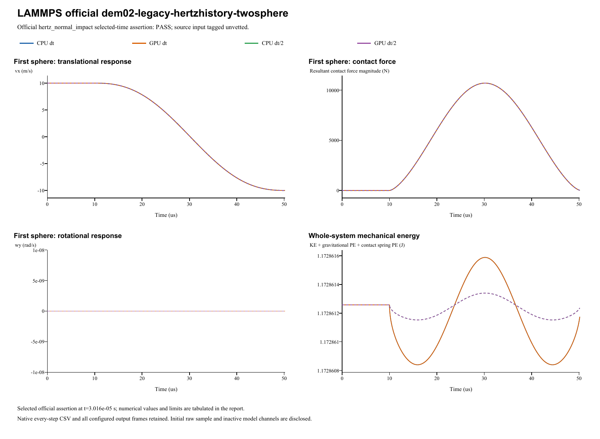

# LAMMPS official dem02-legacy-hertzhistory-twosphere

**Hertz contact energy at the source check time**  
Date: 29 October 2026. Four main runs: **PASS**. Official input tag: `unvetted`.

## Source and official acceptance

[Pinned official YAML](https://github.com/lammps/lammps/blob/29dd3fd7642a6fe9e8b4dd99120df4068b221250/unittest/granular/tests/dem02-legacy-hertzhistory-twosphere-3d-si.yaml) | [Analytic checker](https://github.com/lammps/lammps/blob/29dd3fd7642a6fe9e8b4dd99120df4068b221250/unittest/granular/test_analytic_models.cpp). Commit 29dd3fd7642a6fe9e8b4dd99120df4068b221250; input blob 37af86d762e0051378670464e396250c913158f7. LAMMPS was not rerun locally. The YAML's same-code epsilon is not a cross-software tolerance.

Model `hertz_normal_impact` is evaluated at original step 1508 and time 3.016e-05s. Half-step runs use twice the native check step at the same physical time. The exact reference, relative/absolute error type and unchanged limit are listed separately for each quantity. Whole histories and source golden states supplement these selected-time assertions.

| Run | Quantity | Reference | Native value | Error type | Error | Limit | Result |
|---|---|---:|---:|---|---:|---:|---|
| CPU dt | Hertz peak energy (J) | 1.17286125734 | 1.17286066435 | relative | 5.05588784403e-07 | 0.01 | PASS |
| GPU dt | Hertz peak energy (J) | 1.17286125734 | 1.17286066435 | relative | 5.05588784403e-07 | 0.01 | PASS |
| CPU dt/2 | Hertz peak energy (J) | 1.17286125734 | 1.17286041509 | relative | 7.1811486508e-07 | 0.01 | PASS |
| GPU dt/2 | Hertz peak energy (J) | 1.17286125734 | 1.17286041509 | relative | 7.1811486508e-07 | 0.01 | PASS |

## Inputs and constitutive mapping

- left: R=0.01 m; position=(-0.0101, 0, 0) m; velocity=(10, 0, 0) m/s; spin=(0, 0, 0) rad/s.
- right: R=0.01 m; position=(0.0101, 0, 0) m; velocity=(-10, 0, 0) m/s; spin=(0, 0, 0) rad/s.

- left: mass=0.0117286125734 kg; isotropic inertia=4.69144502936e-07 kg m^2.
- right: mass=0.0117286125734 kg; isotropic inertia=4.69144502936e-07 kg m^2.

Hertz Fn_elastic=(4/3)*E_eff*sqrt(R_eff)*delta^1.5; native E_eff=2.4999975e+10 Pa. Stored linear kn is inactive. Automatic damping uses the harmonic material restitution and the active normal/tangential stiffness; stored manual dashpots are inactive. Tangential inputs: kt=0 N/m (explicit in linear mode), mu=0.35. Rolling/twist coefficients: kr=0, mu_r=0, ktwist=0, mu_twist=0.

Gravity=(0, 0, 0)m/s^2. Base/half dt=2e-08/1e-08s; base/half numerical steps=2508/5016. Initial poses, velocities and physical source coefficients are preserved. The parameter mapping translates the source model's coefficient definitions; it does not fit measured native results.

- Legacy Hertz zero normal damping maps to native e1 and E*=3kn/4. The source NULL tangential Hertz stiffness is dormant because relative tangential velocity is identically zero. This verifies only the normal degeneration.

Native specification (retained locally; not included) | Parameter mapping (retained locally; not included) | Configuration round-trip (retained locally; not included)

## CPU/GPU and timestep refinement

| Quantity | CPU dt error | CPU dt/2 error | Error type and limit |
|---|---:|---:|---|
| Hertz peak energy (J) | 5.0559e-07 | 7.1811e-07 | relative: 0.01 |

CPU/GPU whole-history maximum position / velocity / spin / force differences: 0 m / 1.78e-15 m/s / 0 rad/s / 0 N.

Maximum individual impulse / position-drift / velocity-kick residuals: 1.61e-15 kg m/s / 8.67e-19 m / 1.74e-15 m/s. Gravity is added separately to saved native contact forces.

Energy histories are supplemental unless selected by the official analytic model. Wall/gravity cases exchange external momentum; total sphere momentum is not assumed conserved. The step-refinement table reports each error directly, without imposing monotonic convergence.

## Complete retained results

All 15,052 native output frames, every integration-step particle/contact CSV, projects, raw initial samples and backend logs are retained. Native output cadence is distinct from integration dt; exact counts/intervals are in the analysis and archive manifests. The four primary frame counts are [2509, 2509, 5017, 5017]. 0additional diagnostic run is retained.

- **CPU dt** (main CPU/GPU/time-step comparison): loadable project (retained locally; not included), complete native result (retained locally; not included); 2,508 integration steps, 2,509 stored frames.
- **GPU dt** (main CPU/GPU/time-step comparison): loadable project (retained locally; not included), complete native result (retained locally; not included); 2,508 integration steps, 2,509 stored frames.
- **CPU dt/2** (main CPU/GPU/time-step comparison): loadable project (retained locally; not included), complete native result (retained locally; not included); 5,016 integration steps, 5,017 stored frames.
- **GPU dt/2** (main CPU/GPU/time-step comparison): loadable project (retained locally; not included), complete native result (retained locally; not included); 5,016 integration steps, 5,017 stored frames.

Analysis JSON (retained locally; not included) | Official metrics CSV (retained locally; not included) | Source checkpoints (retained locally; not included) | Independent physics audit (retained locally; not included) | Run manifest (retained locally; not included) | Full native ZIP (retained locally; not included) | Frame/hash audit (retained locally; not included)

Source checkpoint states are supplemental regression diagnostics. Their differences are reported directly; the YAML same-code epsilon is not imposed as an independent cross-software acceptance limit.

A stable helper executable is statically linked to the current native CPU/CUDA libraries. Historical GUI/library byte identity is not asserted. Existing case reports and records are unchanged. Verified scope follows the active source model and the criteria above; a passing inactive channel does not validate every option of its contact family.
