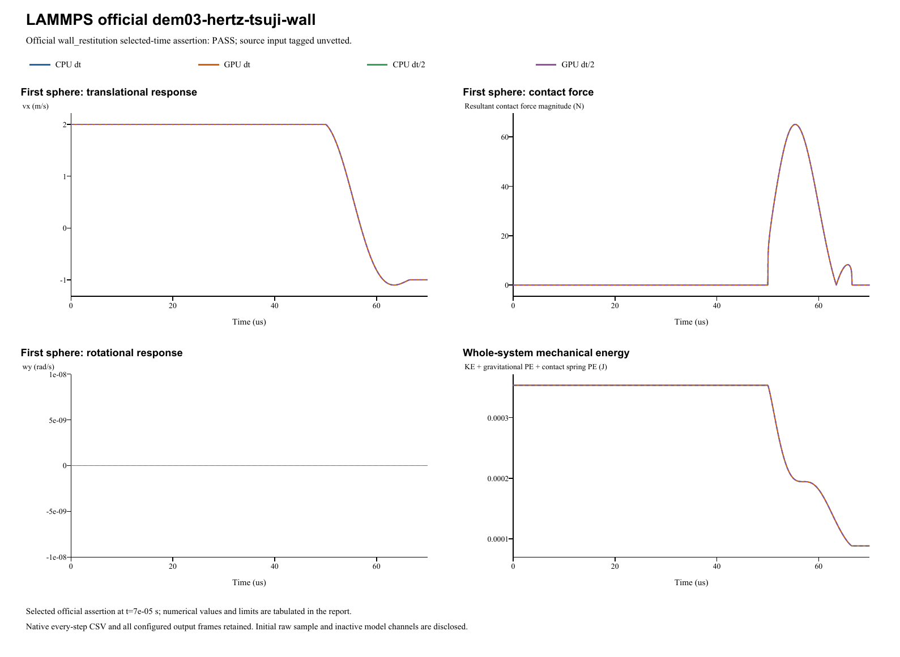

# LAMMPS official dem03-hertz-tsuji-wall

**Sphere-wall rebound and restitution**  
Date: 29 October 2026. Four main runs: **PASS**. Official input tag: `unvetted`.

## Source and official acceptance

[Pinned official YAML](https://github.com/lammps/lammps/blob/29dd3fd7642a6fe9e8b4dd99120df4068b221250/unittest/granular/tests/dem03-hertz-tsuji-wall-3d-si.yaml) | [Analytic checker](https://github.com/lammps/lammps/blob/29dd3fd7642a6fe9e8b4dd99120df4068b221250/unittest/granular/test_analytic_models.cpp). Commit 29dd3fd7642a6fe9e8b4dd99120df4068b221250; input blob b0383cb68ec47ab673287e47b3a0d35768ffbe7d. LAMMPS was not rerun locally. The YAML's same-code epsilon is not a cross-software tolerance.

Model `wall_restitution` is evaluated at original step 7000 and time 7e-05s. Half-step runs use twice the native check step at the same physical time. The exact reference, relative/absolute error type and unchanged limit are listed separately for each quantity. Whole histories and source golden states supplement these selected-time assertions.

| Run | Quantity | Reference | Native value | Error type | Error | Limit | Result |
|---|---|---:|---:|---|---:|---:|---|
| CPU dt | Rebound vx (m/s) | -1 | -0.999743698565 | relative | 0.000256301434736 | 0.005 | PASS |
| GPU dt | Rebound vx (m/s) | -1 | -0.999743698565 | relative | 0.000256301434736 | 0.005 | PASS |
| CPU dt/2 | Rebound vx (m/s) | -1 | -0.999794557626 | relative | 0.000205442373972 | 0.005 | PASS |
| GPU dt/2 | Rebound vx (m/s) | -1 | -0.999794557626 | relative | 0.000205442373972 | 0.005 | PASS |

## Inputs and constitutive mapping

- sphere: R=0.0025 m; position=(-0.0026, 0, 0) m; velocity=(2, 0, 0) m/s; spin=(0, 0, 0) rad/s.

- sphere: mass=0.000176714586764 kg; isotropic inertia=4.41786466911e-10 kg m^2.

Hertz Fn_elastic=(4/3)*E_eff*sqrt(R_eff)*delta^1.5; native E_eff=3.927729772e+10 Pa. Stored linear kn is inactive. Automatic damping uses the harmonic material restitution and the active normal/tangential stiffness; stored manual dashpots are inactive. Tangential inputs: kt=0 N/m (explicit in linear mode), mu=0.4. Rolling/twist coefficients: kr=0, mu_r=0, ktwist=0, mu_twist=0.

Gravity=(0, 0, 0)m/s^2. Base/half dt=1e-08/5e-09s; base/half numerical steps=7000/14000. Initial poses, velocities and physical source coefficients are preserved. The parameter mapping translates the source model's coefficient definitions; it does not fit measured native results.

- The pinned wall mixing helper gives E_eff=E/[2*(1-nu^2)]; both native materials retain source E=7e10 Pa. Two previous doubled-E base attempts are preserved as superseded diagnostics and excluded from this four-run verification.
- Exact Tsuji coefficient mapping: native beta=sqrt(2/5)*P6(e_source); native material restitution is the inverse beta transform, not a fitted rebound. Official analytic target remains e_source. Normal force prefactor and damping at every overlap match.
- Equal opposite pair spins or zero wall spin preserve exactly zero contact tangential velocity. Nonzero friction is retained but no active tangential damping equivalence is claimed.

Native specification (retained locally; not included) | Parameter mapping (retained locally; not included) | Configuration round-trip (retained locally; not included)

## CPU/GPU and timestep refinement

| Quantity | CPU dt error | CPU dt/2 error | Error type and limit |
|---|---:|---:|---|
| Rebound vx (m/s) | 0.0002563 | 0.00020544 | relative: 0.005 |

CPU/GPU whole-history maximum position / velocity / spin / force differences: 0 m / 4.44e-16 m/s / 0 rad/s / 1.42e-14 N.

Maximum individual impulse / position-drift / velocity-kick residuals: 1.95e-18 kg m/s / 2.17e-19 m / 2.19e-16 m/s. Gravity is added separately to saved native contact forces.

Energy histories are supplemental unless selected by the official analytic model. Wall/gravity cases exchange external momentum; total sphere momentum is not assumed conserved. The step-refinement table reports each error directly, without imposing monotonic convergence.

## Complete retained results

All 42,004 native output frames, every integration-step particle/contact CSV, projects, raw initial samples and backend logs are retained. Native output cadence is distinct from integration dt; exact counts/intervals are in the analysis and archive manifests. The four primary frame counts are [7001, 7001, 14001, 14001]. 0additional diagnostic run is retained.

- **CPU dt** (main CPU/GPU/time-step comparison): loadable project (retained locally; not included), complete native result (retained locally; not included); 7,000 integration steps, 7,001 stored frames.
- **GPU dt** (main CPU/GPU/time-step comparison): loadable project (retained locally; not included), complete native result (retained locally; not included); 7,000 integration steps, 7,001 stored frames.
- **CPU dt/2** (main CPU/GPU/time-step comparison): loadable project (retained locally; not included), complete native result (retained locally; not included); 14,000 integration steps, 14,001 stored frames.
- **GPU dt/2** (main CPU/GPU/time-step comparison): loadable project (retained locally; not included), complete native result (retained locally; not included); 14,000 integration steps, 14,001 stored frames.

Analysis JSON (retained locally; not included) | Official metrics CSV (retained locally; not included) | Source checkpoints (retained locally; not included) | Independent physics audit (retained locally; not included) | Run manifest (retained locally; not included) | Full native ZIP (retained locally; not included) | Frame/hash audit (retained locally; not included)

Source checkpoint states are supplemental regression diagnostics. Their differences are reported directly; the YAML same-code epsilon is not imposed as an independent cross-software acceptance limit.

A stable helper executable is statically linked to the current native CPU/CUDA libraries. Historical GUI/library byte identity is not asserted. Existing case reports and records are unchanged. Verified scope follows the active source model and the criteria above; a passing inactive channel does not validate every option of its contact family.
