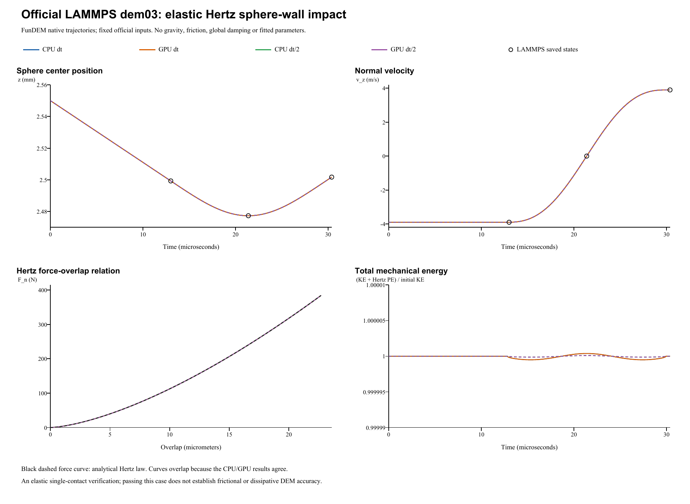

# Hertz sphere-wall impact: verification report

**Case:** LAMMPS official `dem03-hertz-wall-3d-si`  
**Date:** 28 October 2026  
**Outcome:** All four FunDEM native runs pass the official 1% peak-energy check.

## Reference and model

The reference is the [official LAMMPS input and saved states](https://github.com/lammps/lammps/blob/f9720ce2d176d615495d1d6c31349b1f71be1c73/unittest/granular/tests/dem03-hertz-wall-3d-si.yaml), pinned to commit `f9720ce2d176d615495d1d6c31349b1f71be1c73`. The local YAML Git blob is `8ab4e654a5c4612846413c65d239c37cf695ef4d`. LAMMPS was not rerun locally: comparisons use the pinned official golden states and an independent Hertz analytic solution.

| Quantity | Input / mapping |
|---|---:|
| Sphere diameter; density | 0.005 m; 7000 kg/m^3 |
| Initial center; velocity | (0, 0, 0.002550) m; (0, 0, -3.9) m/s |
| Fixed wall | z = 0 |
| LAMMPS Hertz coefficient `k_n` | 7.11111e10 Pa |
| FunDEM effective modulus `E* = 3 k_n / 4` | 5.3333325e10 Pa |
| Material representation, both bodies | Poisson ratio 0.25; E = 9.9999984375e10 Pa |
| Restitution; all friction; gravity | 1; 0; 0 |
| Explicit damping override / global damping | Off / 0 |
| Official time step; duration | 1e-8 s; 30.38 us |

The normal law is `F_n = k_n sqrt(R) delta^(3/2) = (4/3) E* sqrt(R) delta^(3/2)`. FunDEM combines both elastic compliances, including the infinite-mass wall. The chosen Poisson ratio is only a representation choice; E is derived to preserve E*. No contact parameter was fitted. Automatic contact damping is zero because restitution is 1. Continuous LAMMPS segments (1300 + 838 + 900 steps) are one unchanged FunDEM event. The half-step runs preserve the same physical endpoint.

## Results

Independent Hertz reference: peak force **384.052416289 N**; maximum overlap **22.680644976 um**; restitution **1**; contact duration **17.116763980 us**.

| Run | Steps / frames | Peak force (N) | Max. overlap (um) | Measured e | Peak-energy error (%) |
|---|---:|---:|---:|---:|---:|
| CPU dt | 3038 / 3039 | 384.052492736 | 22.680647986 | 1.000000005095 | 0.00003318 |
| GPU dt | 3038 / 3039 | 384.052492736 | 22.680647986 | 1.000000005095 | 0.00003318 |
| CPU dt/2 | 6076 / 6077 | 384.052425444 | 22.680645336 | 1.000000000299 | 0.00000397 |
| GPU dt/2 | 6076 / 6077 | 384.052425444 | 22.680645336 | 1.000000000299 | 0.00000397 |

The official check at cumulative step 2138 is `0.5 m v_in^2 ~ 0.4 F_peak delta_peak`, with a **1% tolerance**. All four pass. The YAML regression epsilon of 1e-10 is not treated as a universal cross-code tolerance. At the three official checkpoint times, the official-step runs differ by at most **5.21e-18 m** in position and **1.68e-13** in velocity normalized by the impact speed. CPU and GPU agree to floating-point precision in this case; halving dt improves the peak and energy errors.

## Retained results and scope

All complete native result directories are retained. Each contains the native `run.json`, saved frames and contacts. Per-run `trajectory.csv` and `native-audit.json` are also retained alongside the projects.

- CPU dt result (retained locally; not included): `run-20261028-031141-411-f6f00539-bf7f-4746-a07d-8dcd059ff0e5`
- GPU dt result (retained locally; not included): `run-20261028-031207-487-7e0a855b-7969-440f-8dbe-13786b5b1039`
- CPU dt/2 result (retained locally; not included): `run-20261028-031321-869-a8ed2326-28ac-45ac-854f-29b169df9c6f`
- GPU dt/2 result (retained locally; not included): `run-20261028-031411-746-3a003f4a-3a58-4283-9df4-8784b6ff55c1`

Full run manifest (retained locally; not included) | Parameter mapping (retained locally; not included) | Analysis JSON (retained locally; not included) | Checkpoint CSV (retained locally; not included) | Native archive ZIP (retained locally; not included)

The helper advances the real FunDEM `SimulationSession` with linked **0.4.3 CPU/CUDA native libraries**; it is not a separate collision integrator. Build manifest (retained locally; not included) and hashes (retained locally; not included) record the executed build. No contact solver code was changed. The test does not establish byte identity with the installed GUI executable.

**Verified scope:** frictionless elastic normal Hertz contact. Dissipative restitution, tangential friction, rolling resistance and many-particle flow require separate tests.
