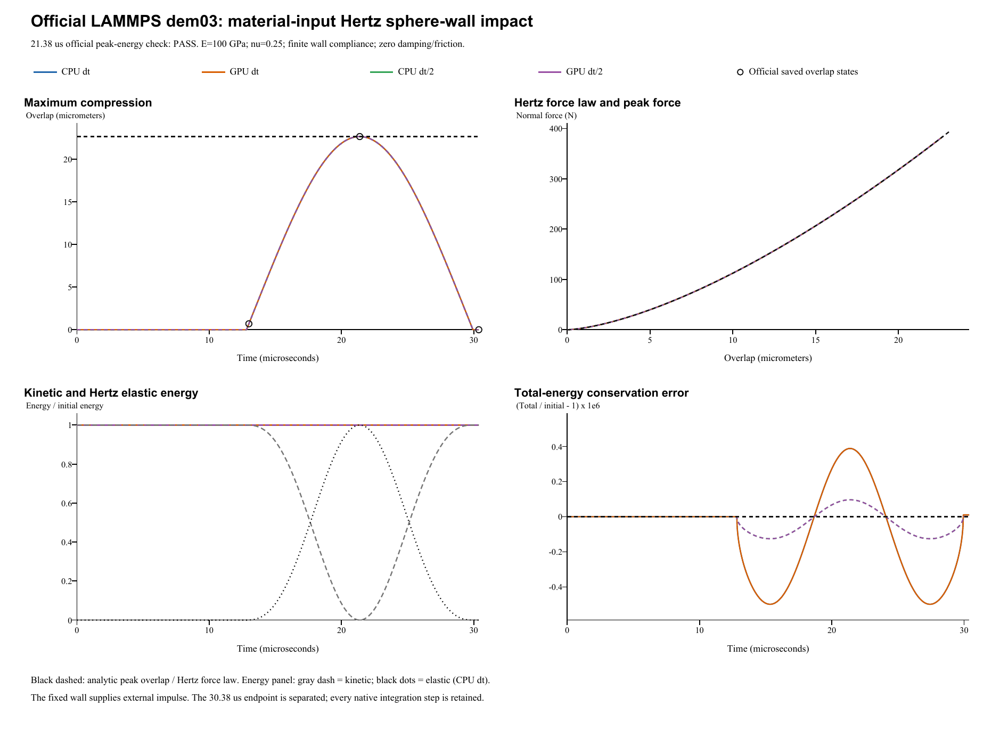

# Material-based Hertz sphere-wall impact: verification report

**Case:** LAMMPS official dem03-hertzmaterial-wall-3d-si  
**Date:** 28 October 2026  
**Outcome: PASS.** 4 of 4 runs pass the official 1% peak-energy check at 21.38 us.

## Reference and unchanged inputs

The reference is the [official LAMMPS input and saved states](https://github.com/lammps/lammps/blob/f9720ce2d176d615495d1d6c31349b1f71be1c73/unittest/granular/tests/dem03-hertzmaterial-wall-3d-si.yaml), pinned to commit f9720ce2d176d615495d1d6c31349b1f71be1c73; the local YAML Git blob is 2b1e846a6377f3218c0bc3756e3c430738d12a33. LAMMPS was not rerun locally. Comparisons use these pinned golden states, the [official analytic checker](https://github.com/lammps/lammps/blob/f9720ce2d176d615495d1d6c31349b1f71be1c73/unittest/granular/test_analytic_models.cpp), and an independent Hertz solution.

| Quantity | Official input / FunDEM mapping |
|---|---|
| One sphere | Diameter 0.005 m; density 7000 kg/m^3 |
| Initial center; velocity | (0, 0, 0.002550) m; (0, 0, -3.9) m/s |
| Initial spin | Zero |
| Fixed plane | z = 0; no translation or rotation |
| Direct material constants | Both sphere and wall: E = 1.0e11 Pa; Poisson ratio = 0.25 |
| Effective elastic contact | E* = E / [2 (1 - nu^2)] = 5.333333333e10 Pa; R* = R = 0.0025 m |
| Restitution; damping; friction | e = 1; all contact damping and friction = 0 |
| Other forces / boundaries | No gravity or global damping; free outer boundaries |
| Base integration | dt = 1e-8 s; 1300 + 838 + 900 = 3038 steps |
| Refined integration | dt = 5e-9 s; 6076 steps; same 30.38 us endpoint |
| Native output | Every integration step, including t = 0 |

The official wall and pair commands use **hertz/material E en nu**, **damping coeff_restitution**, and **tangential linear_nohistory 0.0 0.0**, with E = 100 GPa, nu = 0.25 and en = 1. FunDEM receives the official E and nu directly, uses nonlinear contact stiffness, and leaves the manual damping override disabled. Restitution 1 gives zero automatic normal damping; tangential, rolling and torsional damping are also zero. All friction coefficients, slip, tangential force, torque and spin remain zero. No coefficient was fitted.

The normal law is **F = K delta^(3/2)**, with **K = (4/3) E* sqrt(R)** and **1/E* = (1 - nu_s^2)/E_s + (1 - nu_w^2)/E_w**. Both finite elastic compliances contribute. The plane's infinite mass fixes its motion; it does not make its elastic modulus infinite. The effective impact mass is the sphere mass **m**, while the reduced radius is **R**, not R/2. Unlike the earlier direct-coefficient Hertz wall case, this benchmark checks direct conversion from the specified Young's modulus and Poisson ratio.

## Maximum compression, peak force and official energy criterion

For sphere impact speed V = 3.9 m/s:

    E0 = (1/2) m V^2
    U(delta) = (2/5) K delta^(5/2) = (2/5) F delta
    delta_max = [5 m V^2 / (4 K)]^(2/5)
    F_max = K delta_max^(3/2)

The independent targets are **maximum overlap 22.680643558 um**, **peak force 384.052440292 N**, and initial kinetic energy **0.00348422260237 J**.

The official **hertz_normal_impact** checker compares E0 with **0.4 abs(F1) delta at cumulative step 2138 = 21.38 us**, the end of the second segment (analytic_segment = 1), using **1% relative tolerance**. This is an actual sampled near-peak state, not a search for separate maxima. Its formula omits the small remaining kinetic energy at that instant. The extra maximum-overlap and peak-force comparisons below use separately declared **1% diagnostic limits**; they are not additional assertions in the official checker. The YAML regression epsilon 1e-10 is not a universal cross-code tolerance.

| Run | Max. overlap (um) | Overlap error (%) | Peak force (N) | Force error (%) | Official energy error (%) | Official 1% |
|---|---:|---:|---:|---:|---:|---|
| CPU dt | 22.680647 | 0.0000133 | 384.052517 | 0.0000199 | 0.0000332 | PASS |
| GPU dt | 22.680647 | 0.0000133 | 384.052517 | 0.0000199 | 0.0000332 | PASS |
| CPU dt/2 | 22.680644 | 0.0000016 | 384.052449 | 0.0000024 | 0.0000040 | PASS |
| GPU dt/2 | 22.680644 | 0.0000016 | 384.052449 | 0.0000024 | 0.0000040 | PASS |

4 of 4 runs pass the supplemental 1% maximum-overlap comparison; 4 of 4 pass the supplemental 1% peak-force comparison. Peak values use every native step without post-run parameter adjustment. Errors use the independent continuum Hertz solution. Golden checkpoint comparisons are separate diagnostics.

## Whole-event energy, wall impulse and numerical comparisons

Whole-event conservation uses a separately declared 1% maximum relative-energy-error diagnostic. Mechanical energy is recomputed as **E(t) = 0.5 m abs(v)^2 + 0.4 K delta^(5/2)**. Count the sphere's kinetic energy and its single wall-contact elastic energy once. The fixed plane has zero kinetic energy and does no boundary work. Spin remains zero.

| Run | Maximum abs(E-E0)/E0 (%) | Final abs(E-E0)/E0 (%) | Measured rebound restitution |
|---|---:|---:|---:|
| CPU dt | 0.0000499 | 0.0000010 | 1.0000000051 |
| GPU dt | 0.0000499 | 0.0000010 | 1.0000000051 |
| CPU dt/2 | 0.0000126 | 0.0000001 | 1.0000000003 |
| GPU dt/2 | 0.0000126 | 0.0000001 | 1.0000000003 |

CPU/GPU velocities differ by at most 4.44e-16 m/s; maximum force-history difference is 0 N. Halving dt changes maximum whole-event energy error to 0.251777 of its base-step value. The official fixed-time PE error includes near-peak residual kinetic energy and differs from the conservation error.

Official 1% acceptance compares sampled 0.4 |F| delta with initial sphere kinetic energy at 21.38 us. Separate 1% peak-overlap, peak-force and full-trace total-energy checks are supplemental. The 30.38 us endpoint is separated; rebound speed ratio is a diagnostic, not an official assertion.

4 of 4 runs pass the supplemental 1% whole-event energy diagnostic. The 30.38 us endpoint is separated with zero contact force and elastic energy, so the measured rebound ratio is a valid free-flight restitution diagnostic. It is not a separate official YAML assertion.

The particle's linear momentum is not conserved: the fixed wall supplies an external impulse. Integrating the contact force using the native velocity-Verlet endpoint weights balances the sphere's momentum change; the wall/support receives the opposite impulse. This wall-impulse check is separate from the official energy assertion.

Independent analysis JSON (retained locally; not included) | Every-step energy and force CSV (retained locally; not included) | Official checkpoint CSV (retained locally; not included) | [Contact-model audit](../tools/dem03-hertzmaterial-contact-audit.md)

## Complete retained results and scope

All four complete native result directories retain run.json, project.json, every-step frames/contact records, input projects, CSVs, audits and CPU/CUDA backend logs. Base-step runs retain **3039 frames each**; half-step runs retain **6077 frames each**: **18,232 native frames** in total.

- **CPU dt**: input project (retained locally; not included), complete native result (retained locally; not included); 3,038 steps / 3,039 frames.
- **GPU dt**: input project (retained locally; not included), complete native result (retained locally; not included); 3,038 steps / 3,039 frames.
- **CPU dt/2**: input project (retained locally; not included), complete native result (retained locally; not included); 6,076 steps / 6,077 frames.
- **GPU dt/2**: input project (retained locally; not included), complete native result (retained locally; not included); 6,076 steps / 6,077 frames.

Run manifest (retained locally; not included) | Parameter mapping (retained locally; not included) | Configuration audit (retained locally; not included) | Full native archive ZIP (retained locally; not included)

The helper advances the real **FunDEM SimulationSession** using linked **0.4.3 CPU/CUDA native libraries**. It is not a separate impact integrator. The three consecutive official segments form one unchanged FunDEM event. No contact solver law or official physical parameter was changed to force agreement. Byte identity with the installed GUI executable was not established.

**Verified scope:** direct E/nu material mapping for a frictionless elastic Hertz sphere-plane impact, including the finite wall elastic compliance; peak compression, peak force, energy balance, wall impulse and CPU/CUDA consistency. Nonzero damping, tangential friction, rotation and many-particle flows require other cases.
