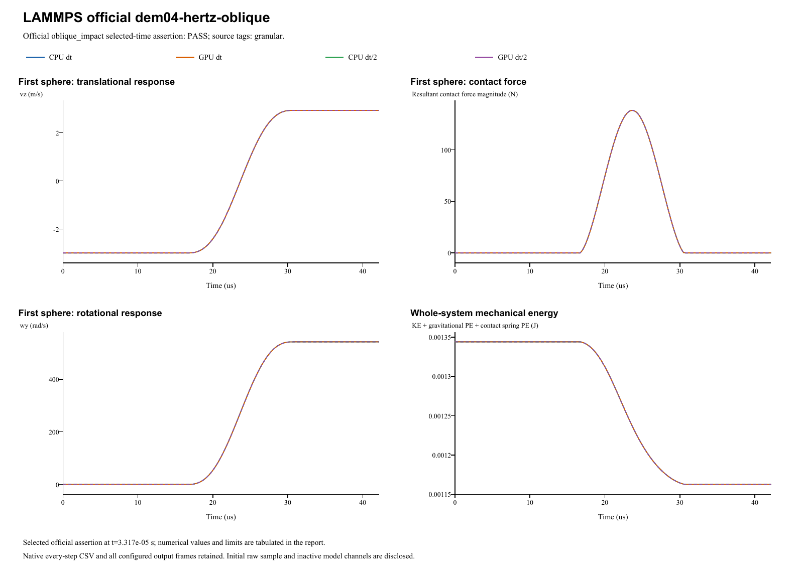

# LAMMPS official dem04-hertz-oblique

**Hertz wall impact: conditional saturated friction and spin**  
Date: 29 October 2026. Four main runs: **PASS**. Official input tag: `granular`.

## Source and official acceptance

[Pinned official YAML](https://github.com/lammps/lammps/blob/29dd3fd7642a6fe9e8b4dd99120df4068b221250/unittest/granular/tests/dem04-hertz-oblique-3d-si.yaml) | [Analytic checker](https://github.com/lammps/lammps/blob/29dd3fd7642a6fe9e8b4dd99120df4068b221250/unittest/granular/test_analytic_models.cpp). Commit 29dd3fd7642a6fe9e8b4dd99120df4068b221250; input blob 5b07ff13041a03aff78974ac92de06db51eafcc0. LAMMPS was not rerun locally. The YAML's same-code epsilon is not a cross-software tolerance.

Model `oblique_impact` is evaluated at original step 3317 and time 3.317e-05s. Half-step runs use twice the native check step at the same physical time. The exact reference, relative/absolute error type and unchanged limit are listed separately for each quantity. Whole histories and source golden states supplement these selected-time assertions.

| Run | Quantity | Reference | Native value | Error type | Error | Limit | Result |
|---|---|---:|---:|---|---:|---:|---|
| CPU dt | Rebound vz (m/s) | 2.927848 | 2.92784231202 | relative | 1.94271769117e-06 | 0.01 | PASS |
| CPU dt | Rebound vx (m/s) | 1.962678784 | 1.9626341309 | relative | 2.2751099776e-05 | 0.01 | PASS |
| CPU dt | Rebound omega_y (rad/s) | 544.221216 | 541.767965973 | relative | 0.00450781769376 | 0.01 | PASS |
| GPU dt | Rebound vz (m/s) | 2.927848 | 2.92784231202 | relative | 1.94271769117e-06 | 0.01 | PASS |
| GPU dt | Rebound vx (m/s) | 1.962678784 | 1.9626341309 | relative | 2.27510997765e-05 | 0.01 | PASS |
| GPU dt | Rebound omega_y (rad/s) | 544.221216 | 541.767965973 | relative | 0.00450781769377 | 0.01 | PASS |
| CPU dt/2 | Rebound vz (m/s) | 2.927848 | 2.92784934954 | relative | 4.60932160063e-07 | 0.01 | PASS |
| CPU dt/2 | Rebound vx (m/s) | 1.962678784 | 1.96263407953 | relative | 2.27772711529e-05 | 0.01 | PASS |
| CPU dt/2 | Rebound omega_y (rad/s) | 544.221216 | 541.768004547 | relative | 0.00450774681542 | 0.01 | PASS |
| GPU dt/2 | Rebound vz (m/s) | 2.927848 | 2.92784934954 | relative | 4.60932159911e-07 | 0.01 | PASS |
| GPU dt/2 | Rebound vx (m/s) | 1.962678784 | 1.96263407953 | relative | 2.27772711534e-05 | 0.01 | PASS |
| GPU dt/2 | Rebound omega_y (rad/s) | 544.221216 | 541.768004547 | relative | 0.00450774681542 | 0.01 | PASS |

## Inputs and constitutive mapping

- sphere: R=0.0025 m; position=(0, 0, 0.00255) m; velocity=(2.5069, 0, -2.9876) m/s; spin=(0, 0, 0) rad/s.

- sphere: mass=0.000176714586764 kg; isotropic inertia=4.41786466911e-10 kg m^2.

Hertz Fn_elastic=(4/3)*E_eff*sqrt(R_eff)*delta^1.5; native E_eff=3.9277275e+10 Pa. Stored linear kn is inactive. Automatic damping uses the harmonic material restitution and the active normal/tangential stiffness; stored manual dashpots are inactive. Tangential inputs: kt=0 N/m (explicit in linear mode), mu=0.092. Rolling/twist coefficients: kr=0, mu_r=0, ktwist=0, mu_twist=0. Source wall spin-slip and torque use R; native uses the shared contact point at R-delta. Maximum source/native contact-speed difference is 0.00512712 m/s; torque-arm difference is 1.40351e-05 m. Official selected-time acceptance does not imply pointwise kinematic identity. Source constant kt=1.5e10 N/m and ct=0 differ from native overlap-dependent Hertz/Mindlin stiffness and automatic damping. Their total Ft agrees only under the proved common saturation. Halving dt cannot remove the R versus R-delta torque convention.

Gravity=(0, 0, 0)m/s^2. Base/half dt=1e-08/5e-09s; base/half numerical steps=4217/8434. Initial poses, velocities and physical source coefficients are preserved. The parameter mapping translates the source model's coefficient definitions; it does not fit measured native results.

- The four runs are accepted only for their independently proved common-Coulomb-cap path. Unsaturated tangential stiffness, damping and history operators are not validated.
- Direct Hertz conversion uses E_eff=0.75kn. Native nu=0.25 is an explicit unfitted encoding choice because the source direct-kn law supplies no Poisson ratio.
- The source constant kt=1.5e10 N/m and ct=0 are replayed separately; native Hertz/Mindlin kt(delta) and automatic ct(delta) differ. All actual contact states must yield the same capped total force vector.
- Source wall torque uses R; native shared-point torque uses R-delta. The persistent spin offset is quantified and cannot be eliminated by timestep refinement.

Native specification (retained locally; not included) | Parameter mapping (retained locally; not included) | Configuration round-trip (retained locally; not included)

## CPU/GPU and timestep refinement

| Quantity | CPU dt error | CPU dt/2 error | Error type and limit |
|---|---:|---:|---|
| Rebound vz (m/s) | 1.9427e-06 | 4.6093e-07 | relative: 0.01 |
| Rebound vx (m/s) | 2.2751e-05 | 2.2777e-05 | relative: 0.01 |
| Rebound omega_y (rad/s) | 0.0045078 | 0.0045077 | relative: 0.01 |

CPU/GPU whole-history maximum position / velocity / spin / force differences: 6.78e-21 m / 1.11e-15 m/s / 2.84e-13 rad/s / 6.42e-12 N.

Maximum individual impulse / position-drift / velocity-kick residuals: 3.05e-18 kg m/s / 2.17e-19 m / 4.38e-16 m/s. Gravity is added separately to saved native contact forces.

Energy histories are supplemental unless selected by the official analytic model. Wall/gravity cases exchange external momentum; total sphere momentum is not assumed conserved. The step-refinement table reports each error directly, without imposing monotonic convergence.

## Conditional source-force equivalence

| Run | Contact rows | Max source/native Ft difference(N) | Max normal-law difference(N) |
|---|---:|---:|---:|
| CPU dt | 1397 | 5.3290705182e-15 | 5.68434188608e-14 |
| GPU dt | 1397 | 5.3290705182e-15 | 5.68434188608e-14 |
| CPU dt/2 | 2793 | 7.1054273576e-15 | 5.68434188608e-14 |
| GPU dt/2 | 2793 | 5.3290705182e-15 | 5.68434188608e-14 |

Every replayed contact is saturated in both laws, including signed normal unloading. This validates total force on this path, not unsaturated kt/Ct/history. Spin error remains about0.4508% with either timestep; refining dt does not remove the sourceR/nativeR-delta convention.
- CPU dt: proof JSON (retained locally; not included) | every-contact replay CSV (retained locally; not included)
- GPU dt: proof JSON (retained locally; not included) | every-contact replay CSV (retained locally; not included)
- CPU dt/2: proof JSON (retained locally; not included) | every-contact replay CSV (retained locally; not included)
- GPU dt/2: proof JSON (retained locally; not included) | every-contact replay CSV (retained locally; not included)

## Complete retained results

All 25,306 native output frames, every integration-step particle/contact CSV, projects, raw initial samples and backend logs are retained. Native output cadence is distinct from integration dt; exact counts/intervals are in the analysis and archive manifests. The four primary frame counts are [4218, 4218, 8435, 8435]. 0additional diagnostic run is retained.

- **CPU dt** (main CPU/GPU/time-step comparison): loadable project (retained locally; not included), complete native result (retained locally; not included); 4,217 integration steps, 4,218 stored frames.
- **GPU dt** (main CPU/GPU/time-step comparison): loadable project (retained locally; not included), complete native result (retained locally; not included); 4,217 integration steps, 4,218 stored frames.
- **CPU dt/2** (main CPU/GPU/time-step comparison): loadable project (retained locally; not included), complete native result (retained locally; not included); 8,434 integration steps, 8,435 stored frames.
- **GPU dt/2** (main CPU/GPU/time-step comparison): loadable project (retained locally; not included), complete native result (retained locally; not included); 8,434 integration steps, 8,435 stored frames.

Analysis JSON (retained locally; not included) | Official metrics CSV (retained locally; not included) | Source checkpoints (retained locally; not included) | Independent physics audit (retained locally; not included) | Run manifest (retained locally; not included) | Full native ZIP (retained locally; not included) | Frame/hash audit (retained locally; not included)

Source checkpoint states are supplemental regression diagnostics. Their differences are reported directly; the YAML same-code epsilon is not imposed as an independent cross-software acceptance limit.

A stable helper executable is statically linked to the current native CPU/CUDA libraries. Historical GUI/library byte identity is not asserted. Existing case reports and records are unchanged. Verified scope follows the active source model and the criteria above; a passing inactive channel does not validate every option of its contact family.
