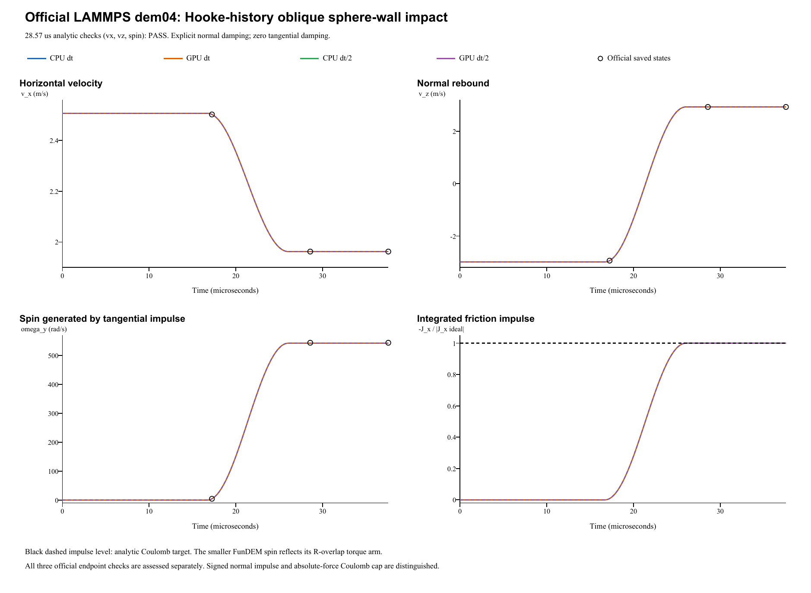

# Oblique wall impact: verification report

**Case:** LAMMPS official dem04-hookehistory-oblique-3d-si  
**Date:** 28 October 2026  
**Outcome: PASS.** All four runs pass all three official 1% checks at 28.57 us.

## Official reference and unchanged inputs

The reference is the [official LAMMPS YAML and saved states](https://github.com/lammps/lammps/blob/f9720ce2d176d615495d1d6c31349b1f71be1c73/unittest/granular/tests/dem04-hookehistory-oblique-3d-si.yaml), pinned to commit f9720ce2d176d615495d1d6c31349b1f71be1c73. The local YAML Git blob is 6ab54dcfe7fcef2d4dcc16eb430a29ba8ebe8f3a. The [official analytic checker](https://github.com/lammps/lammps/blob/f9720ce2d176d615495d1d6c31349b1f71be1c73/unittest/granular/test_analytic_models.cpp) uses oblique_impact with **1% relative tolerance on vx, vz and omega_y separately**, at the end of segment 1 (zero-based): cumulative step **2857 = 28.57 us**. The 37.57 us endpoint is an additional free-flight diagnostic, not a replacement acceptance point. LAMMPS was not rerun locally. The YAML regression epsilon 1e-10 is not a universal cross-code tolerance.

| Quantity | Official input / FunDEM configuration |
|---|---|
| Sphere diameter; density | 0.005 m; 2700 kg/m^3 |
| Solid-sphere mass; inertia | 0.000176714586764 kg; 4.41786466911e-10 kg m^2 |
| Initial center | (0, 0, 0.002550) m |
| Initial translation; spin | (2.5069, 0, -2.9876) m/s; omega = 0 |
| Wall; gravity | Fixed plane z = 0; gravity = 0 |
| Normal / tangential contact | Hooke / linear_history; kn = 2.0e7 N/m; kt = 5.7e6 N/m |
| Restitution; sliding friction | e = 0.98; mu = 0.092 |
| Explicit damping mapping | cn = 0.764595808533 N s/m; ct = cr = ctorsion = 0 |
| Rolling / torsional / global damping | Rolling and torsional stiffness/friction = 0; global damping = 0 |
| Time step; official segments | dt = 1e-8 s; 1724 + 1133 + 900 = 3757 steps |
| Refined run | dt = 5e-9 s; 7514 steps; same 37.57 us endpoint |
| Native saved output | Every integration step, including t = 0 |

FunDEM explicit linear stiffness is enabled: kn = 2e7 N/m and ks = 5.7e6 N/m; rolling and torsional stiffnesses are zero. The official Hooke input gives no Young's modulus or Poisson ratio; FunDEM E = 10000 Pa and Poisson ratio = 0.33 are inactive schema placeholders in this mode. To preserve the official zero tangential damping, an explicit contact damping mapping is used: beta = -ln(e)/sqrt(pi^2 + ln(e)^2); cn = 2 beta sqrt(m kn), with ct = cr = ctorsion = 0. This is the analytic conversion of the official restitution, not a fitted parameter. **Explicit damping override is enabled. This case does not validate FunDEM automatic Hooke normal or tangential damping.**

The consecutive LAMMPS segments are one unchanged FunDEM event. The helper advances real FunDEM SimulationSession using linked 0.4.3 CPU/CUDA native libraries; it is not a separate collision integrator. The isolated sphere never reaches the official periodic x/y boundaries, so free x/y motion on the uniform plane is equivalent here. No input coefficient, radius, initial state or solver law was changed to force agreement.

## Analytic friction impulse and spin

For a solid sphere, I = (2/5) m R^2. In the official gross-sliding approximation:

    Jn = m (1 + e) vz_in
    Jt = -mu Jn
    vx_out = vx_in - mu (1 + e) vz_in
    vz_out = e vz_in
    omega_y_out = (5/2) mu (1 + e) vz_in / R

The ideal targets are **vx = 1.962678784 m/s**, **vz = 2.927848 m/s**, and **omega_y = 544.221216 rad/s**. Corresponding impulses are **Jn = 0.00104534594885 N s**, **Jt = -9.61718272939e-5 N s**, and **angular impulse = 2.40429568235e-7 N m s**. The angular impulse uses the nominal radius R, as in the official checker.

| Run | dt (s) | Steps / native frames | vx (m/s) | vx error (%) | vz (m/s) | vz error (%) | omega_y (rad/s) | Spin error (%) | All 1% checks |
|---|---:|---:|---:|---:|---:|---:|---:|---:|---|
| CPU dt | 1e-08 | 3,757 / 3,758 | 1.962646252 | 0.001658 | 2.927827885 | 0.000687 | 542.75063903 | 0.270217 | PASS |
| GPU dt | 1e-08 | 3,757 / 3,758 | 1.962646252 | 0.001658 | 2.927827885 | 0.000687 | 542.75063903 | 0.270217 | PASS |
| CPU dt/2 | 5e-09 | 7,514 / 7,515 | 1.962651011 | 0.001415 | 2.927892057 | 0.001505 | 542.74583807 | 0.271099 | PASS |
| GPU dt/2 | 5e-09 | 7,514 / 7,515 | 1.962651011 | 0.001415 | 2.927892057 | 0.001505 | 542.74583807 | 0.271099 | PASS |

The official YAML golden free-flight state is vx = 1.9626463236052916 m/s, vz = 2.9278279037320356 m/s and omega_y = 544.25367639471085 rad/s. Golden-trajectory comparisons are separate from the analytic acceptance checks. CPU/GPU agreement and time-step refinement do not override the official pass/fail result.

## Native friction, angular impulse and numerical evidence

Explicit normal damping is analytically derived from e=0.98; tangential damping remains exactly zero as specified. Signed normal force is integrated for momentum; its absolute magnitude sets the Coulomb cap. A small tensile unloading tail is retained. The particle torque, not the extra contact-resistance torque field, carries the friction moment. The measured arm is the center-to-plane distance R-delta. Linear and angular impulses are independently integrated over every native step and compared with momentum changes. LAMMPS re-evaluates setup forces at run-segment boundaries; the FunDEM event is continuous. Very small velocity-dependent-force checkpoint differences can occur.

Capped-sample abs(Ft)/abs(Fn) = 0.092000; 929/934 base-step contact samples are capped, with 5 early history-transient samples uncapped. Minimum assembly slip is 0.6058012 m/s, so slip does not reverse. Maximum linear/angular impulse-balance residuals are 2.82e-18 kg m/s / 1.96e-21 N m s. CPU/GPU maximum velocity/spin differences are 1.33e-15 m/s / 1.71e-13 rad/s. Halving dt changes the checked CPU spin by 0.00480095 rad/s; it does not reduce the approximately 0.27% spin gap. The base-step impulse-weighted arm is 0.002493095551 m; using nominal R with the same measured friction impulse would give 544.25374791 rad/s and the actual shorter arm accounts for 1.50310889 rad/s of deficit.

| Run | Signed normal impulse (N s) | Tangential impulse (N s) | Angular impulse (N m s) | Capped-sample friction ratio |
|---|---:|---:|---:|---:|
| CPU dt | 0.00104534239417 | -9.61775761577e-05 | 2.39779887229e-07 | 0.092000000 |
| GPU dt | 0.00104534239417 | -9.61775761577e-05 | 2.39779887229e-07 | 0.092000000 |
| CPU dt/2 | 0.00104535373445 | -9.61767351052e-05 | 2.39777766233e-07 | 0.092000000 |
| GPU dt/2 | 0.00104535373445 | -9.61767351052e-05 | 2.39777766233e-07 | 0.092000000 |

The un-clipped signed normal force can have a weak negative tail. The Coulomb cap uses mu abs(Fn); signed normal impulse and absolute normal-load impulse are kept separately. In the full result, ordinary friction torque is taken from particle torque; the separate contact torque channel contains only additional rolling/torsional resistance, zero here.

The geometric sphere-wall force arm in FunDEM is **a = R - delta**; tangential contact velocity is vx - a omega_y and ordinary friction torque has magnitude a abs(Fx). The official LAMMPS sphere convention uses nominal R. The sphere radius and solid-sphere inertia remain unchanged. Measured force/torque histories are used to quantify the convention difference; the official targets are never replaced by a geometric-arm target.

Independent analysis JSON (retained locally; not included) | Official checkpoint CSV (retained locally; not included) | [Contact-model audit](../tools/dem04-contact-audit.md)

## Complete retained results and scope

All native result frames and contact records are preserved, with native run.json, project.json, input projects, audits, backend logs and every-step trajectory CSVs. Base-step runs retain **3758 frames each**; half-step runs retain **7515 frames each**. This is **22546 native frames** in total, including the initial frame of each run.

- **CPU dt**: input project (retained locally; not included), complete native result (retained locally; not included); 3,757 steps / 3,758 native frames.
- **GPU dt**: input project (retained locally; not included), complete native result (retained locally; not included); 3,757 steps / 3,758 native frames.
- **CPU dt/2**: input project (retained locally; not included), complete native result (retained locally; not included); 7,514 steps / 7,515 native frames.
- **GPU dt/2**: input project (retained locally; not included), complete native result (retained locally; not included); 7,514 steps / 7,515 native frames.

Run manifest (retained locally; not included) | Native archive ZIP (retained locally; not included)

**Scope:** oblique sphere-wall impact, tangential Coulomb friction impulse, translation-to-spin exchange, and Hooke/linear-history contact. No rolling or torsional resistance acts. Gross sliding does not fully test tangential sticking, history reversal or stick-slip cycles; nonzero tangential damping and many-particle flows require other cases. The linked native libraries were tested; byte identity with the installed GUI executable was not established.
