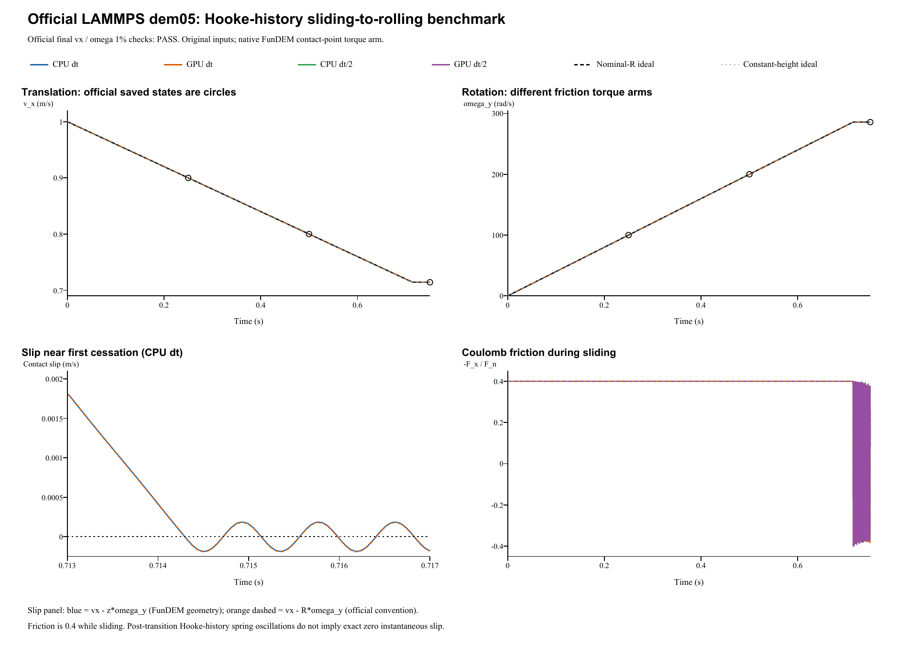

# Hooke sliding to rolling: verification report

**Case:** LAMMPS official dem05-hookehistory-slip-3d-si  
**Date:** 28 October 2026  
**Outcome: PASS.** 4 of 4 runs pass both official 1% endpoint velocity checks.

## Reference and unchanged inputs

The reference is the [official LAMMPS YAML and saved states](https://github.com/lammps/lammps/blob/f9720ce2d176d615495d1d6c31349b1f71be1c73/unittest/granular/tests/dem05-hookehistory-slip-3d-si.yaml), pinned to commit **f9720ce2d176d615495d1d6c31349b1f71be1c73**. Its YAML Git blob is **9d4f2bbc7cf3aa5c10728a2cb2e90cbce024fa91**. LAMMPS was not rerun locally. Comparisons use the pinned golden states and the [official analytic checker](https://github.com/lammps/lammps/blob/f9720ce2d176d615495d1d6c31349b1f71be1c73/unittest/granular/test_analytic_models.cpp). The YAML regression epsilon of 1e-10 is not a universal cross-code tolerance.

| Quantity | Official input / FunDEM mapping |
|---|---|
| Sphere | Radius 0.0025 m; density 2700 kg/m^3 |
| Mass; moment of inertia | 0.000176714586764 kg; 4.41786466911e-10 kg m^2 |
| Initial center | (0, 0, 0.002499982) m |
| Initial translation; rotation | vx = 1 m/s; zero spin |
| Floor; upper plane | z = 0 m; z = 1 m, inactive |
| Gravity | (0, 0, -1) m/s^2 |
| Normal law | Hooke; kn = 10000 N/m |
| Tangential law | Linear history; kt = 2800 N/m; sliding friction = 0.4 |
| Damping | Restitution = 1; normal and tangential damping = 0 |
| Other dissipation | Rolling/torsional friction and global damping = 0 |
| Official time step / segments | 1e-5 s; 25000 + 25000 + 25000 steps |
| Refined time step | 5e-6 s; 150000 steps; same 0.75 s endpoint |
| Native output | Every 1 ms, including both endpoints; 751 frames per run |
| Detailed CSV output | Every integration step, separately from native result frames |
| Official periodic box | x: [-0.05, 0.5] m; y: [-0.05, 0.05] m |

The official command is **hooke kn en tangential linear_history kt 0.0 mu damping coeff_restitution**. FunDEM uses explicit linear stiffness with **kn = 1e4 N/m** and **kt = 2800 N/m**, and leaves manual damping override off. Restitution 1 gives zero automatic contact damping. The official tangential damping argument is also zero. Young's modulus and Poisson ratio in the native project are inactive schema placeholders under the explicit linear-stiffness override; they are not official material values or fitted parameters.

The native event uses one sphere with unwrapped free x/y motion on a uniform plane. This is physically equivalent here to the official periodic x/y domain: there is no second particle, edge, texture or spatially varying wall. For comparison with the saved states, x is mapped modulo 0.55 m into the official box. The three official segments form one uninterrupted 0.75 s FunDEM event. No radius, height, coefficient or solver law was adjusted after examining the outcome.

## Official endpoint criteria and results

For a solid sphere, I = (2/5) m R^2. The ideal nominal-radius Coulomb solution is:

    vx(t) = 1 - 0.4 t
    omega_y(t) = 400 t
    s_R(t) = vx - R omega_y = 1 - 1.4 t
    t* = 2 / (7 mu g) = 0.714285714286 s

After ideal slip cessation, **vx = 5/7 = 0.714285714286 m/s** and **omega_y = (5/7)/R = 285.714285714 rad/s**. The official **slip_cessation** checker evaluates these two endpoint quantities separately at **0.75 s**, with **1% relative tolerance on each** (analytic_segment = 2, cumulative step 75000). The transition time t* is an additional diagnostic, not an official endpoint assertion.

| Run | dt (us) | Final vx (m/s) | vx error (%) | Final omega_y (rad/s) | omega error (%) | Both 1% checks |
|---|---:|---:|---:|---:|---:|---|
| CPU dt | 10 | 0.714236806 | 0.006847 | 285.761175 | 0.016411 | PASS |
| GPU dt | 10 | 0.714236805 | 0.006847 | 285.761175 | 0.016411 | PASS |
| CPU dt/2 | 5 | 0.714237445 | 0.006758 | 285.760535 | 0.016187 | PASS |
| GPU dt/2 | 5 | 0.714237445 | 0.006758 | 285.760535 | 0.016187 | PASS |

Maximum CPU/GPU history differences: 1.96e-11 m/s in velocity and 1.96e-08 rad/s in spin. Halving dt changes the CPU endpoint vx by 6.4e-07 m/s and omega_y by 0.00064 rad/s. Errors in this table are relative to the analytic targets. Agreement between CPU/GPU or between time steps is independent of the official pass/fail decision. This new Hooke/linear-history case has its own result; it does not replace or reinterpret the earlier **dem05-mindlin-slip** failure.

## Contact geometry, Coulomb friction and slip diagnostics

FunDEM uses the actual sphere-to-plane arm **a = R - delta = z** for tangential slip and torque:

    s_a = vx - a omega_y
    abs(torque_y) = a abs(Fx)

The pinned LAMMPS sphere-wall implementation uses the nominal radius R. The initial overlap is **1.8e-08 m**, or **0.000720% of R**. This geometric difference is retained; the much stiffer Hooke case has a much smaller relative overlap than the earlier soft Mindlin benchmark. No adjusted radius is used in the official acceptance target.

| Run | Final nominal slip s_R (m/s) | Final geometric slip s_a (m/s) | First s_a zero (s) | Mean sliding abs(Ft)/Fn | Maximum abs(Ft)/Fn |
|---|---:|---:|---:|---:|---:|
| CPU dt | -0.000166131247 | -0.000161025043 | 0.714296412 | 0.400000000 | 0.400000000 |
| GPU dt | -0.000166131304 | -0.000161025101 | 0.714296412 | 0.400000000 | 0.400000000 |
| CPU dt/2 | -0.000163892614 | -0.000158749168 | 0.714293019 | 0.400000000 | 0.400000000 |
| GPU dt/2 | -0.000163892625 | -0.000158749178 | 0.714293019 | 0.400000000 | 0.400000000 |

Maximum torque-derived lever-arm error over the four runs is **4.33681e-19 m**. The analysis defines the sliding sampling mask. A first slip sign crossing is a diagnostic: elastic tangential-history oscillation can remain afterward, so it is not proof of sustained exact pure rolling. The official checker only asserts the final translational and angular velocities.

The native t = 0 eventStart snapshot retains unassembled force/contact channels as zero. The physical initial force **kn delta = 0.00018 N** follows independently from the supplied overlap; the raw initial result was not rewritten to insert this derived value.

Independent analysis JSON (retained locally; not included) | Official checkpoint CSV (retained locally; not included) | [Contact source audit](../tools/dem05-hooke-contact-audit.md)

## Complete retained results and execution scope

All four complete configured native results are retained: **751 frames each; 3004 frames in total**, including run.json, project.json, every configured frame/contact record, loadable input projects, configuration audits and CPU/CUDA backend logs. Native output is every 1 ms (100 original steps or 200 half steps); the trajectory/contact CSVs separately preserve every integration step. A native frame was not written at every step.

- **CPU dt**: input project (retained locally; not included), complete native result (retained locally; not included); 75,000 integration steps / 751 native frames.
- **GPU dt**: input project (retained locally; not included), complete native result (retained locally; not included); 75,000 integration steps / 751 native frames.
- **CPU dt/2**: input project (retained locally; not included), complete native result (retained locally; not included); 150,000 integration steps / 751 native frames.
- **GPU dt/2**: input project (retained locally; not included), complete native result (retained locally; not included); 150,000 integration steps / 751 native frames.

Run manifest (retained locally; not included) | Parameter mapping (retained locally; not included) | Configuration round-trip audit (retained locally; not included) | Full native result ZIP (retained locally; not included)

The helper advances the real **FunDEM SimulationSession** with linked **0.4.3 CPU/CUDA native libraries**. It is not an independent rolling integrator. No contact solver source was modified. Byte identity with the installed GUI executable was not established.

**Verified scope:** the official endpoint decision applies to this Hooke normal / linear-history tangential sphere-wall case, with Coulomb sliding, spin-up, approach to rolling and CPU/CUDA consistency. Tangential damping is zero, so this case does not validate a limiter acting on a nonzero viscous tangential contribution. Rolling resistance, torsional friction, nonzero viscous damping and many-particle flows require separate cases.
