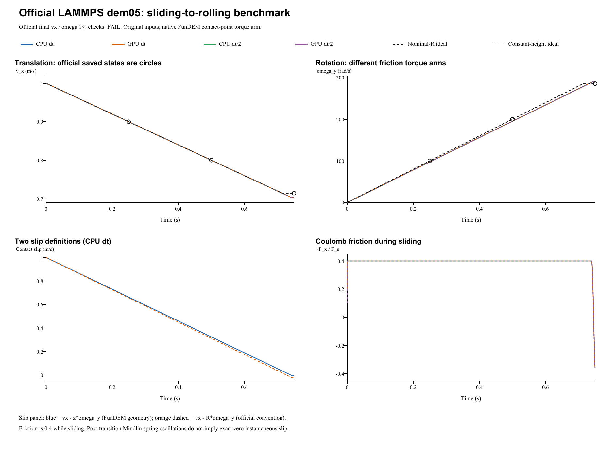

# Sliding to rolling: verification report

**Case:** LAMMPS official dem05-mindlin-slip-3d-si  
**Date:** 28 October 2026  
**Outcome: FAIL.** 0 of 4 runs pass both official 1% checks; the benchmark is not validated.

## Reference and inputs

The reference is the [official LAMMPS input and saved states](https://github.com/lammps/lammps/blob/f9720ce2d176d615495d1d6c31349b1f71be1c73/unittest/granular/tests/dem05-mindlin-slip-3d-si.yaml), pinned to commit f9720ce2d176d615495d1d6c31349b1f71be1c73. The local YAML Git blob is 864e4de3731c20e3ee0941e946439adfd40bfbbe. The [official analytic checker](https://github.com/lammps/lammps/blob/f9720ce2d176d615495d1d6c31349b1f71be1c73/unittest/granular/test_analytic_models.cpp) uses slip_cessation with a 1% relative tolerance on each final quantity, evaluated at cumulative step 75000 (0.75 s). LAMMPS was not rerun locally. The YAML regression epsilon of 1e-10 is not a universal cross-code tolerance.

| Quantity | Official input / FunDEM configuration |
|---|---|
| Sphere diameter; density | 0.005 m; 2700 kg/m^3 |
| Mass; moment of inertia | 0.000176714586764 kg; 4.41786466911e-10 kg m^2 |
| Initial center | (0, 0, 0.0024393) m |
| Initial translation; rotation | vx = 1 m/s; omega = 0 |
| Floor; upper plane | z = 0 m; z = 1 m (inactive) |
| Gravity | (0, 0, -1) m/s^2 |
| Sphere and wall materials | E = 1e4 Pa; Poisson ratio = 0.33 |
| Effective normal / shear moduli | E* = 5611.0425317 Pa; G* = 1125.56841205 Pa |
| Normal / tangential contact | Hertz / Mindlin; sliding friction = 0.4 |
| Restitution; automatic damping | e = 1; normal and tangential damping = 0 |
| Rolling / torsional friction; global damping | All 0 |
| Official dt; end time | 1e-5 s; 0.75 s (25000 + 25000 + 25000 steps) |
| Refined dt | 5e-6 s; same physical endpoint |
| Periodic x length | 0.55 m; wrapped and unwrapped positions are compared consistently |

The native run uses unwrapped free x/y motion on the uniform plane, equivalent here to the official periodic x/y domain for a single isolated sphere. Both FunDEM materials use the supplied E and Poisson ratio. Their combined E* and G* match the official sphere-wall material convention. No material or friction parameter was fitted. The helper advances the real FunDEM SimulationSession using linked 0.4.3 CPU/CUDA native libraries. The solver was not modified.

## Official analytic target and measured results

For a solid sphere, I = (2/5) m R^2. During ideal Coulomb sliding:

- vx(t) = u0 - mu g t = 1 - 0.4 t.
- omega_y(t) = (5 mu g / (2 R)) t = 400 t.
- Nominal contact slip s_R = vx - R omega_y = 1 - 1.4 t.

The ideal slip-cessation time is ts = 2 u0 / (7 mu g) = **0.714285714286 s**. Subsequent pure rolling gives **vx = 5 u0/7 = 0.714285714286 m/s** and **omega_y = vx/R = 285.714285714 rad/s**. The official acceptance check tests these final values independently; it does not directly test the transition time. Ideal final kinetic energy / initial kinetic energy is 5/7. Ideal unwrapped x at 0.75 s is 0.637755102 m, or 0.087755102 m after wrapping.

| Run | dt (s) | Steps / native frames | Final vx (m/s) | vx error (%) | Final omega_y (rad/s) | omega error (%) | Both 1% checks |
|---|---:|---:|---:|---:|---:|---:|---|
| CPU dt | 1e-05 | 75000 / 751 | 0.7034837955 | 1.512269 | 289.32192844 | 1.262675 | FAIL |
| GPU dt | 1e-05 | 75000 / 751 | 0.7034837955 | 1.512269 | 289.32192844 | 1.262675 | FAIL |
| CPU dt/2 | 5e-06 | 150000 / 751 | 0.7034838039 | 1.512267 | 289.32192024 | 1.262672 | FAIL |
| GPU dt/2 | 5e-06 | 150000 / 751 | 0.7034838039 | 1.512267 | 289.32192024 | 1.262672 | FAIL |

Errors are relative to the analytic targets. Inputs and acceptance criteria were retained after examining the results. CPU/GPU agreement and dt refinement do not override a failed official check. The maximum CPU/GPU differences are **3.33067e-15 m/s** and **5.74119e-12 rad/s**. Halving dt changes final vx by **8.39944e-09 m/s** and omega_y by **8.19639e-06 rad/s** in the CPU runs; the reference mismatch persists.

## Contact geometry and friction evidence

FunDEM evaluates the sphere-plane slip and tangential torque using the center-to-plane lever arm **a = R - delta = z**:

    s_a = vx - a omega_y
    abs(T_y) = a abs(F_x)

LAMMPS uses the nominal radius R in both relations. The initial overlap is 6.07e-05 m, or **2.4280% of R**, so that convention difference is relevant. Small geometric slip s_a does not by itself establish agreement with the official nominal-radius rolling target.

At the independent static equilibrium height h = **0.00243934312036 m**, a constant-height model using the FunDEM arm predicts **vx = 0.7041558363 m/s**, **omega_y = 288.66617017 rad/s**, and **ts = 0.7396104093 s**. This approximation explains the contact convention; it is not the official acceptance target and was not used to correct the native motion. A discrepancy due to contact conventions is not, by itself, a demonstrated solver bug.

| Run | Final nominal slip s_R (m/s) | Final geometric slip s_a (m/s) | First s_a zero (s) | Mean sliding abs(Ft)/Fn | Max. abs(Ft)/Fn |
|---|---:|---:|---:|---:|---:|
| CPU dt | -0.0198210256 | -0.00227002151 | 0.739611830 | 0.400000000 | 0.400000000 |
| GPU dt | -0.0198210256 | -0.00227002151 | 0.739611830 | 0.400000000 | 0.400000000 |
| CPU dt/2 | -0.0198209967 | -0.00226999323 | 0.739611808 | 0.400000000 | 0.400000000 |
| GPU dt/2 | -0.0198209967 | -0.00226999323 | 0.739611808 | 0.400000000 | 0.400000000 |

At 0.75 s, the base-step nominal slip is **-0.0198210256 m/s** and geometric slip is **-0.00227002151 m/s**. Sustained exact pure rolling is not demonstrated. The largest torque-derived lever-arm error across all runs is **4.33681e-19 m**. The independent analysis specifies the friction sampling mask. The first slip zero is a diagnostic; friction-spring transients can remain and it is not a strict settling time. See the analysis JSON (retained locally; not included) and [contact-model source audit](../tools/dem05-contact-audit.md).

## Complete retained results

All configured native result frames and contacts are retained, with native run.json, project.json, input projects, audits, backend logs and per-step trajectory CSVs.

- **CPU dt**: project (retained locally; not included), complete result (retained locally; not included); 75,000 steps and 751 native frames.
- **GPU dt**: project (retained locally; not included), complete result (retained locally; not included); 75,000 steps and 751 native frames.
- **CPU dt/2**: project (retained locally; not included), complete result (retained locally; not included); 150,000 steps and 751 native frames.
- **GPU dt/2**: project (retained locally; not included), complete result (retained locally; not included); 150,000 steps and 751 native frames.

Each run saves native frames every **1 ms**, including t = 0 and t = 0.75 s: **751 native frames per run**. This is every 100 steps at the official dt or every 200 steps at half dt. Complete result means every configured output frame is retained. The per-step CSV separately records all integration steps; a separate native frame was not written at every step.

Run manifest (retained locally; not included) | Analysis JSON (retained locally; not included) | Checkpoint CSV (retained locally; not included) | [Contact-model source audit](../tools/dem05-contact-audit.md)

**Scope and limitations:** this case exercises tangential Coulomb friction, sphere spin-up and transition toward rolling. The official endpoint criteria determine its pass/fail status. Rolling resistance and torsional friction are zero; nonzero tangential damping and many-particle flows are not validated. No radius, initial height, coefficient or solver law was changed to conceal a mismatch. Byte identity with the installed GUI executable was not established.
