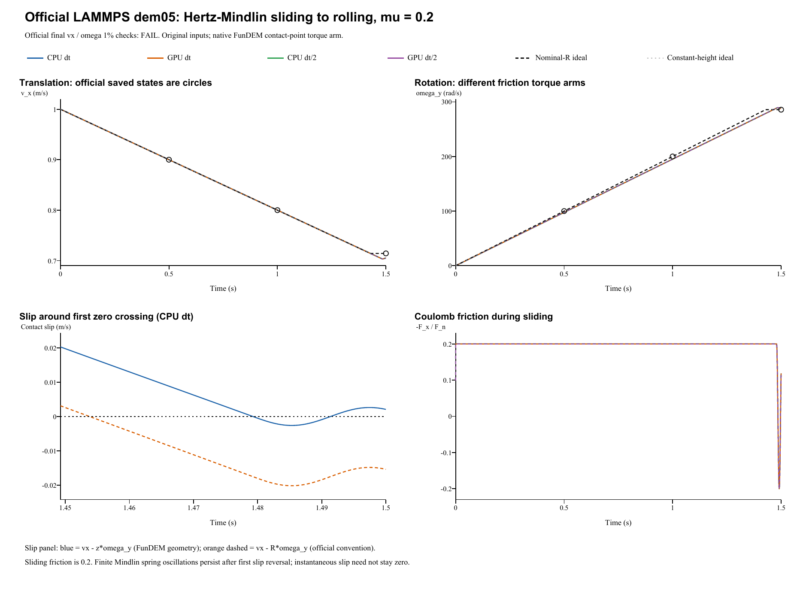

# Mindlin sliding to rolling, friction 0.2: verification report

**Case:** LAMMPS official dem05-slip-mu02-3d-si  
**Date:** 28 October 2026  
**Outcome: FAIL.** 0 of 4 runs pass both official 1% endpoint checks. vx passes: 0/4; spin passes: 4/4. This case is not validated against the official criteria.

## Reference and unchanged physical inputs

The reference is the [official LAMMPS YAML and saved states](https://github.com/lammps/lammps/blob/f9720ce2d176d615495d1d6c31349b1f71be1c73/unittest/granular/tests/dem05-slip-mu02-3d-si.yaml), pinned to commit **f9720ce2d176d615495d1d6c31349b1f71be1c73**. Its Git blob is **ccecc980cfbec0aecff7827c313801c7c06d07a0**. LAMMPS was not rerun locally. Comparisons use the pinned saved states and the [official analytic checker](https://github.com/lammps/lammps/blob/f9720ce2d176d615495d1d6c31349b1f71be1c73/unittest/granular/test_analytic_models.cpp); YAML regression epsilon 1e-10 is not a universal cross-code tolerance.

| Quantity | Official input / FunDEM mapping |
|---|---|
| Sphere | Radius 0.0025 m; density 2700 kg/m^3 |
| Mass; moment of inertia | 0.000176714586764 kg; 4.41786466911e-10 kg m^2 |
| Initial center | (0, 0, 0.0024393) m |
| Initial motion | vx = 1 m/s; zero spin |
| Wall boundary | Native floor z = 0 m; official upper plane z = 1 m is inactive and omitted |
| Gravity | (0, 0, -1) m/s^2 |
| Sphere and wall materials | E = 10000 Pa; Poisson ratio = 0.33 |
| Combined normal / shear moduli | E* = 5611.0425317 Pa; G* = 1125.56841205 Pa |
| Normal / tangential contact | Hertz / Mindlin; sliding friction = 0.2 |
| Damping | Restitution = 1; manual override off; automatic normal and tangential damping = 0 |
| Other dissipation | Rolling/torsional friction and global damping = 0 |
| Official dt / segments | 1e-5 s; 50000 + 50000 + 50000 steps |
| Refined dt | 5e-6 s; 300000 steps; same 1.5 s endpoint |
| Native output | Every 1 ms, including both endpoints; 1501 frames per run |
| Detailed CSV output | Every integration step; 900004 trajectory rows and 900000 contact rows across four runs |
| Official periodic domain | x: [-0.05, 0.5] m; y: [-0.05, 0.05] m |

The official wall law is **hertz/material E en nu tangential mindlin NULL 1.0 mu damping coeff_restitution**. Both native materials retain the supplied finite elastic modulus and Poisson ratio. Their combined E* = E/[2(1-nu^2)] and G* = E/[4(1+nu)(2-nu)] match the official wall convention. Native explicit linear-stiffness and manual damping overrides remain off. Restitution 1 makes the automatic normal and tangential damping zero; the official Mindlin damping multiplier 1.0 therefore does not add nonzero damping. No material, radius, friction or initial height was fitted.

The native event uses one sphere with unwrapped free x/y motion on a uniform plane. This is physically equivalent here to the official periodic domain: no other particle or spatially varying wall is present. Saved-state x comparisons wrap the native coordinate modulo 0.55 m. The official three segments form one uninterrupted 1.5 s event. The sphere remains below z = 0.003 m, so the official upper plane at z = 1 m is inactive and omitted from the native event.

## Official endpoint criteria and measured results

For a solid sphere, I = (2/5) m R^2. The ideal nominal-radius Coulomb solution is:

    vx(t) = 1 - 0.2 t
    omega_y(t) = 200 t
    s_R(t) = vx - R omega_y = 1 - 0.7 t
    t* = 2 / (7 mu g) = 1.428571428571 s

After ideal slip cessation, **vx = 5/7 = 0.714285714286 m/s** and **omega_y = (5/7)/R = 285.714285714 rad/s**. Lowering friction from 0.4 to 0.2 doubles the ideal transition time; it does not change these ideal final velocities. The official **slip_cessation** checker evaluates both endpoint quantities separately at **1.5 s**, with **1% relative tolerance on each** (analytic_segment = 2, cumulative step 150000). The ideal transition time is a diagnostic, not an official assertion.

| Run | dt (us) | Final vx (m/s) | vx error (%) | Final omega_y (rad/s) | omega error (%) | Both 1% checks |
|---|---:|---:|---:|---:|---:|---|
| CPU dt | 10 | 0.704768783 | 1.332370 | 288.068070 | 0.823825 | FAIL |
| GPU dt | 10 | 0.704768783 | 1.332370 | 288.068070 | 0.823825 | FAIL |
| CPU dt/2 | 5 | 0.704768781 | 1.332371 | 288.068072 | 0.823825 | FAIL |
| GPU dt/2 | 5 | 0.704768781 | 1.332371 | 288.068072 | 0.823825 | FAIL |

Maximum CPU/GPU history differences: 1.37e-14 m/s in velocity and 5.74e-12 rad/s in spin. Halving dt changes the CPU endpoint vx by 1.44e-09 m/s and omega_y by 1.4e-06 rad/s. Relative to the retained friction-0.4 Mindlin case, the first geometric-slip zero occurs 2.00002643 to 2.00002646 times later; the ideal inverse-friction transition-time factor is 2. This diagnostic does not change the official endpoint targets. Agreement between backends or time steps does not override the official endpoint decision. No coefficient, target or solver law was changed after examining the outcome. This lower-friction case has its own result; earlier dem05 outcomes remain unchanged.

## Contact geometry, torque and slip

FunDEM uses the actual sphere-to-plane arm **a = R - delta = z** for tangential velocity and torque:

    s_a = vx - a omega_y
    abs(torque_y) = a abs(Fx)

The pinned LAMMPS implementation uses nominal R. The initial overlap is **6.07e-05 m**, or **2.428000% of R**. This finite overlap makes the contact convention relevant. A small geometric slip s_a does not by itself establish agreement with the official nominal-radius target.

A supplemental constant-height calculation at the independent Hertz equilibrium h = **0.00243934312036 m**, using the FunDEM arm, predicts **vx = 0.7041558363 m/s**, **omega_y = 288.66617017 rad/s**, and transition time **1.4792208185 s**. It explains the geometric effect without changing the official acceptance target, and does not represent the full native elastic transient. The base-step native endpoint is vx = **0.704768783 m/s** and omega_y = **288.068070 rad/s**; these differ from the constant-height diagnostic because a finite Mindlin spring oscillation remains. The audited lever arm supports a persistent geometric offset, but sustained exact pure rolling at 1.5 s is not established.

| Run | Final nominal slip s_R (m/s) | Final geometric slip s_a (m/s) | First s_a zero (s) | Mean sliding abs(Ft)/Fn | Maximum abs(Ft)/Fn |
|---|---:|---:|---:|---:|---:|
| CPU dt | -0.0154013926 | 0.0020599239 | 1.479243204 | 0.200000000 | 0.200000000 |
| GPU dt | -0.0154013926 | 0.0020599239 | 1.479243204 | 0.200000000 | 0.200000000 |
| CPU dt/2 | -0.0154013976 | 0.00205991898 | 1.479243183 | 0.200000000 | 0.200000000 |
| GPU dt/2 | -0.0154013976 | 0.00205991898 | 1.479243183 | 0.200000000 | 0.200000000 |

Maximum torque-derived arm error across the four runs is **4.33681e-19 m**. The analysis defines the sliding sampling mask. A first slip sign crossing is a diagnostic: tangential elastic oscillation may remain afterward, so it is not proof of sustained exact pure rolling. The official checker asserts final vx and omega_y.

Independent analysis JSON (retained locally; not included) | Official checkpoint CSV (retained locally; not included) | [Contact-model source audit](../tools/dem05-mu02-contact-audit.md)

## Complete retained results and execution scope

All four complete configured native results are retained: **1501 frames each; 6004 frames in total**, including run.json, project.json, every configured frame/contact record, loadable input projects, configuration audits and CPU/CUDA backend logs. Native output is every 1 ms (100 base steps / 200 half steps). Detailed trajectory/contact CSVs separately retain every integration step; native frames were not written at every step.

- **CPU dt**: input project (retained locally; not included), complete native result (retained locally; not included); 150,000 integration steps / 1,501 native frames.
- **GPU dt**: input project (retained locally; not included), complete native result (retained locally; not included); 150,000 integration steps / 1,501 native frames.
- **CPU dt/2**: input project (retained locally; not included), complete native result (retained locally; not included); 300,000 integration steps / 1,501 native frames.
- **GPU dt/2**: input project (retained locally; not included), complete native result (retained locally; not included); 300,000 integration steps / 1,501 native frames.

Run manifest (retained locally; not included) | Parameter mapping (retained locally; not included) | Configuration round-trip audit (retained locally; not included) | Complete native result ZIP (retained locally; not included)

The helper advances the real **FunDEM SimulationSession** using linked **0.4.3 CPU/CUDA native libraries**. It is not a separate rolling integrator. No contact solver source was modified. Byte identity with the installed GUI executable was not established.

**Scope:** this case exercises soft Hertz/Mindlin contact, Coulomb sliding, spin-up and approach to rolling with friction 0.2. The official endpoint criteria determine validation status. Tangential viscous damping is zero, so this case does not test a limiter acting on a nonzero viscous contribution. Nonzero rolling resistance, torsional friction, damping and many-particle flows require other cases.
