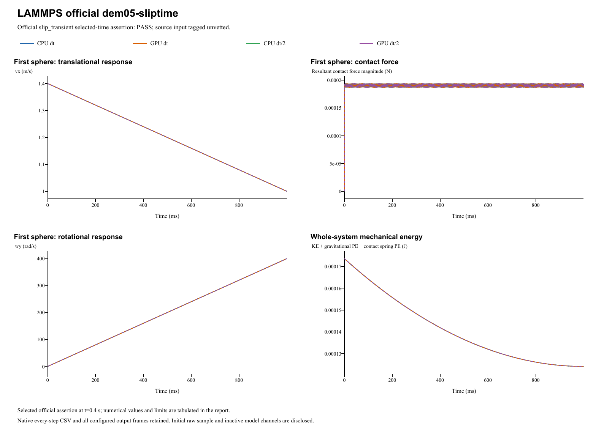

# LAMMPS official dem05-sliptime

**Frictional sliding and spin before rolling starts**  
Date: 29 October 2026. Four main runs: **PASS**. Official input tag: `unvetted`.

## Source and official acceptance

[Pinned official YAML](https://github.com/lammps/lammps/blob/29dd3fd7642a6fe9e8b4dd99120df4068b221250/unittest/granular/tests/dem05-sliptime-3d-si.yaml) | [Analytic checker](https://github.com/lammps/lammps/blob/29dd3fd7642a6fe9e8b4dd99120df4068b221250/unittest/granular/test_analytic_models.cpp). Commit 29dd3fd7642a6fe9e8b4dd99120df4068b221250; input blob 20f0a60a7ead5d669a420f48008aae1fd26fe928. LAMMPS was not rerun locally. The YAML's same-code epsilon is not a cross-software tolerance.

Model `slip_transient` is evaluated at original step 40000 and time 0.4s. Half-step runs use twice the native check step at the same physical time. The exact reference, relative/absolute error type and unchanged limit are listed separately for each quantity. Whole histories and source golden states supplement these selected-time assertions.

| Run | Quantity | Reference | Native value | Error type | Error | Limit | Result |
|---|---|---:|---:|---|---:|---:|---|
| CPU dt | Sliding vx (m/s) | 1.24 | 1.24000196289 | relative | 1.58297653426e-06 | 0.01 | PASS |
| CPU dt | Sliding omega_y (rad/s) | 160 | 159.996905954 | relative | 1.93377878995e-05 | 0.01 | PASS |
| GPU dt | Sliding vx (m/s) | 1.24 | 1.24000196289 | relative | 1.58297716781e-06 | 0.01 | PASS |
| GPU dt | Sliding omega_y (rad/s) | 160 | 159.996905953 | relative | 1.93377928463e-05 | 0.01 | PASS |
| CPU dt/2 | Sliding vx (m/s) | 1.24 | 1.24000145496 | relative | 1.1733511648e-06 | 0.01 | PASS |
| CPU dt/2 | Sliding omega_y (rad/s) | 160 | 159.997413889 | relative | 1.61631921143e-05 | 0.01 | PASS |
| GPU dt/2 | Sliding vx (m/s) | 1.24 | 1.24000145496 | relative | 1.17335294151e-06 | 0.01 | PASS |
| GPU dt/2 | Sliding omega_y (rad/s) | 160 | 159.997413887 | relative | 1.6163205679e-05 | 0.01 | PASS |

## Inputs and constitutive mapping

- sphere: R=0.0025 m; position=(0, 0, 0.002499982) m; velocity=(1.4, 0, 0) m/s; spin=(0, 0, 0) rad/s.

- sphere: mass=0.000176714586764 kg; isotropic inertia=4.41786466911e-10 kg m^2.

Linear Hooke Fn_elastic=kn*delta, kn=10000 N/m. Automatic damping uses the harmonic material restitution and the active normal/tangential stiffness; stored manual dashpots are inactive. Tangential inputs: kt=2800 N/m (explicit in linear mode), mu=0.4. Rolling/twist coefficients: kr=0, mu_r=0, ktwist=0, mu_twist=0. Source wall spin-slip and torque use R; native uses the shared contact point at R-delta. Maximum source/native contact-speed difference is 7.198e-06 m/s; torque-arm difference is 1.8e-08 m. Official selected-time acceptance does not imply pointwise kinematic identity.

Gravity=(0, 0, -1)m/s^2. Base/half dt=1e-05/5e-06s; base/half numerical steps=100000/200000. Initial poses, velocities and physical source coefficients are preserved. The parameter mapping translates the source model's coefficient definitions; it does not fit measured native results.

- Source periodic x/y do not affect contact dynamics. Map saved x coordinates modulo original periodic box length0.55m for checkpoint comparison. Source ceiling atz=1m remains inactive but is retained.

Native specification (retained locally; not included) | Parameter mapping (retained locally; not included) | Configuration round-trip (retained locally; not included)

## CPU/GPU and timestep refinement

| Quantity | CPU dt error | CPU dt/2 error | Error type and limit |
|---|---:|---:|---|
| Sliding vx (m/s) | 1.583e-06 | 1.1734e-06 | relative: 0.01 |
| Sliding omega_y (rad/s) | 1.9338e-05 | 1.6163e-05 | relative: 0.01 |

CPU/GPU whole-history maximum position / velocity / spin / force differences: 2.72e-14 m / 2.65e-11 m/s / 1.06e-08 rad/s / 3.55e-11 N.

Maximum individual impulse / position-drift / velocity-kick residuals: 1.1e-17 kg m/s / 1.11e-16 m / 6.21e-14 m/s. Gravity is added separately to saved native contact forces.

Raw eventStart samples precede initialization and retain zero force/contact placeholders. Physical geometric preloads are used only for derived bootstrap/impulse audits; native initialization supplies the actual first half-kick. No raw results or initial velocities were changed.

Energy histories are supplemental unless selected by the official analytic model. Wall/gravity cases exchange external momentum; total sphere momentum is not assumed conserved. The step-refinement table reports each error directly, without imposing monotonic convergence.

## Complete retained results

All 4,004 native output frames, every integration-step particle/contact CSV, projects, raw initial samples and backend logs are retained. Native output cadence is distinct from integration dt; exact counts/intervals are in the analysis and archive manifests. The four primary frame counts are [1001, 1001, 1001, 1001]. 0additional diagnostic run is retained.

- **CPU dt** (main CPU/GPU/time-step comparison): loadable project (retained locally; not included), complete native result (retained locally; not included); 100,000 integration steps, 1,001 stored frames.
- **GPU dt** (main CPU/GPU/time-step comparison): loadable project (retained locally; not included), complete native result (retained locally; not included); 100,000 integration steps, 1,001 stored frames.
- **CPU dt/2** (main CPU/GPU/time-step comparison): loadable project (retained locally; not included), complete native result (retained locally; not included); 200,000 integration steps, 1,001 stored frames.
- **GPU dt/2** (main CPU/GPU/time-step comparison): loadable project (retained locally; not included), complete native result (retained locally; not included); 200,000 integration steps, 1,001 stored frames.

Analysis JSON (retained locally; not included) | Official metrics CSV (retained locally; not included) | Source checkpoints (retained locally; not included) | Independent physics audit (retained locally; not included) | Run manifest (retained locally; not included) | Full native ZIP (retained locally; not included) | Frame/hash audit (retained locally; not included)

Source checkpoint states are supplemental regression diagnostics. Their differences are reported directly; the YAML same-code epsilon is not imposed as an independent cross-software acceptance limit.

A stable helper executable is statically linked to the current native CPU/CUDA libraries. Historical GUI/library byte identity is not asserted. Existing case reports and records are unchanged. Verified scope follows the active source model and the criteria above; a passing inactive channel does not validate every option of its contact family.
