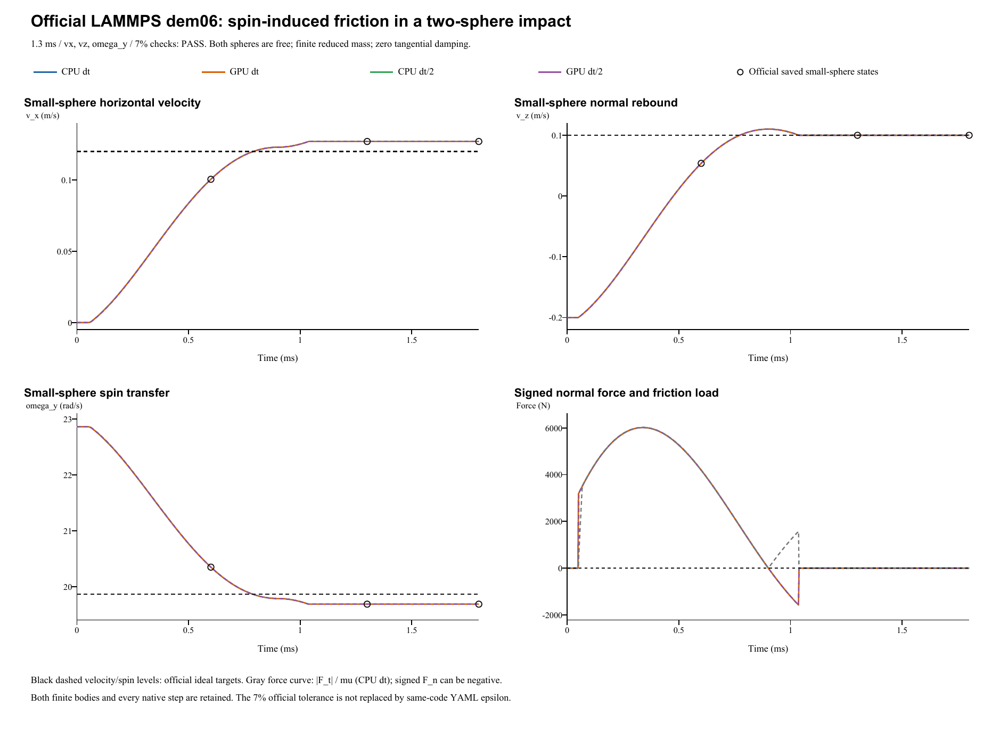

# Spinning two-sphere impact: verification report

**Case:** LAMMPS official dem06-hookehistory-spin-3d-si  
**Date:** 28 October 2026  
**Outcome: PASS.** 4 of 4 runs pass all three official 7% checks at 1.3 ms.

## Official reference and unchanged inputs

The reference is the [official LAMMPS YAML and golden states](https://github.com/lammps/lammps/blob/f9720ce2d176d615495d1d6c31349b1f71be1c73/unittest/granular/tests/dem06-hookehistory-spin-3d-si.yaml), pinned to commit f9720ce2d176d615495d1d6c31349b1f71be1c73. The local YAML Git blob is d1cc7b040decc016ec05e95b5e0dc2e283406434. LAMMPS was not rerun locally. Comparisons use the pinned saved states, the [official analytic checker](https://github.com/lammps/lammps/blob/f9720ce2d176d615495d1d6c31349b1f71be1c73/unittest/granular/test_analytic_models.cpp), and independent force/impulse checks.

| Quantity | Official input / FunDEM configuration |
|---|---|
| Small sphere | Radius 0.1 m; density 2700 kg/m^3 |
| Large sphere | Radius 0.5 m; density 2.7e6 kg/m^3; mass ratio 125000 |
| Initial centers | Small: (0, 0, 0.60001) m; large: (0, 0, 0) m |
| Initial translation | Small: (0, 0, -0.2) m/s; large: zero |
| Initial spin | Small omega = (0, 22.86, 0) rad/s; large: zero |
| Normal / tangential model | Hooke / linear_history; kn = 1.2e8 N/m; kt = 3.4e7 N/m |
| Restitution / sliding friction | e = 0.5; mu = 0.40 |
| Small / large mass | 11.3097335529 / 1413716.69412 kg |
| Reduced mass | 11.3096430758 kg |
| Explicit damping | cn = 15874.4669065 N s/m; ct = cr = ctorsion = 0 |
| Other forces / constraints | No gravity, wall or global damping; both spheres free; rolling/torsional resistance = 0 |
| Base step / official segments | dt = 1e-6 s; 600 + 700 + 500 = 1800 steps |
| Refined run | dt = 5e-7 s; 3600 steps; same 1.8 ms endpoint |
| Output | Every integration step, including t = 0 |

The large sphere is a finite, freely moving partner, not a fixed wall. Its small recoil and spin are retained. Both radii, solid-sphere inertias and densities remain at the official values.

FunDEM uses explicit linear normal and tangential stiffnesses. Its material elastic schema fields are inactive in this mode; they are not additional official material constants. Normal damping is derived without fitting from the full two-particle reduced mass:

    m* = m_small m_large / (m_small + m_large)
    beta = -ln(e) / sqrt(pi^2 + ln(e)^2)
    cn = 2 beta sqrt(m* kn)
    ct = cr = ctorsion = 0

The explicit damping override preserves the official zero tangential damping. **This case does not validate automatic tangential damping or automatic Hooke damping.** The official consecutive segments are represented by one uninterrupted native event. No physical parameter or contact solver law was changed to improve agreement.

## Spin-induced friction and official acceptance

The small sphere initially has zero horizontal translation and positive spin. The contact surface slip generates positive horizontal friction and a negative y torque: translation increases while the initial spin decays.

The official spin_impact checker uses the gross-sliding, heavy-partner approximation:

    Jn = m_small (1 + e) vin
    Jt = mu Jn
    vx_out = mu (1 + e) vin = 0.12 m/s
    vz_out = e vin = 0.10 m/s
    omega_y_out = omega0 - (5/2) mu (1 + e) vin / R_small
                = 19.86 rad/s

The official acceptance point is cumulative step **1300 = 1.3 ms**, the end of segment 1 (zero-based). It checks **vx, vz and omega_y separately with 7% relative tolerance**. The 1.8 ms endpoint is an additional diagnostic, not a replacement checkpoint. This case's official tolerance is 7%; the YAML regression epsilon 1e-10 is not a universal cross-code tolerance.

| Run | vx (m/s) | vx error (%) | vz (m/s) | vz error (%) | omega_y (rad/s) | Spin error (%) | All official 7% |
|---|---:|---:|---:|---:|---:|---:|---|
| CPU dt | 0.12706942 | 5.89118 | 0.09986565 | 0.13435 | 19.6839496 | 0.88646 | PASS |
| GPU dt | 0.12706942 | 5.89118 | 0.09986565 | 0.13435 | 19.6839496 | 0.88646 | PASS |
| CPU dt/2 | 0.12705825 | 5.88188 | 0.10004190 | 0.04190 | 19.6842301 | 0.88504 | PASS |
| GPU dt/2 | 0.12705825 | 5.88188 | 0.10004190 | 0.04190 | 19.6842301 | 0.88504 | PASS |

The pinned official golden state at 1.3 ms is small-sphere vx = 0.12706938882175314 m/s, vz = 0.099865657293162532 m/s and omega_y = 19.683950332657247 rad/s. These detailed numerical reference values differ from the checker's simplified analytic targets. Golden-state comparisons are recorded separately; targets and acceptance limits are unchanged.

## Independent force, impulse and momentum checks

Both finite spheres translate and rotate freely; total angular momentum includes orbital and spin contributions of both bodies.

The negative signed normal-force tail is retained. Its absolute magnitude sets the friction cap, increasing available tangential impulse; early uncapped history offsets part of this increase.

The horizontal-impulse difference from the ideal formula is decomposed into signed normal impulse, tensile-tail cap, history buildup, and changing normal/tangent directions.

Pair friction torque arms Ri-delta/2 agree. LAMMPS uses nominal radii for rotational slip; FunDEM uses the actual shared point. General rotating-history algorithms also differ.

Official 7% component tests and pinned stored-state comparisons are reported separately. Explicit cn maps e=0.5 with finite reduced mass; ct is exactly zero.

Base CPU: signed / absolute normal impulse = 3.39143829 / 3.61950266 N s; absolute load is 6.7247% larger. Tangential x impulse = 1.43705473 N s; 18 early uncapped samples reduce the realized friction impulse. Across all four runs, slip stays negative; minimum magnitude = 1.841472 m/s.

The measured small-sphere angular impulse is -0.143681134 N m s. Maximum total linear / angular momentum drifts across four runs are 1.88e-14 kg m/s / 1.89e-14 kg m^2/s, including both bodies and orbital momentum.

CPU/GPU maximum velocity / spin differences are 1.17e-14 m/s / 1.56e-13 rad/s. Halving dt changes checked CPU vx, vz and spin by 1.12e-05 m/s, 0.000176 m/s and 0.00028 rad/s. The approximately 5.9% vx gap to the simplified analytic target remains.

| Run | Signed normal impulse (N s) | Absolute normal impulse (N s) | Tangential x impulse (N s) | Small angular impulse y (N m s) |
|---|---:|---:|---:|---:|
| CPU dt | 3.391438290 | 3.619502657 | 1.437054733 | -0.143681134 |
| GPU dt | 3.391438290 | 3.619502657 | 1.437054733 | -0.143681134 |
| CPU dt/2 | 3.393431569 | 3.620359809 | 1.436928418 | -0.143668446 |
| GPU dt/2 | 3.393431569 | 3.620359809 | 1.436928418 | -0.143668446 |

Signed normal force and the absolute normal load used by the Coulomb cap are kept separate. A negative normal-force unloading tail is possible for the official un-clipped damped contact. Both particles' forces, torques, recoil and spin must be included in impulse and total momentum checks. Tangential contact resistance is distinct from an additional rolling or torsional torque; the latter is zero in this case.

Both codes use geometric pair-force torque arms a_i = R_i - delta/2 for this sphere-sphere contact. Their surface-velocity conventions differ: LAMMPS uses nominal R_i times spin in the tangential contact velocity, while FunDEM uses the shared contact-point arms. Their tangential-history transport also differs. The source audit keeps those distinctions separate; this diagnostic does not replace official targets, redefine radii or adjust solid-sphere inertias.

Verified analysis JSON (retained locally; not included) | Every-step impulse and momentum CSV (retained locally; not included) | Official checkpoint CSV (retained locally; not included) | [Contact-model audit](../tools/dem06-contact-audit.md)

## Complete retained results and scope

All four complete native result directories are retained with native run.json, project.json, frames/contact records, input projects, every-step CSVs, audits and backend logs. The base-step runs contain **1801 frames each**; the half-step runs contain **3601 frames each**: **10,804 native frames** total.

- **CPU dt**: input project (retained locally; not included), complete native result (retained locally; not included); 1,800 steps / 1,801 native frames.
- **GPU dt**: input project (retained locally; not included), complete native result (retained locally; not included); 1,800 steps / 1,801 native frames.
- **CPU dt/2**: input project (retained locally; not included), complete native result (retained locally; not included); 3,600 steps / 3,601 native frames.
- **GPU dt/2**: input project (retained locally; not included), complete native result (retained locally; not included); 3,600 steps / 3,601 native frames.

Run manifest (retained locally; not included) | Parameter mapping (retained locally; not included) | Configuration audit (retained locally; not included) | Full native archive ZIP (retained locally; not included)

The helper advances the real FunDEM SimulationSession using linked **0.4.3 CPU/CUDA native libraries**. It is not a separate impact integrator. The test does not establish byte identity with the installed GUI executable.

**Verified scope:** spin-induced tangential friction, spin-to-translation transfer, ordinary friction torque and two-body momentum balance in a free, strongly unequal two-sphere collision. This is distinct from torsion about the contact normal. Rolling/torsional resistance, nonzero tangential damping, sustained sticking and many-particle flows require separate cases.
