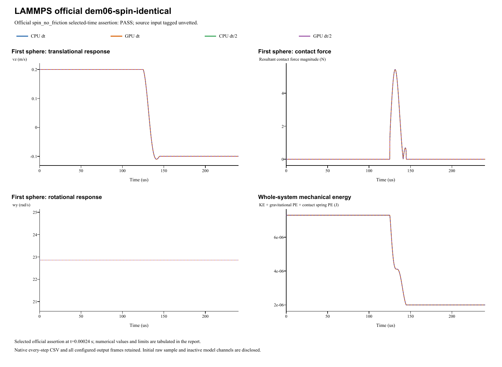

# LAMMPS official dem06-spin-identical

**Spin preservation with friction inactive**  
Date: 29 October 2026. Four main runs: **PASS**. Official input tag: `unvetted`.

## Source and official acceptance

[Pinned official YAML](https://github.com/lammps/lammps/blob/29dd3fd7642a6fe9e8b4dd99120df4068b221250/unittest/granular/tests/dem06-spin-identical-3d-si.yaml) | [Analytic checker](https://github.com/lammps/lammps/blob/29dd3fd7642a6fe9e8b4dd99120df4068b221250/unittest/granular/test_analytic_models.cpp). Commit 29dd3fd7642a6fe9e8b4dd99120df4068b221250; input blob 97f00c537ce8d677399d1fc390e6e5f70605c32f. LAMMPS was not rerun locally. The YAML's same-code epsilon is not a cross-software tolerance.

Model `spin_no_friction` is evaluated at original step 2400 and time 0.00024s. Half-step runs use twice the native check step at the same physical time. The exact reference, relative/absolute error type and unchanged limit are listed separately for each quantity. Whole histories and source golden states supplement these selected-time assertions.

| Run | Quantity | Reference | Native value | Error type | Error | Limit | Result |
|---|---|---:|---:|---|---:|---:|---|
| CPU dt | Preserved omega_y (rad/s) | 22.86 | 22.86 | relative | 0 | 1e-08 | PASS |
| CPU dt | Spurious vx (m/s) | 0 | 0 | absolute | 0 | 1e-08 | PASS |
| CPU dt | Spurious vy (m/s) | 0 | 0 | absolute | 0 | 1e-08 | PASS |
| GPU dt | Preserved omega_y (rad/s) | 22.86 | 22.86 | relative | 0 | 1e-08 | PASS |
| GPU dt | Spurious vx (m/s) | 0 | 0 | absolute | 0 | 1e-08 | PASS |
| GPU dt | Spurious vy (m/s) | 0 | 0 | absolute | 0 | 1e-08 | PASS |
| CPU dt/2 | Preserved omega_y (rad/s) | 22.86 | 22.86 | relative | 0 | 1e-08 | PASS |
| CPU dt/2 | Spurious vx (m/s) | 0 | 0 | absolute | 0 | 1e-08 | PASS |
| CPU dt/2 | Spurious vy (m/s) | 0 | 0 | absolute | 0 | 1e-08 | PASS |
| GPU dt/2 | Preserved omega_y (rad/s) | 22.86 | 22.86 | relative | 0 | 1e-08 | PASS |
| GPU dt/2 | Spurious vx (m/s) | 0 | 0 | absolute | 0 | 1e-08 | PASS |
| GPU dt/2 | Spurious vy (m/s) | 0 | 0 | absolute | 0 | 1e-08 | PASS |

## Inputs and constitutive mapping

- lower: R=0.0025 m; position=(0, 0, -0.002525) m; velocity=(0, 0, 0.2) m/s; spin=(0, 22.86, 0) rad/s.
- upper: R=0.0025 m; position=(0, 0, 0.002525) m; velocity=(0, 0, -0.2) m/s; spin=(0, -22.86, 0) rad/s.

- lower: mass=0.000176714586764 kg; isotropic inertia=4.41786466911e-10 kg m^2.
- upper: mass=0.000176714586764 kg; isotropic inertia=4.41786466911e-10 kg m^2.

Hertz Fn_elastic=(4/3)*E_eff*sqrt(R_eff)*delta^1.5; native E_eff=3.927729772e+10 Pa. Stored linear kn is inactive. Automatic damping uses the harmonic material restitution and the active normal/tangential stiffness; stored manual dashpots are inactive. Tangential inputs: kt=0 N/m (explicit in linear mode), mu=0.4. Rolling/twist coefficients: kr=0, mu_r=0, ktwist=0, mu_twist=0.

Gravity=(0, 0, 0)m/s^2. Base/half dt=1e-07/5e-08s; base/half numerical steps=2400/4800. Initial poses, velocities and physical source coefficients are preserved. The parameter mapping translates the source model's coefficient definitions; it does not fit measured native results.

- Equal opposite spins make relative tangential contact velocity exactly zero. The configured nonzero friction is retained; this is a zero-tangential-channel regression, not validation of active tangential dashpot equivalence.

Native specification (retained locally; not included) | Parameter mapping (retained locally; not included) | Configuration round-trip (retained locally; not included)

## CPU/GPU and timestep refinement

| Quantity | CPU dt error | CPU dt/2 error | Error type and limit |
|---|---:|---:|---|
| Preserved omega_y (rad/s) | 0 | 0 | relative: 1e-08 |
| Spurious vx (m/s) | 0 | 0 | absolute: 1e-08 |
| Spurious vy (m/s) | 0 | 0 | absolute: 1e-08 |

CPU/GPU whole-history maximum position / velocity / spin / force differences: 0 m / 4.34e-19 m/s / 0 rad/s / 8.88e-16 N.

Maximum individual impulse / position-drift / velocity-kick residuals: 4.07e-20 kg m/s / 2.17e-19 m / 2.52e-17 m/s. Gravity is added separately to saved native contact forces.

Energy histories are supplemental unless selected by the official analytic model. Wall/gravity cases exchange external momentum; total sphere momentum is not assumed conserved. The step-refinement table reports each error directly, without imposing monotonic convergence.

## Complete retained results

All 14,404 native output frames, every integration-step particle/contact CSV, projects, raw initial samples and backend logs are retained. Native output cadence is distinct from integration dt; exact counts/intervals are in the analysis and archive manifests. The four primary frame counts are [2401, 2401, 4801, 4801]. 0additional diagnostic run is retained.

- **CPU dt** (main CPU/GPU/time-step comparison): loadable project (retained locally; not included), complete native result (retained locally; not included); 2,400 integration steps, 2,401 stored frames.
- **GPU dt** (main CPU/GPU/time-step comparison): loadable project (retained locally; not included), complete native result (retained locally; not included); 2,400 integration steps, 2,401 stored frames.
- **CPU dt/2** (main CPU/GPU/time-step comparison): loadable project (retained locally; not included), complete native result (retained locally; not included); 4,800 integration steps, 4,801 stored frames.
- **GPU dt/2** (main CPU/GPU/time-step comparison): loadable project (retained locally; not included), complete native result (retained locally; not included); 4,800 integration steps, 4,801 stored frames.

Analysis JSON (retained locally; not included) | Official metrics CSV (retained locally; not included) | Source checkpoints (retained locally; not included) | Independent physics audit (retained locally; not included) | Run manifest (retained locally; not included) | Full native ZIP (retained locally; not included) | Frame/hash audit (retained locally; not included)

Source checkpoint states are supplemental regression diagnostics. Their differences are reported directly; the YAML same-code epsilon is not imposed as an independent cross-software acceptance limit.

A stable helper executable is statically linked to the current native CPU/CUDA libraries. Historical GUI/library byte identity is not asserted. Existing case reports and records are unchanged. Verified scope follows the active source model and the criteria above; a passing inactive channel does not validate every option of its contact family.
