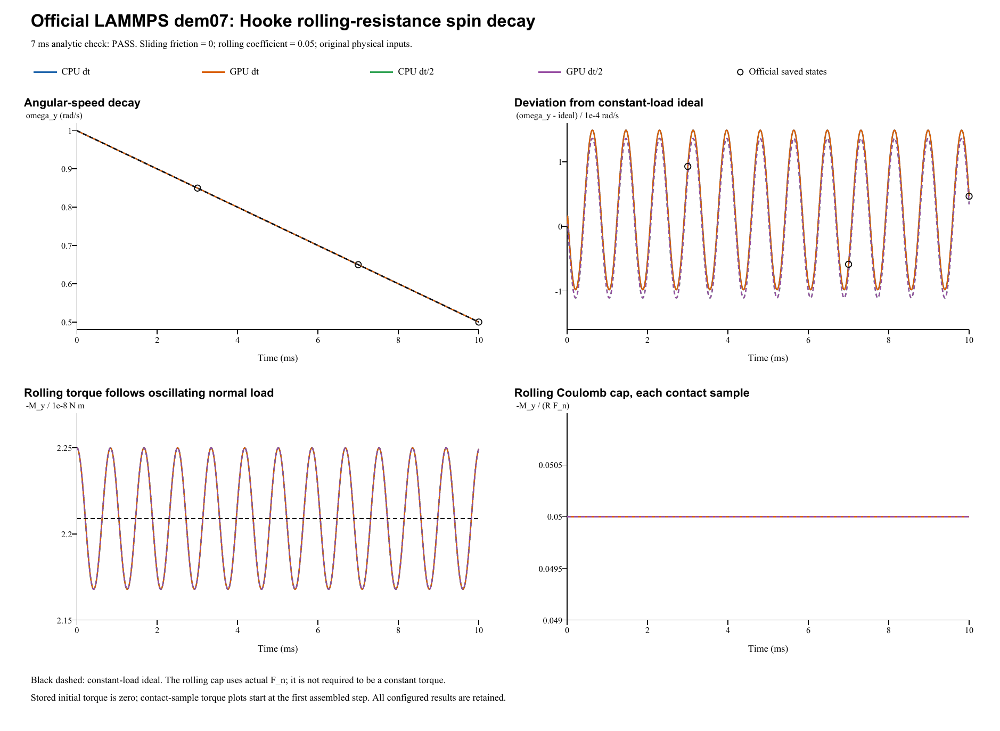

# Rolling resistance: verification report

**Case:** LAMMPS official dem07-hooke-rolling-3d-si  
**Date:** 28 October 2026  
**Outcome: PASS.** All four runs pass the official 1% spin check at 7 ms.

## Official reference and unchanged inputs

The reference is the [official LAMMPS YAML and saved states](https://github.com/lammps/lammps/blob/f9720ce2d176d615495d1d6c31349b1f71be1c73/unittest/granular/tests/dem07-hooke-rolling-3d-si.yaml), pinned to commit f9720ce2d176d615495d1d6c31349b1f71be1c73. The input Git blob is 70c8d8237edc01e7b207a9a1724b416118e179b0. The [official analytic checker](https://github.com/lammps/lammps/blob/f9720ce2d176d615495d1d6c31349b1f71be1c73/unittest/granular/test_analytic_models.cpp) uses rolling_decay with a **1% relative tolerance at cumulative step 7000 (7 ms)**, the end of the second segment. The 10 ms final state is an additional diagnostic, not a replacement acceptance point. LAMMPS was not rerun locally. The YAML regression epsilon 1e-10 is not a universal cross-code tolerance.

| Quantity | Official input / FunDEM configuration |
|---|---|
| Sphere diameter; density | 0.005 m; 2700 kg/m^3 |
| Mass; solid-sphere inertia | 0.000176714586764 kg; 4.41786466911e-10 kg m^2 |
| Initial center; translation | (0, 0, 0.002499982) m; zero translation |
| Initial angular velocity | (0, 1, 0) rad/s |
| Wall; gravity | Fixed plane z = 0; g = 1 m/s^2 downward |
| Normal model; stiffness | Hooke; kn = 10000 N/m |
| Sliding channel | Zero sliding stiffness, damping and friction |
| Rolling channel | Spring-dashpot-slider; kr = 10000 N/m, damping = 0, mu_r = 0.05 |
| Restitution; torsion; global damping | e = 1; torsional resistance = 0; global damping = 0 |
| Time step; duration | dt = 1e-6 s; 10000 steps; 0.01 s |
| Official segments | 3000 + 4000 + 3000 steps; unchanged continuous motion |
| Refined run | dt = 5e-7 s; 20000 steps; same 0.01 s endpoint |
| Native saved result | Every 10 us including both endpoints; 1001 frames per run |
| Detailed trajectory | Every integration step in CSV |

FunDEM uses explicit linear normal/rolling stiffness and zero tangential stiffness: linearStiffnessEnabled = true with kn = 10000, ks = 0, kr = 10000 and ktorsion = 0 N/m. The official Hooke input does not specify E or Poisson ratio. Any FunDEM material entries E = 1e4 Pa and Poisson ratio = 0.33 are inactive schema placeholders; they do not determine these explicit stiffnesses. Automatic contact damping is zero because e = 1. Initial geometry, coefficients and inertia are unchanged. The isolated sphere remains in place horizontally, so the official periodic x/y boundaries do not affect this test. The native helper advances the real FunDEM SimulationSession using linked CPU/CUDA libraries, without solver edits or fitting.

## Analytic target and results

For a solid sphere, I = (2/5) m R^2. In the Coulomb-capped rolling regime, the resisting torque has magnitude **mu_r R N**, opposite the rolling angular velocity. With the ideal normal load N = mg:

    M_ideal = mu_r R m g
    d(omega_y)/dt = -M_ideal/I = -(5 mu_r g)/(2 R) = -50 rad/s^2
    omega_y(t) = 1 - 50 t

Thus the official analytic target is **omega_y(7 ms) = 0.65 rad/s**. The ideal 10 ms diagnostic target is **0.5 rad/s**. The corresponding ideal load torque is **2.20893233456e-08 N m**.

| Run | dt (s) | Steps / native frames | omega_y at 7 ms (rad/s) | Official error (%) | omega_y at 10 ms (rad/s) | Official check |
|---|---:|---:|---:|---:|---:|---|
| CPU dt | 1e-06 | 10,000 / 1,001 | 0.6499413004 | 0.009031 | 0.5000467081 | PASS |
| GPU dt | 1e-06 | 10,000 / 1,001 | 0.6499413004 | 0.009031 | 0.5000467081 | PASS |
| CPU dt/2 | 5e-07 | 20,000 / 1,001 | 0.6499285592 | 0.010991 | 0.5000339920 | PASS |
| GPU dt/2 | 5e-07 | 20,000 / 1,001 | 0.6499285592 | 0.010991 | 0.5000339920 | PASS |

The source YAML saved values are 0.850092821878919 rad/s at 3 ms, 0.649941300447990 rad/s at 7 ms and 0.500046708120960 rad/s at 10 ms. The official acceptance criterion compares the 7 ms value to 0.65; golden-state comparisons are retained separately. Inputs and criteria were not changed after inspecting results.

## Rolling-torque evidence and numerical comparisons

The normal load is not perfectly constant: the initial overlap is 18 nm, close to but not exactly mg/kn. With zero normal damping, small vertical oscillations remain. The rolling history starts from zero; the first stepped state in this configuration already reaches its Coulomb cap. Therefore, the native torque should follow its spring/cap law and the instantaneous load; it is not required to equal a constant mu_r R mg at every step.

After the initial zero-torque state, native resisting torque follows -mu_r R F_n using the instantaneous normal force. The small initial height offset causes about 1.86% normal-force oscillation; the constant-load angular-speed line is an approximation. The initial rolling history is zero. Full-step angular velocity agrees with the trapezoidal integral of rolling torque. At 7 ms, dt refinement need not monotonically reduce distance to the constant-load target because normal-load oscillations remain physical. CPU/GPU spin histories agree exactly. Max. torque-coefficient error is 6.94e-18; angular-impulse residual is 1.1e-16 rad/s. Halving dt changes omega_y at 7 ms by 1.27e-05 rad/s. Rolling uses R; the dem05 force arm R-delta is inactive because Ft = 0.

Verified analysis JSON (retained locally; not included) | Checkpoint comparisons (retained locally; not included) | [Rolling-contact source audit](../tools/dem07-contact-audit.md)

## Complete retained results

All configured native result frames and contact records are preserved, with run.json, project.json, input projects, audits, backend logs and per-step trajectory CSVs.

- **CPU dt**: input project (retained locally; not included), complete native result (retained locally; not included); 10,000 integration steps, 1,001 configured result frames.
- **GPU dt**: input project (retained locally; not included), complete native result (retained locally; not included); 10,000 integration steps, 1,001 configured result frames.
- **CPU dt/2**: input project (retained locally; not included), complete native result (retained locally; not included); 20,000 integration steps, 1,001 configured result frames.
- **GPU dt/2**: input project (retained locally; not included), complete native result (retained locally; not included); 20,000 integration steps, 1,001 configured result frames.

Each run has **1001 native frames**, saved every 10 us: every 10 base-dt steps or 20 half-dt steps. This retains every configured result frame. The CSV separately retains every integration step, including t = 0. A native result frame was not written at every integration step.

Run manifest (retained locally; not included) | Native archive ZIP (retained locally; not included)

**Scope:** this case checks rolling resistance about a tangential axis, its capped torque and sphere spin decay on a plane. Sliding friction is zero. It does not validate torsional friction, a rolling sphere with nonzero translation, or many-particle flows. CPU/GPU agreement and timestep refinement are numerical evidence, while the official 7 ms criterion determines pass/fail. Linked native libraries were tested; byte identity with the installed GUI executable was not established.
