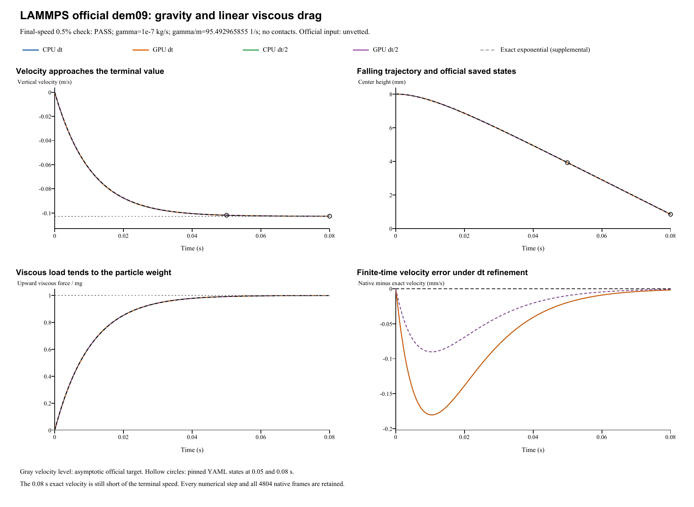

# Linear viscous drag and terminal speed

**Case:** LAMMPS official dem09-viscous-linear  
**Date:** 29 October 2026  
**Official input qualification:** tagged `granular unvetted`  
**Outcome: PASS.** The final falling speed is compared with the official asymptotic terminal-speed target.

## Official source and exact native parameter mapping

The [official input](https://github.com/lammps/lammps/blob/29dd3fd7642a6fe9e8b4dd99120df4068b221250/unittest/granular/tests/dem09-viscous-linear-3d-si.yaml) is pinned to commit 29dd3fd7642a6fe9e8b4dd99120df4068b221250, Git blob c1948eb56cac61f1c6159fc060d7d191c1ab897c; [official analytic checker](https://github.com/lammps/lammps/blob/29dd3fd7642a6fe9e8b4dd99120df4068b221250/unittest/granular/test_analytic_models.cpp). LAMMPS was not rerun locally. This newer official input is outside the unchanged historical 24-input source catalog, like dem13; both carry `unvetted`. The [source and force-channel audit](../tools/dem09-viscous-linear-contact-audit.md) retains the primary evidence.

| Quantity | Official / native value |
|---|---|
| Particle | R=5e-5 m, density=2000 kg/m^3; m=1.0471975512e-09 kg |
| Initial state | Center=(0,0,0.008) m; zero velocity and spin |
| Gravity | (0,0,-9.81) m/s^2 throughout |
| External viscous drag | F_drag=-gamma v; gamma=1e-7 kg/s |
| Native particle-damping module | dampingRate=gamma/m=95.4929658551 1/s; target sphere; rotationalDragCoefficient=0 |
| Contacts / other forces | No contacts, walls, other particles or active SPH forces; inactive contact-material fields do not set the drag |
| Time | Official dt=1e-4 s; 500+300=800 steps to 0.08 s. Half-step=5e-5 s; 1600 steps |
| Full native outputs | Every numerical step including t=0: 801/801/1601/1601 frames, total 4804 |

The module rate has units **1/s**, while the official gamma has units **kg/s**. Exact conversion gamma=m*dampingRate preserves the applied force. This is external body drag, separate from contact restitution damping. No coefficient was fitted and no solver source was changed. The native saved `force` channel contains the actual drag force; gravity is added separately by the integrator. Contacts, transverse velocity, torque and spin remain zero.

## Official assertion: asymptotic terminal speed at the finite endpoint

The pinned `terminal_velocity_linear` assertion evaluates at final step 800=0.08 s:

    V_infinity = m g / gamma = 0.102730079772 m/s
    relative_error = abs((-vz)/V_infinity - 1)
    relative_error <= 0.005   (0.5%)

It does **not** substitute the finite-time exponential speed for V_infinity. The finite-time exact 0.08 s speed is 0.102680656423 m/s. Its remaining difference from the asymptote is physical, even with exact time integration. Source epsilon=1e-10 is same-code saved-state regression precision, not the cross-software analytic tolerance.

| Run | Final falling speed -vz (m/s) | Official relative error (%) | Final z (m) | Official 0.5% assertion |
|---|---:|---:|---:|---|
| CPU dt | 0.10268243674 | 0.0463769 | 0.0008517475 | PASS |
| GPU dt | 0.10268243674 | 0.0463769 | 0.0008517475 | PASS |
| CPU dt/2 | 0.10268155218 | 0.0472380 | 0.0008543053 | PASS |
| GPU dt/2 | 0.10268155218 | 0.0472380 | 0.0008543053 | PASS |

## Supplemental finite-time trajectory and drag reconstruction

For initial rest, define lambda=gamma/m and tau=m/gamma=0.010471975512 s:

    vz(t) = -V_infinity [1-exp(-lambda t)]
    z(t) = z0 - V_infinity [t-tau(1-exp(-lambda t))]

All native numerical steps are compared with these unfitted continuous solutions. The original LAMMPS run splits at 500 steps and recomputes forces during the second setup; FunDEM executes one continuous 800-step event. Golden states at 0.05/0.08 s are retained as separate diagnostics, without changing the official terminal-speed target or fitting the native trajectory.

Force assembly uses a half-step velocity. Remove the final half-kick, including gravity, before comparing drag or inferring gamma:

    v_assembly = v_saved - (dt/2)(F_native/m + g_vector)
    F_native = -gamma v_assembly
    gamma_inferred = -F_native,z / v_assembly,z

Near-zero velocity samples are excluded from coefficient division; direct force reconstruction and the native drift/kick recurrence are checked independently. The scalar gamma is inferred from native states rather than read from a separate force-coefficient channel.

| Run | Inferred gamma (kg/s) | Max drag-law residual (N) | Max finite-time velocity error (m/s) | Max relative work-energy residual (%) |
|---|---:|---:|---:|---:|
| CPU dt | 1e-07 | 1.7e-24 | 0.0001803 | 0.032073 |
| GPU dt | 1e-07 | 1.7e-24 | 0.0001803 | 0.032073 |
| CPU dt/2 | 1e-07 | 1.7e-24 | 9.019e-05 | 0.016036 |
| GPU dt/2 | 1e-07 | 1.7e-24 | 9.019e-05 | 0.016036 |

CPU/GPU whole-history maximum position / velocity / force differences are 1.73e-18 m / 2.78e-17 m/s / 3.31e-24 N.

Halving dt reduces whole-history finite-time velocity / position errors by factors 1.99920 / 2.00006. The official asymptotic-speed error increases slightly, from 0.0463769% to 0.0472380%. The references differ: the exact 0.08 s speed remains below its infinite-time limit.

Maximum gravity-plus-drag impulse residual is 8.01e-25 kg m/s. Native force is drag only; gravity must be added for total impulse. Mechanical energy falls through viscous dissipation; energy conservation is not the assertion.

Mechanical energy is E=mv^2/2+mgz; dissipation rate is gamma*|v_assembly|^2. The work-energy diagnostic compares E(t)+integral(gamma*v_assembly^2 dt) with E(0), retaining numerical quadrature residuals. Particle momentum changes under external gravity and drag. This case does not assert energy or isolated particle momentum conservation.

Analysis JSON (retained locally; not included) | Official/golden checkpoints (retained locally; not included) | Energy-force history (retained locally; not included) | Drag reconstruction (retained locally; not included) | Independent physics audit (retained locally; not included)

## Complete retained results and scope

All four new runs use real FunDEM SimulationSession linked to FunDEMSoftware 0.4.3 CPU/CUDA native libraries; installed GUI executable byte identity is not established. All 4804 configured native frames, every-step particle CSV, empty contact CSVs, four loadable projects and backend logs are retained.

- **CPU dt**: input project (retained locally; not included), complete native result (retained locally; not included); 800 steps, 801 initial-inclusive native frames.
- **GPU dt**: input project (retained locally; not included), complete native result (retained locally; not included); 800 steps, 801 initial-inclusive native frames.
- **CPU dt/2**: input project (retained locally; not included), complete native result (retained locally; not included); 1600 steps, 1601 initial-inclusive native frames.
- **GPU dt/2**: input project (retained locally; not included), complete native result (retained locally; not included); 1600 steps, 1601 initial-inclusive native frames.

Run manifest (retained locally; not included) | Complete native ZIP (retained locally; not included) | Frame/hash retention audit (retained locally; not included)

Verified scope: external translational viscous drag, mass-to-rate conversion, terminal-speed assertion, finite-time gravity/drag motion, impulse/dissipation and CPU/CUDA consistency. Contact restitution, friction and rotational damping remain inactive. Existing 17 case records and reports remain unchanged.
