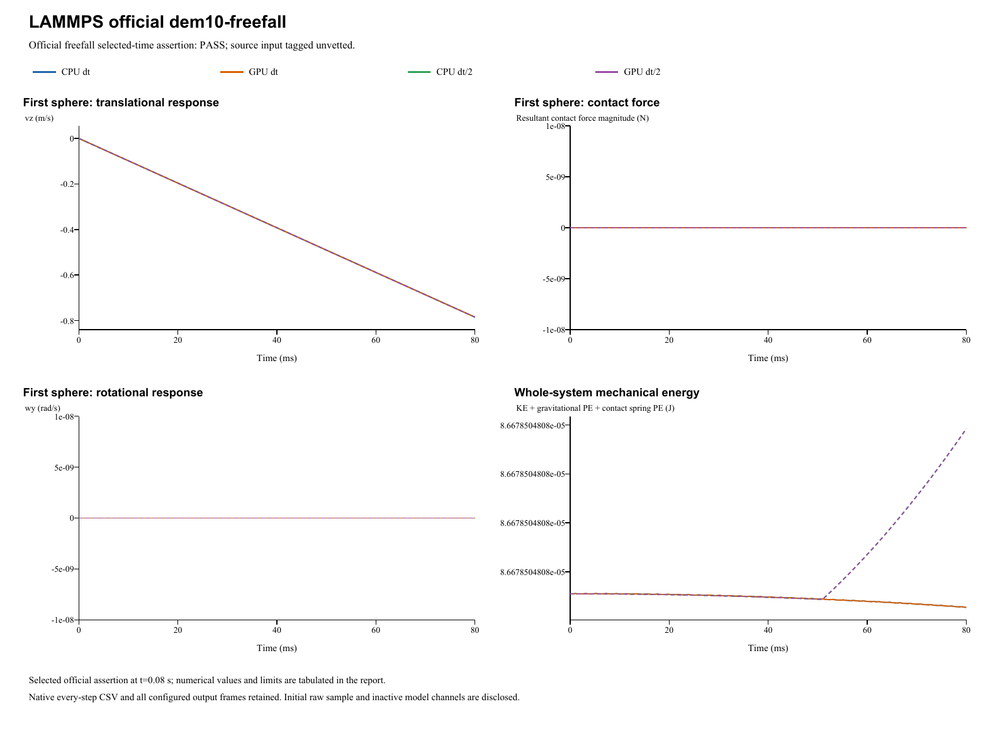

# LAMMPS official dem10-freefall

**Ballistic trajectory and gravity integration**  
Date: 29 October 2026. Four main runs: **PASS**. Official input tag: `unvetted`.

## Source and official acceptance

[Pinned official YAML](https://github.com/lammps/lammps/blob/29dd3fd7642a6fe9e8b4dd99120df4068b221250/unittest/granular/tests/dem10-freefall-3d-si.yaml) | [Analytic checker](https://github.com/lammps/lammps/blob/29dd3fd7642a6fe9e8b4dd99120df4068b221250/unittest/granular/test_analytic_models.cpp). Commit 29dd3fd7642a6fe9e8b4dd99120df4068b221250; input blob be3161683b34bb6cecb5bc8474e8a89bceebfa1b. LAMMPS was not rerun locally. The YAML's same-code epsilon is not a cross-software tolerance.

Model `freefall` is evaluated at original step 8000 and time 0.08s. Half-step runs use twice the native check step at the same physical time. The exact reference, relative/absolute error type and unchanged limit are listed separately for each quantity. Whole histories and source golden states supplement these selected-time assertions.

| Run | Quantity | Reference | Native value | Error type | Error | Limit | Result |
|---|---|---:|---:|---|---:|---:|---|
| CPU dt | Freefall z (m) | 0.018608 | 0.018608 | relative | 2.17399782136e-13 | 1e-09 | PASS |
| CPU dt | Freefall vz (m/s) | -0.7848 | -0.7848 | relative | 1.15153101688e-13 | 1e-09 | PASS |
| GPU dt | Freefall z (m) | 0.018608 | 0.018608 | relative | 2.17399782136e-13 | 1e-09 | PASS |
| GPU dt | Freefall vz (m/s) | -0.7848 | -0.7848 | relative | 1.15153101688e-13 | 1e-09 | PASS |
| CPU dt/2 | Freefall z (m) | 0.018608 | 0.018608 | relative | 6.32062831423e-14 | 1e-09 | PASS |
| CPU dt/2 | Freefall vz (m/s) | -0.7848 | -0.784800000001 | relative | 6.02361065093e-13 | 1e-09 | PASS |
| GPU dt/2 | Freefall z (m) | 0.018608 | 0.018608 | relative | 6.24604862911e-14 | 1e-09 | PASS |
| GPU dt/2 | Freefall vz (m/s) | -0.7848 | -0.784800000001 | relative | 6.02361065093e-13 | 1e-09 | PASS |

## Inputs and constitutive mapping

- sphere: R=0.0025 m; position=(0, 0, 0.05) m; velocity=(0, 0, 0) m/s; spin=(0, 0, 0) rad/s.

- sphere: mass=0.000176714586764 kg; isotropic inertia=4.41786466911e-10 kg m^2.

Linear Hooke Fn_elastic=kn*delta, kn=10000 N/m. Automatic damping uses the harmonic material restitution and the active normal/tangential stiffness; stored manual dashpots are inactive. Tangential inputs: kt=0 N/m (explicit in linear mode), mu=0. Rolling/twist coefficients: kr=0, mu_r=0, ktwist=0, mu_twist=0.

Gravity=(0, 0, -9.81)m/s^2. Base/half dt=1e-05/5e-06s; base/half numerical steps=8000/16000. Initial poses, velocities and physical source coefficients are preserved. The parameter mapping translates the source model's coefficient definitions; it does not fit measured native results.

- No wall and no particle pair; configured Hooke material pair is inactive. Official tight ballistic z/vz assertions are independent.

Native specification (retained locally; not included) | Parameter mapping (retained locally; not included) | Configuration round-trip (retained locally; not included)

## CPU/GPU and timestep refinement

| Quantity | CPU dt error | CPU dt/2 error | Error type and limit |
|---|---:|---:|---|
| Freefall z (m) | 2.174e-13 | 6.3206e-14 | relative: 1e-09 |
| Freefall vz (m/s) | 1.1515e-13 | 6.0236e-13 | relative: 1e-09 |

CPU/GPU whole-history maximum position / velocity / spin / force differences: 1.39e-17 m / 0 m/s / 0 rad/s / 0 N.

Maximum individual impulse / position-drift / velocity-kick residuals: 5.86e-17 kg m/s / 3.47e-18 m / 1.06e-16 m/s. Gravity is added separately to saved native contact forces.

Energy histories are supplemental unless selected by the official analytic model. Wall/gravity cases exchange external momentum; total sphere momentum is not assumed conserved. The step-refinement table reports each error directly, without imposing monotonic convergence.

## Complete retained results

All 3,204 native output frames, every integration-step particle/contact CSV, projects, raw initial samples and backend logs are retained. Native output cadence is distinct from integration dt; exact counts/intervals are in the analysis and archive manifests. The four primary frame counts are [801, 801, 801, 801]. 0additional diagnostic run is retained.

- **CPU dt** (main CPU/GPU/time-step comparison): loadable project (retained locally; not included), complete native result (retained locally; not included); 8,000 integration steps, 801 stored frames.
- **GPU dt** (main CPU/GPU/time-step comparison): loadable project (retained locally; not included), complete native result (retained locally; not included); 8,000 integration steps, 801 stored frames.
- **CPU dt/2** (main CPU/GPU/time-step comparison): loadable project (retained locally; not included), complete native result (retained locally; not included); 16,000 integration steps, 801 stored frames.
- **GPU dt/2** (main CPU/GPU/time-step comparison): loadable project (retained locally; not included), complete native result (retained locally; not included); 16,000 integration steps, 801 stored frames.

Analysis JSON (retained locally; not included) | Official metrics CSV (retained locally; not included) | Source checkpoints (retained locally; not included) | Independent physics audit (retained locally; not included) | Run manifest (retained locally; not included) | Full native ZIP (retained locally; not included) | Frame/hash audit (retained locally; not included)

Source checkpoint states are supplemental regression diagnostics. Their differences are reported directly; the YAML same-code epsilon is not imposed as an independent cross-software acceptance limit.

A stable helper executable is statically linked to the current native CPU/CUDA libraries. Historical GUI/library byte identity is not asserted. Existing case reports and records are unchanged. Verified scope follows the active source model and the criteria above; a passing inactive channel does not validate every option of its contact family.
