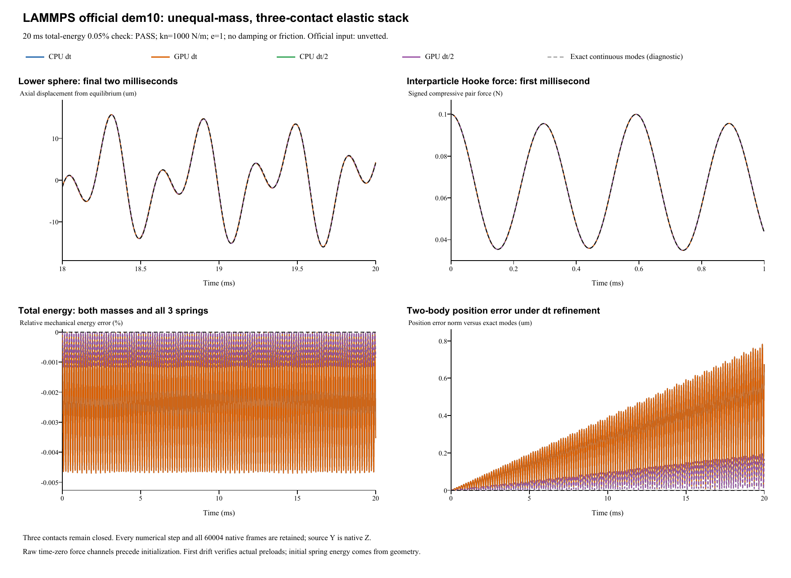

# LAMMPS official dem10-stack: preloaded elastic stack

**Case:** LAMMPS official dem10-stack  
**Date:** 29 October 2026  
**Official qualification:** tagged `granular unvetted`  
**Final 0.05% mechanical-energy assertion: PASS in all four retained runs.**

## Official source, coordinate mapping and inputs

The [official YAML](https://github.com/lammps/lammps/blob/29dd3fd7642a6fe9e8b4dd99120df4068b221250/unittest/granular/tests/dem10-stack-3d-si.yaml) uses commit 29dd3fd7642a6fe9e8b4dd99120df4068b221250, Git blob 405583bd3e27294ab46506f6ba242485a756de33; [analytic checker](https://github.com/lammps/lammps/blob/29dd3fd7642a6fe9e8b4dd99120df4068b221250/unittest/granular/test_analytic_models.cpp). LAMMPS was not rerun locally. This separately pinned `unvetted` input is outside the unchanged historical 24-input catalog, alongside dem09 and dem13. [Source and preload/bootstrap audit](../tools/dem10-stack-contact-audit.md).

Use the **proper coordinate rotation** (x,y,z)_official -> (x,-z,y)_native, determinant +1. Original y positions, velocities, forces and gravity become native z components. Both spheres and both planes are rotated together; physical orientation is preserved.

| Quantity | Official / native mapping |
|---|---|
| Spheres | R=0.0005 m; lower/upper density=20000/10000 kg/m^3 |
| Finite masses | Lower=1.0471975512e-05 kg; upper=5.23598775598e-06 kg |
| Initial centers | Official y=0.00045/0.00135 m -> native z; initial velocities/spins zero |
| Fixed planes | Official y=0/0.0018 m -> native z=0/0.0018 m |
| Contact law | Hooke kn=1000 N/m for all three contacts; restitution 1 gives zero automatic damping |
| Other channels | Zero tangential stiffness/friction, resistance and damping; no body damping; gravity 9.81 m/s^2 downward |
| Time | Official 2 us, five 2000-step segments to 20 ms; half-step 1 us, 20000 steps; continuous native events |
| Full output | Every integration step including initial frame: 10001/10001/20001/20001, total 60004 native frames |

Contact stiffness is explicit and linear; schema E/nu fields remain inactive. All manual damping overrides are zero/off, with e=1 giving automatic zero damping. The two particles begin at rest but the initial spring forces are unbalanced, so they oscillate without a relaxation stage. No coefficient, mass, initial position or velocity was fitted, and no solver source was changed.

## Three initial precompressions and the physical bootstrap

Let z1/z2 be the lower/upper sphere centers, R=0.0005 m and H=0.0018 m:

    d_floor = max(R-z1,0)
    d_pair = max(2R-(z2-z1),0)
    d_roof = max(z2+R-H,0)
    F_contact = kn*d

Initial overlaps floor/pair/roof are **50/100/50 micrometers**, giving force magnitudes **0.05/0.10/0.05 N**. Net initial contact force is **-0.05 N** on the lower sphere and **+0.05 N** on the upper sphere, with gravity added separately. All three physical contacts remain compressed throughout every run.

**Raw t=0 CSV/frame sampling precedes initialization:** its force and contact channels are zero placeholders. The solver then assembles the physical preloads at dt=0 before its first half kick. The first displacement and full Verlet updates are independently checked against the geometric initial forces plus gravity. There is no force injection, warm-up, manual velocity correction or fitted initialization. The original raw CSV and frames remain unchanged. Only derived impulse quadrature supplies the physical initial contact force; E0 is computed from the supplied geometry.

## Official total-energy assertion at 20 ms

Count both finite spheres and count each spring only once:

    E = sum(0.5*m_i*v_i^2) + g*(m1*z1+m2*z2)
        + 0.5*kn*(d_floor^2+d_pair^2+d_roof^2)
    E0_spring = 7.5e-06 J
    E0_gravity = 1.15571339744e-07 J
    E0_total = 7.61557133974e-06 J
    abs(E(20ms)/E0_total-1) <= 0.0005   (0.05%)

The potential reference is the same lower plane at zero height. The source selects final segment 4 after five 2000-step segments. The 0.05% limit applies to total energy, not position or velocity accuracy. Whole-trace energy error is supplemental; conservative integration can accumulate modal phase error over many cycles. YAML epsilon 1e-10 is same-code state-regression precision, not cross-software acceptance. Saved source states at 4/8/12/16/20 ms are retained as separate diagnostics.

| Run | Final E (microjoules) | Final relative error (%) | Maximum whole-trace error (%) | Official0.05% |
|---|---:|---:|---:|---|
| CPU dt | 7.615302319 | 0.0035325 | 0.0047021 | PASS |
| GPU dt | 7.615302319 | 0.0035325 | 0.0047021 | PASS |
| CPU dt/2 | 7.615505900 | 0.0008593 | 0.0011755 | PASS |
| GPU dt/2 | 7.615505900 | 0.0008593 | 0.0011755 | PASS |

## Force, impulse and coupled-mode diagnostics

At every physical contact, Fn=kn*d and U=kn*d^2/2. Contact records verify geometry, three simultaneous positive overlaps, contact points, equal/opposite sphere-pair forces and each particle's force sum. Gravity is excluded from saved contact-force accumulators and added in impulse/integration checks. Transverse motion, spin and torque remain zero.

| Run | Max force-law residual (N) | Max individual impulse residual (kg m/s) | Max continuous-mode position norm error (micrometers) | Max continuous-mode velocity norm error (m/s) |
|---|---:|---:|---:|---:|
| CPU dt | 1.4e-15 | 4.2e-20 | 0.78434 | 0.016596 |
| GPU dt | 1.4e-15 | 2.8e-20 | 0.78434 | 0.016596 |
| CPU dt/2 | 1.4e-15 | 2.7e-20 | 0.19608 | 0.0041492 |
| GPU dt/2 | 1.4e-15 | 5e-20 | 0.19608 | 0.0041492 |

CPU/GPU whole-history maximum position / velocity / contact-force / energy differences are 9.11e-18 m / 1.66e-13 m/s / 9.65e-15 N / 3.83e-19 J.

Halving dt reduces maximum whole-trace relative energy drift by 3.99998; continuous normal-mode position / velocity errors reduce by 4.00009 / 3.99971. These modal comparisons are supplemental and use no fitted phase or coefficients.

Maximum total gravity-and-wall impulse residual is 5.06e-18 kg m/s. The pair contact cancels internally; fixed floor/ceiling loads and gravity supply external impulse. Fixed walls do no work, while particle momentum alone is not conserved.

Maximum first-displacement bootstrap residual over all four runs is 0 m; the physical initial forces are verified independently of the raw preinitialization placeholders.

All three positive overlaps make the linear system K=kn[[2,-1],[-1,2]] valid throughout. The continuous two-mode oscillator and its exact discrete Verlet recurrence are derived from the unchanged masses, stiffness and gravity. They supplement the official energy criterion and do not fit a phase to native or LAMMPS states.

Analysis JSON (retained locally; not included) | All source checkpoints (retained locally; not included) | Energy-force history (retained locally; not included) | Contact reconstruction (retained locally; not included) | Independent audit (retained locally; not included)

## Complete retained results and verified scope

All four new runs execute real FunDEM SimulationSession with linked FunDEMSoftware 0.4.3 CPU/CUDA native libraries; installed GUI executable byte identity is not established. All 60004 native frames, every-step particle/contact CSV, four loadable projects, raw preinitialization samples and backend logs are retained.

- **CPU dt**: loadable project (retained locally; not included), complete native result (retained locally; not included); 10,000 steps, 10,001 initial-inclusive native frames.
- **GPU dt**: loadable project (retained locally; not included), complete native result (retained locally; not included); 10,000 steps, 10,001 initial-inclusive native frames.
- **CPU dt/2**: loadable project (retained locally; not included), complete native result (retained locally; not included); 20,000 steps, 20,001 initial-inclusive native frames.
- **GPU dt/2**: loadable project (retained locally; not included), complete native result (retained locally; not included); 20,000 steps, 20,001 initial-inclusive native frames.

Run manifest (retained locally; not included) | Complete native ZIP (retained locally; not included) | Frame/hash retention audit (retained locally; not included)

Verified scope: preloaded three-contact Hooke elasticity, unequal masses, proper coordinate rotation, actual initialization bootstrap, conservative total energy, contact/impulse balance and CPU/CUDA consistency. Active friction, nonzero damping and rotational resistance require separate cases. Existing 18 case records and reports remain unchanged.
