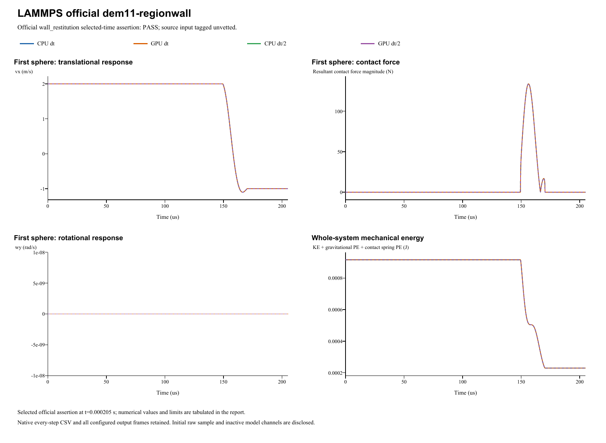

# LAMMPS official dem11-regionwall

**Curved-wall rebound and geometry refinement**  
Date: 29 October 2026. Four main runs: **PASS**. Official input tag: `unvetted`.

## Source and official acceptance

[Pinned official YAML](https://github.com/lammps/lammps/blob/29dd3fd7642a6fe9e8b4dd99120df4068b221250/unittest/granular/tests/dem11-regionwall-3d-si.yaml) | [Analytic checker](https://github.com/lammps/lammps/blob/29dd3fd7642a6fe9e8b4dd99120df4068b221250/unittest/granular/test_analytic_models.cpp). Commit 29dd3fd7642a6fe9e8b4dd99120df4068b221250; input blob e90c87ee07bed0d26ab25bb04320a43f73ef1b4c. LAMMPS was not rerun locally. The YAML's same-code epsilon is not a cross-software tolerance.

Model `wall_restitution` is evaluated at original step 20500 and time 0.000205s. Half-step runs use twice the native check step at the same physical time. The exact reference, relative/absolute error type and unchanged limit are listed separately for each quantity. Whole histories and source golden states supplement these selected-time assertions.

| Run | Quantity | Reference | Native value | Error type | Error | Limit | Result |
|---|---|---:|---:|---|---:|---:|---|
| CPU dt | Rebound vx (m/s) | -1 | -0.999807429792 | relative | 0.000192570208063 | 0.01 | PASS |
| GPU dt | Rebound vx (m/s) | -1 | -0.999807429792 | relative | 0.000192570208063 | 0.01 | PASS |
| CPU dt/2 | Rebound vx (m/s) | -1 | -0.999881839183 | relative | 0.000118160816632 | 0.01 | PASS |
| GPU dt/2 | Rebound vx (m/s) | -1 | -0.999881839183 | relative | 0.000118160816632 | 0.01 | PASS |

## Inputs and constitutive mapping

- sphere: R=0.0025 m; position=(0.0072, 0, 0) m; velocity=(2, 0, 0) m/s; spin=(0, 0, 0) rad/s.

- sphere: mass=0.000458148928649 kg; isotropic inertia=1.14537232162e-09 kg m^2.

Hertz Fn_elastic=(4/3)*E_eff*sqrt(R_eff)*delta^1.5; native E_eff=5.70157227e+10 Pa. Stored linear kn is inactive. Automatic damping uses the harmonic material restitution and the active normal/tangential stiffness; stored manual dashpots are inactive. Tangential inputs: kt=0 N/m (explicit in linear mode), mu=0. Rolling/twist coefficients: kr=0, mu_r=0, ktwist=0, mu_twist=0.

Gravity=(0, 0, 0)m/s^2. Base/half dt=1e-08/5e-09s; base/half numerical steps=20500/41000. Initial poses, velocities and physical source coefficients are preserved. The parameter mapping translates the source model's coefficient definitions; it does not fit measured native results.

- The physical cylinder radius is 0.01 m with endcaps at z=+/-0.05 m. Sphere pose, velocity, mass, restitution and duration are retained; periodic Z is inactive at z=vz=0.
- The analytic conversion E_eff=(3/4)*kn*sqrt(8/7) maps the source inner-cylinder effective radius Rp*8/7 to native Rp, preserving elastic and automatic damping coefficients without fitting.
- Sliding friction is zero. The dormant native tangential stiffness differs from source kt=0 but contributes no force in this invariant normal motion.
- The prepared SDF grid has a symmetric transverse phase. It is the authoritative saved geometry; regenerating the built-in geometry would change that phase.
- Fine/coarse signed-distance interpolation errors are measured explicitly. This is a discretized-wall verification, not a claim of exact analytic cylinder geometry.
- A metadata-only URL typo was corrected to unittest/granular/tests. Original configured input and result bytes remain preserved with the correction record.

Native specification (retained locally; not included) | Parameter mapping (retained locally; not included) | Configuration round-trip (retained locally; not included)

## CPU/GPU and timestep refinement

| Quantity | CPU dt error | CPU dt/2 error | Error type and limit |
|---|---:|---:|---|
| Rebound vx (m/s) | 0.00019257 | 0.00011816 | relative: 0.01 |

CPU/GPU whole-history maximum position / velocity / spin / force differences: 0 m / 4.44e-16 m/s / 0 rad/s / 2.84e-14 N.

Maximum individual impulse / position-drift / velocity-kick residuals: 6.94e-18 kg m/s / 4.33e-19 m / 2.2e-16 m/s. Gravity is added separately to saved native contact forces.

Energy histories are supplemental unless selected by the official analytic model. Wall/gravity cases exchange external momentum; total sphere momentum is not assumed conserved. The step-refinement table reports each error directly, without imposing monotonic convergence.

## Independent geometry refinement

The source cylinder radius is 0.01m. Native and analytic effective radii differ (0.0025/0.00285714285714m), so E_eff=57015722699.3Pa is derived to preserve the full Hertz coefficient; no curve was fitted. The saved prepared SDF has an explicitly symmetric grid phase. Regenerating its built-in geometry would change that phase.

| Grid run | Spacing(m) | Max SDF axis error at actual contact samples(micrometers) | Measured restitution |
|---|---:|---:|---:|
| Fine CPU main | 0.00025 | 1.0417437 | 0.4999037149 |
| Coarse CPU diagnostic | 0.0005 | 4.1679848 | 0.4998392524 |

Actual-contact axis errors improve by 4.00096940. These samples differ from the auditor's full-axis probe domain, which is reported separately. Four fine-grid main runs retain 824frames; the extra coarse CPU run retains 206frames, for 1030in all five executions. The canonical source URL is the granular/tests URL above; a previous metadata-only URL typo is preserved in its correction record (retained locally; not included), without rewriting original configuration/result bytes.

## Complete retained results

All 1,030 native output frames, every integration-step particle/contact CSV, projects, raw initial samples and backend logs are retained. Native output cadence is distinct from integration dt; exact counts/intervals are in the analysis and archive manifests. The four primary frame counts are [206, 206, 206, 206]. 1additional diagnostic run is retained.

- **CPU dt** (main CPU/GPU/time-step comparison): loadable project (retained locally; not included), complete native result (retained locally; not included); 20,500 integration steps, 206 stored frames.
- **GPU dt** (main CPU/GPU/time-step comparison): loadable project (retained locally; not included), complete native result (retained locally; not included); 20,500 integration steps, 206 stored frames.
- **CPU dt/2** (main CPU/GPU/time-step comparison): loadable project (retained locally; not included), complete native result (retained locally; not included); 41,000 integration steps, 206 stored frames.
- **GPU dt/2** (main CPU/GPU/time-step comparison): loadable project (retained locally; not included), complete native result (retained locally; not included); 41,000 integration steps, 206 stored frames.
- **grid-coarse-cpu** (supplemental coarse-grid diagnostic): loadable project (retained locally; not included), complete native result (retained locally; not included); 20,500 integration steps, 206 stored frames.

Analysis JSON (retained locally; not included) | Official metrics CSV (retained locally; not included) | Source checkpoints (retained locally; not included) | Independent physics audit (retained locally; not included) | Run manifest (retained locally; not included) | Full native ZIP (retained locally; not included) | Frame/hash audit (retained locally; not included)

Source checkpoint states are supplemental regression diagnostics. Their differences are reported directly; the YAML same-code epsilon is not imposed as an independent cross-software acceptance limit.

A stable helper executable is statically linked to the current native CPU/CUDA libraries. Historical GUI/library byte identity is not asserted. Existing case reports and records are unchanged. Verified scope follows the active source model and the criteria above; a passing inactive channel does not validate every option of its contact family.
