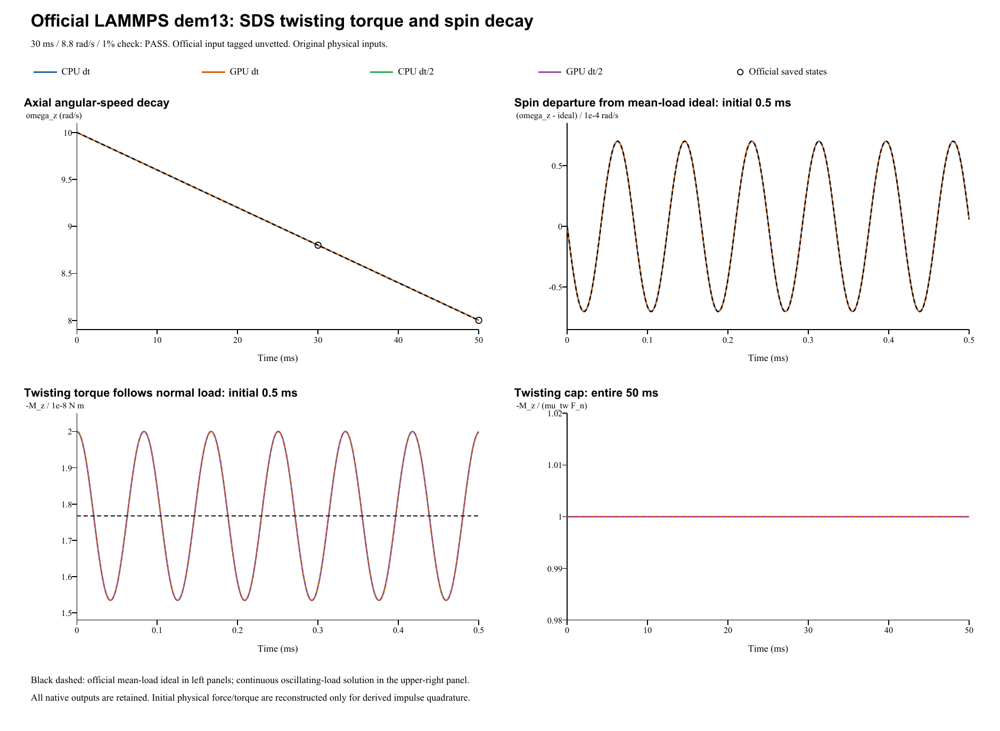

# Torsional resistance: verification report

**Case:** LAMMPS official dem13-twist-sds-3d-si  
**Date:** 28 October 2026  
**Outcome: PASS.** All four runs pass the official 1% spin check at 30 ms.

## Official source and acceptance criterion

The reference is the [official YAML and saved states](https://github.com/lammps/lammps/blob/29dd3fd7642a6fe9e8b4dd99120df4068b221250/unittest/granular/tests/dem13-twist-sds-3d-si.yaml), pinned to commit **29dd3fd7642a6fe9e8b4dd99120df4068b221250**, Git blob **a6b317c73f34232186ceb3207a9422c02686f657**. This newer reference is separate from the earlier suite pin used for dem01-dem08. The official input is tagged **granular unvetted**; that upstream status is retained here, including when the FunDEM comparison passes. LAMMPS was not rerun locally.

The [official twist_decay checker](https://github.com/lammps/lammps/blob/29dd3fd7642a6fe9e8b4dd99120df4068b221250/unittest/granular/test_analytic_models.cpp) tests **omega_z = 8.8 rad/s at 30 ms**, cumulative step 30000 at the end of segment 0, using a **1% relative tolerance**. Its 50 ms endpoint target of 8.0 rad/s is supplementary. The stored LAMMPS golden values are 8.7999300950861805 rad/s at 30 ms and 8.0000697292061798 rad/s at 50 ms. The YAML regression epsilon 1e-10 is not a universal cross-code tolerance.

## Inputs and direct parameter mapping

| Quantity | Official input / FunDEM configuration |
|---|---|
| Sphere diameter; density | 0.005 m; 2700 kg/m^3 |
| Mass; solid-sphere inertia | 0.000176714586764 kg; 4.41786466911e-10 kg m^2 |
| Initial center; translation | (0, 0, 0.0024999998) m; v = 0 |
| Initial spin | (0, 0, 10) rad/s, about the contact normal |
| Wall; gravity | Fixed plane z = 0; g = 1 m/s^2 downward |
| Normal and sliding | Hooke kn = 1e6 N/m; linear_history ks = 2.8e5 N/m; sliding friction = 0.5 |
| Restitution; other channels | e = 1; normal/sliding/rolling/global damping = 0; rolling friction = 0 |
| Official twisting SDS | angular stiffness Ktw = 1 N m/rad; damping Ctw = 1e-6 N m s/rad; torque-cap length mut = 1e-4 m |
| FunDEM torsional parameters | ktorsion = 40000 N/m; ctorsion = 0.04 N s/m; torsional friction = 0.02 |
| Time and output | dt = 1e-6 / 5e-7 s; 50000 / 100000 steps; 50 ms endpoint |
| Full native result | Every 10 us including t = 0; 5001 frames per run |
| Detailed trajectory | Every integration step in CSV |

For this sphere-plane contact, FunDEM uses torsional diameter **D = 2R = 0.005 m**. Its dimensional mapping is **Ktw = ktorsion D^2**, **Ctw = ctorsion D^2**, and **mut = torsional_friction D**. The official coefficient mut is a length, whereas the FunDEM friction field is dimensionless. The factor-of-diameter conversion preserves the specified torque cap and pre-cap angular stiffness/damping scales; no coefficient was fitted.

Explicit linear stiffness and explicit contact damping are enabled to preserve the nonzero twisting dashpot and zero damping in all other channels. Any material E/Poisson-ratio fields are inactive schema placeholders because all stiffnesses are explicit. The official periodic x/y boundaries are immaterial for this isolated sphere, which has zero horizontal motion. The 30000 + 20000 official segments form one unchanged native event.

## Torque and angular-velocity reference

The official [SDS twisting model](https://github.com/lammps/lammps/blob/29dd3fd7642a6fe9e8b4dd99120df4068b221250/doc/src/granular_twisting_models.rst) uses a history-dependent angular spring and dashpot, truncated by the critical torque mut Fn. In this sustained, positive-spin test, the resisting torque is saturated:

    Mz(t) = -mut Fn(t)
    I = (2/5) m R^2
    With Fn = mg: d(omega_z)/dt = -(mut mg)/I = -40 rad/s^2
    omega_z(t) = 10 - 40 t

The ideal constant-load torque is **1.76714586764e-08 N m** in magnitude. The official analytic targets are **8.8 rad/s at 30 ms** and **8.0 rad/s at 50 ms**.

The exact specified initial overlap is 0.2 nm. It differs from the equilibrium overlap mg/kn. With zero normal damping, Hooke contact produces a normal-load oscillation of approximately **+/-13.177%** about mg; the instantaneous torsional torque must follow that load. The independent harmonic diagnostic is:

    Omega = sqrt(kn/m)
    Fn(t) = mg + (kn delta0 - mg) cos(Omega t)
    omega_z(t) = 10 - (mut/I) [mg t + (kn delta0 - mg) sin(Omega t)/Omega]

This oscillating-load diagnostic supplements the official linear-in-time reference. It never replaces the official 30 ms pass/fail criterion.

## Four native runs and numerical evidence

| Run | dt (s) | Steps / native frames | omega_z at 30 ms (rad/s) | Official error (%) | omega_z at 50 ms (rad/s) | 1% check |
|---|---:|---:|---:|---:|---:|---|
| CPU dt | 1e-06 | 50,000 / 5,001 | 8.7999300953 | 0.000794 | 8.0000697065 | PASS |
| GPU dt | 1e-06 | 50,000 / 5,001 | 8.7999300953 | 0.000794 | 8.0000697065 | PASS |
| CPU dt/2 | 5e-07 | 100,000 / 5,001 | 8.7999340255 | 0.000750 | 8.0000589191 | PASS |
| GPU dt/2 | 5e-07 | 100,000 / 5,001 | 8.7999340255 | 0.000750 | 8.0000589191 | PASS |

The instantaneous torque cap spans 1.5342916e-08 to 2.0000001e-08 N m. The minimum saturated-contact fraction across all four runs is 100.000000%. The maximum torque-cap residual, normalized by the ideal load torque, is 1.87e-16. The largest angular-momentum closure residual is 2.99e-22 N m s; reconstructing spin by integrating the actual torque differs by at most 6.77e-13 rad/s. CPU/GPU histories differ by at most 0 rad/s in spin and 3.31e-24 N m in torque. Halving dt changes the CPU spin at 30 ms by 3.93e-06 rad/s and the final spin by 1.08e-05 rad/s. The maximum spin error against the continuous oscillating-load solution changes from 6.01e-05 to 1.55e-05 rad/s. An undamped normal oscillator accumulates timestep-dependent phase error; pointwise comparison with the mean-load line need not improve monotonically.

The independent analysis checks Mz/Fn = -1e-4 m, the opposing torque direction, and angular-impulse closure I(omega_z - omega0) = integral Mz dt. The saved t = 0 frame precedes initial force assembly and contains zero force/torque. For integration only, the analysis reconstructs the actual initial contact load Fn0 = kn delta0 = 2e-4 N and Mz0 = -mut Fn0; the raw CSV and native frame remain unchanged. Recorded force_z is contact force, with gravity applied separately. The recorded contact-resistance torque is the twisting torque in this case; sliding force, ordinary friction torque, rolling torque and transverse spin remain inactive. CPU/GPU and half-step comparisons are numerical evidence, separate from the official criterion.

## Limits of this saturated SDS test

The mapped torque cap and angular decay are tested directly. FunDEM first caps the elastic torsional pseudo-force and rescales its history, then adds the dashpot within the remaining Coulomb limit. LAMMPS forms the sum of the angular spring and dashpot torques, caps that sum and adjusts the angular history. These general spring/dashpot limiting algorithms differ. Here the spin stays positive and the twisting channel is saturated, so this case does **not** establish complete equivalence for uncapped torsional elasticity, dashpot sharing, reversals, sticking, or transitions into/out of the cap. It also does not validate the Marshall torsion model or many-particle flow.

Independent analysis JSON (retained locally; not included) | Official checkpoint CSV (retained locally; not included) | [Contact-model audit](../tools/dem13-contact-audit.md)

## Complete retained results

- **CPU dt**: input project (retained locally; not included), complete native result (retained locally; not included); 50,000 integration steps / 5,001 native frames.
- **GPU dt**: input project (retained locally; not included), complete native result (retained locally; not included); 50,000 integration steps / 5,001 native frames.
- **CPU dt/2**: input project (retained locally; not included), complete native result (retained locally; not included); 100,000 integration steps / 5,001 native frames.
- **GPU dt/2**: input project (retained locally; not included), complete native result (retained locally; not included); 100,000 integration steps / 5,001 native frames.

Each run retains **5001 native result frames**, saved every 10 us: every 10 base-dt steps or 20 half-dt steps. All **20,004 native frames** and contact records are preserved. Input projects, run.json, project.json, backend logs, audits and every-step trajectory/contact CSVs are retained. Native frames are not written at every integration step; the CSVs separately retain those states.

Run manifest (retained locally; not included) | Complete native archive ZIP (retained locally; not included)

**Execution:** the helper advances the real FunDEM SimulationSession using linked 0.4.3 CPU/CUDA native libraries. It is not an independent torsion integrator. No solver code or reference parameter was changed to force a pass. Byte identity with the installed GUI executable was not established.
