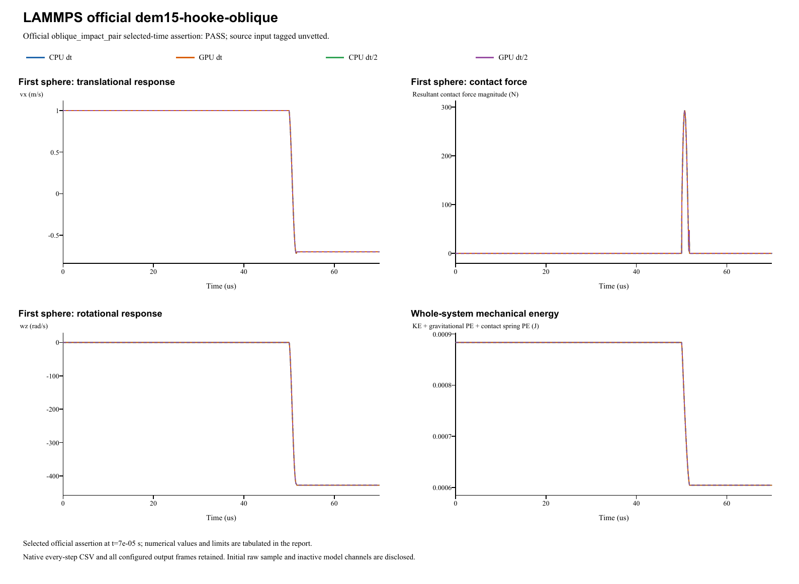

# LAMMPS official dem15-hooke-oblique

**Oblique collision: friction impulse and spin**  
Date: 29 October 2026. Four main runs: **PASS**. Official input tag: `unvetted`.

## Source and official acceptance

[Pinned official YAML](https://github.com/lammps/lammps/blob/29dd3fd7642a6fe9e8b4dd99120df4068b221250/unittest/granular/tests/dem15-hooke-oblique-3d-si.yaml) | [Analytic checker](https://github.com/lammps/lammps/blob/29dd3fd7642a6fe9e8b4dd99120df4068b221250/unittest/granular/test_analytic_models.cpp). Commit 29dd3fd7642a6fe9e8b4dd99120df4068b221250; input blob 32b2385c6f9d69c3d3d0af7bdb7dd0cd45cef81b. LAMMPS was not rerun locally. The YAML's same-code epsilon is not a cross-software tolerance.

Model `oblique_impact_pair` is evaluated at original step 7000 and time 7e-05s. Half-step runs use twice the native check step at the same physical time. The exact reference, relative/absolute error type and unchanged limit are listed separately for each quantity. Whole histories and source golden states supplement these selected-time assertions.

| Run | Quantity | Reference | Native value | Error type | Error | Limit | Result |
|---|---|---:|---:|---|---:|---:|---|
| CPU dt | left vx (m/s) | -0.7 | -0.698865572416 | relative | 0.00162061083439 | 0.01 | PASS |
| CPU dt | left vy (m/s) | 1.575 | 1.57272813435 | relative | 0.00144245437898 | 0.01 | PASS |
| CPU dt | left omega_z (rad/s) | -425 | -428.11364772 | relative | 0.00732622992884 | 0.01 | PASS |
| CPU dt | right vx (m/s) | 0.7 | 0.698865572416 | relative | 0.00162061083439 | 0.01 | PASS |
| CPU dt | right vy (m/s) | -1.575 | -1.57272813435 | relative | 0.00144245437898 | 0.01 | PASS |
| CPU dt | right omega_z (rad/s) | -425 | -428.11364772 | relative | 0.00732622992884 | 0.01 | PASS |
| GPU dt | left vx (m/s) | -0.7 | -0.698865572416 | relative | 0.00162061083437 | 0.01 | PASS |
| GPU dt | left vy (m/s) | 1.575 | 1.57272813435 | relative | 0.00144245437898 | 0.01 | PASS |
| GPU dt | left omega_z (rad/s) | -425 | -428.11364772 | relative | 0.00732622992884 | 0.01 | PASS |
| GPU dt | right vx (m/s) | 0.7 | 0.698865572416 | relative | 0.00162061083437 | 0.01 | PASS |
| GPU dt | right vy (m/s) | -1.575 | -1.57272813435 | relative | 0.00144245437898 | 0.01 | PASS |
| GPU dt | right omega_z (rad/s) | -425 | -428.11364772 | relative | 0.00732622992884 | 0.01 | PASS |
| CPU dt/2 | left vx (m/s) | -0.7 | -0.699232366895 | relative | 0.00109661872154 | 0.01 | PASS |
| CPU dt/2 | left vy (m/s) | 1.575 | 1.57322717211 | relative | 0.00112560500984 | 0.01 | PASS |
| CPU dt/2 | left omega_z (rad/s) | -425 | -427.615600536 | relative | 0.0061543542031 | 0.01 | PASS |
| CPU dt/2 | right vx (m/s) | 0.7 | 0.699232366895 | relative | 0.00109661872154 | 0.01 | PASS |
| CPU dt/2 | right vy (m/s) | -1.575 | -1.57322717211 | relative | 0.00112560500984 | 0.01 | PASS |
| CPU dt/2 | right omega_z (rad/s) | -425 | -427.615600536 | relative | 0.0061543542031 | 0.01 | PASS |
| GPU dt/2 | left vx (m/s) | -0.7 | -0.699232366895 | relative | 0.0010966187215 | 0.01 | PASS |
| GPU dt/2 | left vy (m/s) | 1.575 | 1.57322717211 | relative | 0.00112560500984 | 0.01 | PASS |
| GPU dt/2 | left omega_z (rad/s) | -425 | -427.615600536 | relative | 0.00615435420311 | 0.01 | PASS |
| GPU dt/2 | right vx (m/s) | 0.7 | 0.699232366895 | relative | 0.0010966187215 | 0.01 | PASS |
| GPU dt/2 | right vy (m/s) | -1.575 | -1.57322717211 | relative | 0.00112560500984 | 0.01 | PASS |
| GPU dt/2 | right omega_z (rad/s) | -425 | -427.615600536 | relative | 0.00615435420311 | 0.01 | PASS |

## Inputs and constitutive mapping

- left: R=0.0025 m; position=(-0.00255, -0.0001, 0) m; velocity=(1, 2, 0) m/s; spin=(0, 0, 0) rad/s.
- right: R=0.0025 m; position=(0.00255, 0.0001, 0) m; velocity=(-1, -2, 0) m/s; spin=(0, 0, 0) rad/s.

- left: mass=0.000176714586764 kg; isotropic inertia=4.41786466911e-10 kg m^2.
- right: mass=0.000176714586764 kg; isotropic inertia=4.41786466911e-10 kg m^2.

Linear Hooke Fn_elastic=kn*delta, kn=3e+08 N/m. Manual c_n=36.7327514 N s/m, c_t=0 N s/m; automatic restitution damping is inactive. Tangential inputs: kt=8e+07 N/m (explicit in linear mode), mu=0.25. Rolling/twist coefficients: kr=0, mu_r=0, ktwist=0, mu_twist=0. Source pair spin-slip uses R; native uses R-delta/2. Pair torque arms both use R-delta/2. Maximum source/native contact-speed difference is 0.000275732 m/s; torque-arm difference is 8.47033e-22 m. Official selected-time acceptance does not imply pointwise kinematic identity.

Gravity=(0, 0, 0)m/s^2. Base/half dt=1e-08/5e-09s; base/half numerical steps=7000/14000. Initial poses, velocities and physical source coefficients are preserved. The parameter mapping translates the source model's coefficient definitions; it does not fit measured native results.

- Exact constant normal restitution dashpot; source tangential damping ratio is0, so manual ct=0. Full finite partner masses, oblique impact parameters and spin generation retained.

Native specification (retained locally; not included) | Parameter mapping (retained locally; not included) | Configuration round-trip (retained locally; not included)

## CPU/GPU and timestep refinement

| Quantity | CPU dt error | CPU dt/2 error | Error type and limit |
|---|---:|---:|---|
| left vx (m/s) | 0.0016206 | 0.0010966 | relative: 0.01 |
| left vy (m/s) | 0.0014425 | 0.0011256 | relative: 0.01 |
| left omega_z (rad/s) | 0.0073262 | 0.0061544 | relative: 0.01 |
| right vx (m/s) | 0.0016206 | 0.0010966 | relative: 0.01 |
| right vy (m/s) | 0.0014425 | 0.0011256 | relative: 0.01 |
| right omega_z (rad/s) | 0.0073262 | 0.0061544 | relative: 0.01 |

CPU/GPU whole-history maximum position / velocity / spin / force differences: 6.78e-21 m / 4.85e-14 m/s / 1.12e-11 rad/s / 2.64e-10 N.

Maximum individual impulse / position-drift / velocity-kick residuals: 3.25e-19 kg m/s / 2.17e-19 m / 2.15e-16 m/s. Gravity is added separately to saved native contact forces.

Energy histories are supplemental unless selected by the official analytic model. Wall/gravity cases exchange external momentum; total sphere momentum is not assumed conserved. The step-refinement table reports each error directly, without imposing monotonic convergence.

## Complete retained results

All 2,804 native output frames, every integration-step particle/contact CSV, projects, raw initial samples and backend logs are retained. Native output cadence is distinct from integration dt; exact counts/intervals are in the analysis and archive manifests. The four primary frame counts are [701, 701, 701, 701]. 0additional diagnostic run is retained.

- **CPU dt** (main CPU/GPU/time-step comparison): loadable project (retained locally; not included), complete native result (retained locally; not included); 7,000 integration steps, 701 stored frames.
- **GPU dt** (main CPU/GPU/time-step comparison): loadable project (retained locally; not included), complete native result (retained locally; not included); 7,000 integration steps, 701 stored frames.
- **CPU dt/2** (main CPU/GPU/time-step comparison): loadable project (retained locally; not included), complete native result (retained locally; not included); 14,000 integration steps, 701 stored frames.
- **GPU dt/2** (main CPU/GPU/time-step comparison): loadable project (retained locally; not included), complete native result (retained locally; not included); 14,000 integration steps, 701 stored frames.

Analysis JSON (retained locally; not included) | Official metrics CSV (retained locally; not included) | Source checkpoints (retained locally; not included) | Independent physics audit (retained locally; not included) | Run manifest (retained locally; not included) | Full native ZIP (retained locally; not included) | Frame/hash audit (retained locally; not included)

Source checkpoint states are supplemental regression diagnostics. Their differences are reported directly; the YAML same-code epsilon is not imposed as an independent cross-software acceptance limit.

A stable helper executable is statically linked to the current native CPU/CUDA libraries. Historical GUI/library byte identity is not asserted. Existing case reports and records are unchanged. Verified scope follows the active source model and the criteria above; a passing inactive channel does not validate every option of its contact family.
