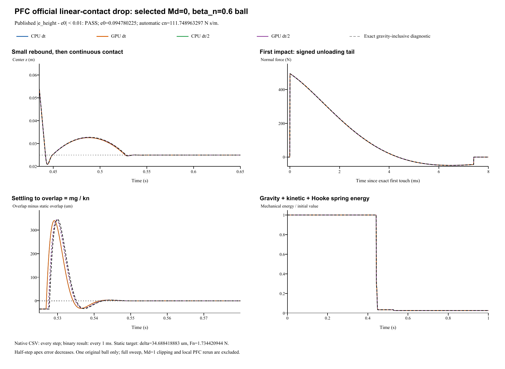

# PFC stronger damping: rebound and static settling

**Reference:** PFC3D 7.0 official linear-contact restitution example  
**Selected subcase:** original ball 12, dashpot mode Md=0, normal damping ratio beta_n=0.6  
**Date:** 29 October 2026  
**Published comparison target: PASS in the four retained runs.**

## Official source, scope and unchanged parameters

The [official example](https://docs.itascacg.com/pfc700/pfc/docproject/source/manual/examples/verification/linear_contact_model/cmlinear_restitution.html) contains the complete `restitution.p3dat` input. This verification selects **one independent original ball** with x=1.15 m, y=0.05 m, initial center z=1 m and radius 0.025 m from the Md=0 row. The other balls are independent parameter-sweep subcases. It does **not** claim the full 32-ball sweep, Md=1 no-tension clipping, PFC solver execution, or a new numbered LAMMPS demo.

The versioned PFC7 documentation text, embedded source and mapping audit are retained with SHA-256 identity. There is no invented Git commit or blob. Official-page web-connector text snapshot SHA-256: **3dc3744ccb9cc04fb3ec1db4a2d44f27f83b50b8e187020b03c54ab80f00e7e5**. [Source/contact audit](../tools/pfc-linear-beta06-contact-audit.md).

| Quantity | Official input / native mapping |
|---|---|
| Particle | R=0.025 m; density=2650 kg/m^3; mass=0.173442094417 kg |
| Initial state | Center=(1.15,0.05,1) m; zero velocity and spin |
| Wall / gravity | Fixed z=0 plane; gravity=(0,0,-10) m/s^2 throughout |
| Normal contact | Linear kn=50000 N/m; beta_n=0.6; Md=0 full signed dashpot |
| Other channels | Zero tangential stiffness, friction/damping, rolling/twist resistance, local/global damping |
| Automatic damping | e_input=0.094780224842; derived cn=111.748963297 N s/m; manual overrides off |
| Time | Official fixed dt=1e-5 s, 100000 steps to 1 s; half-step 5e-6 s, 200000 steps |
| Retention | Every numerical step in particle/contact CSV; native binary output every 1 ms, 1001 frames/run |

The initial center height is 1 m; the **free-fall clearance is 1-R=0.975 m**, not 1 m. Both sphere and wall material restitution are set from the published damping ratio. `linearStiffnessEnabled=true` preserves kn; `dampingEnabled=false` disables manual overrides and uses automatic contact damping. All stored manual dashpots are zero. Sphere-wall effective mass is the **full sphere mass**, not half mass. Tangential channels remain inactive.

## Analytic coefficient, published target and measured rebound

The official damped-oscillator relation is:

    e0 = exp[-beta_n pi / sqrt(1-beta_n^2)] = 0.094780224842
    beta_n = -ln(e0)/sqrt(pi^2+ln(e0)^2)
    cn = 2 beta_n sqrt(m kn)
    Fn = kn delta - cn vn_assembly

No coefficient was fitted and no solver source was changed. Md=0 retains the signed viscous unloading tail while geometrical contact exists. A negative normal force in that tail is not an adhesion law. **Md=1**, which clips the dashpot to prevent tensile total force, is excluded because it is not this native contact mode.

The official FISH height-apex method evaluates the rebound after first impact:

    e_height = sqrt[(z_first_rebound_apex - R)/(z0 - R)]
    coefficient_error = abs(e_height - e0)
    published comparison target: coefficient_error < 0.01

The page reports a maximum difference below 1%, but its `make_tables` expression actually computes **max(abs(e_num-e_ana))** over the Md=0 row. Thus this report uses an **absolute coefficient error below 0.01**, not relative 1%. The example does not supply an automated assertion; the target is the published comparison target applied to this one subcase. Reference e0 neglects gravity during contact, while the actual simulation retains gravity; a finite contact-time offset can remain under dt refinement.

| Run | Apex-derived e | Absolute coefficient error | Relative error (%) | First rebound apex z (m) | Published target |
|---|---:|---:|---:|---:|---|
| CPU dt | 0.0881547443 | 0.0066255 | 6.99036 | 0.032576977 | PASS |
| GPU dt | 0.0881547443 | 0.0066255 | 6.99036 | 0.032576977 | PASS |
| CPU dt/2 | 0.0888625165 | 0.0059177 | 6.24361 | 0.032699133 | PASS |
| GPU dt/2 | 0.0888625165 | 0.0059177 | 6.24361 | 0.032699133 | PASS |

The relative errors are diagnostic only; acceptance uses the absolute coefficient difference below 0.01. The initial high center and falling branch are excluded from the first-rebound apex measurement. Only the first rebound is used; later bounces within the 1 s run do not replace it. Quantitative apex analysis uses every-step CSV rather than the 1 ms binary viewing cadence.

An independent gravity-inclusive continuous contact solution gives supplemental e_height=0.089142243795, first apex z=0.032747681138 m at t=0.488359670757 s. It solves the forced damped contact oscillator followed by ballistic rebound, without fitting native results. The official unforced coefficient remains the published comparator. Absolute error to the gravity-inclusive solution is 0.000987499519 / 0.00027972727 at dt / dt/2; errors to both references decrease under this refinement.

## Persistent second contact and static equilibrium

The ball has two contact episodes. After its first rebound, the second contact remains active through the 1 s endpoint and settles toward:

    delta_eq = mg/kn = 3.46884188834e-05 m
    z_eq = R-delta_eq = 0.024965311581 m
    Fn_eq = mg = 1.73442094417 N

Over t=0.8-1.0 s, declared supplemental checks require maximum center-height error <1e-9 m, relative force error <1e-6, and vertical speed <1e-8 m/s. These are explicitly declared checks, not official PFC acceptance limits. Both the first rebound and late equilibrium are compared; the final state does not replace the first-apex coefficient.

| Run | Final center z (m) | Final Fn (N) | Late max height error (m) | Late max vertical speed (m/s) |
|---|---:|---:|---:|---:|
| CPU dt | 0.024965311581 | 1.734420944 | 6.6e-17 | 9.1e-15 |
| GPU dt | 0.024965311581 | 1.734420944 | 6.6e-17 | 9.1e-15 |
| CPU dt/2 | 0.024965311581 | 1.734420944 | 2.2e-16 | 8.8e-14 |
| GPU dt/2 | 0.024965311581 | 1.734420944 | 2.2e-16 | 8.8e-14 |

Maximum late force error over all four runs is 2.22045e-16 N. All four declared equilibrium checks pass. The prior beta_n=0.2 report and results remain unchanged.

## Native force, damping and impulse checks

Stored velocities follow the final half-kick. The force-law audit accounts for gravity when recovering the force-assembly velocity:

    vn_assembly = vz_saved - (dt/2)(Fn/m - 10)
    cn_inferred = (kn delta - Fn)/vn_assembly

Near-zero denominators are excluded from coefficient division, while direct force reconstruction covers valid contact states. The coefficient is inferred from native states; it is not a separate native output channel. Linear spring energy is counted once, and gravitational potential energy is included in mechanical-energy diagnostics. The dashpot intentionally dissipates energy, so energy conservation is not the acceptance criterion.

| Run | Inferred cn (N s/m) | Min. signed Fn (N) | Max. force residual (N) | Max. impulse residual (kg m/s) |
|---|---:|---:|---:|---:|
| CPU dt | 111.748963297 | -48.90583 | 1.4e-14 | 4.2e-13 |
| GPU dt | 111.748963297 | -48.90583 | 5.7e-14 | 4.2e-13 |
| CPU dt/2 | 111.748963297 | -49.01194 | 2.8e-14 | 2.1e-12 |
| GPU dt/2 | 111.748963297 | -49.01194 | 5.7e-14 | 2.1e-12 |

CPU/GPU whole-history maximum position / velocity / signed-force differences are 1.11e-16 m / 2.71e-14 m/s / 1.83e-11 N.
Halving dt changes apex-derived restitution by 0.0007077722. The absolute differences from the published analytic coefficient are 0.006625481 / 0.005917708. The half-step error decreases for both the published and gravity-inclusive references.
The fixed wall supplies external impulse, while gravity acts throughout. The maximum residual in m(v-v0) = integral(F_contact + mg)dt is 2.07e-12 kg m/s. Sphere momentum alone is not conserved.

Analysis JSON (retained locally; not included) | Independent physics audit (retained locally; not included)

## Complete retained results and verified scope

All four new runs use real **FunDEM SimulationSession** linked to **FunDEMSoftware 0.4.3 CPU/CUDA native libraries**. Installed GUI executable byte identity is not established. Each run retains 1001 configured native output frames, all numerical particle/contact CSV records, input projects and backend logs: **4004 native frames total**.

- **CPU dt**: loadable project (retained locally; not included), complete native result (retained locally; not included); 100,000 numerical steps / 1,001 initial-inclusive native frames.
- **GPU dt**: loadable project (retained locally; not included), complete native result (retained locally; not included); 100,000 numerical steps / 1,001 initial-inclusive native frames.
- **CPU dt/2**: loadable project (retained locally; not included), complete native result (retained locally; not included); 200,000 numerical steps / 1,001 initial-inclusive native frames.
- **GPU dt/2**: loadable project (retained locally; not included), complete native result (retained locally; not included); 200,000 numerical steps / 1,001 initial-inclusive native frames.

Run manifest (retained locally; not included) | Complete native ZIP (retained locally; not included) | Frame/hash retention audit (retained locally; not included)

**Verified scope:** one published stronger-normal-dashpot linear sphere-wall subcase, beta_n-to-restitution-to-automatic-damping conversion, signed unloading, first rebound, persistent second contact, static force/height equilibrium and CPU/CUDA/time-step comparison. Full PFC parameter sweep, no-tension Md=1, active friction/rotation, and many-particle dynamics require separate cases. The existing numbered LAMMPS series and prior beta_n=0.2 case remain unchanged.
