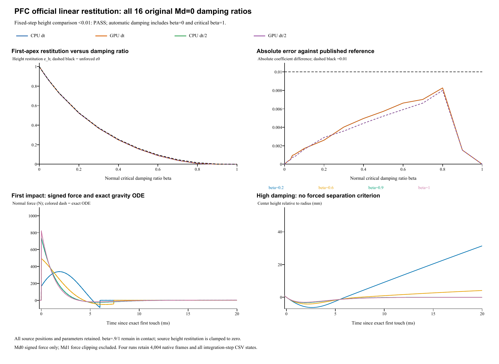

# PFC official linear restitution: complete Md0 row

Date: 29 October 2026. **All 64 published absolute-error checks PASS.** PFC is proprietary Itasca software with public official examples; it is not described as open-source. Local PFC was not executed.

## Official scope and parameters

The [PFC 7.0 reference](https://docs.itascacg.com/pfc700/pfc/docproject/source/manual/examples/verification/linear_contact_model/cmlinear_restitution.html) contains two rows of 16 balls. This case reproduces **all 16 original Md=0 balls**, including beta=0 and the beta=1 critical limit. It does not reproduce the Md=1 no-tension row or claim the full 32-ball example. The earlier individual beta=0.2/0.6 cases remain separate and unchanged. Fresh official/native source hashes (retained locally; not included).

Original R=0.025 m, density 2650 kg/m^3, centroid height 1 m, kn=50000 N/m, ks=friction=0, gravity (0,0,-10)m/s^2 and zero initial velocity/spin are retained. The16 source x coordinates run 0.05 to1.55 m in 0.1 m increments, at y=0.05 m. Their independent vertical paths stay inside the original floor. Its inactive edges/reflect faces are replaced by a larger plane at z=0. Fixed dt=10 microseconds to 1 s is the documented comparison; all four runs also include CPU/GPU at5 microseconds.

## Automatic damping and exact material mixing

The official contact parameter is beta, not a per-particle material restitution. For the selected linear ball-plane contact:

    m = 4*pi*rho*R^3/3
    e_contact = exp(-pi*beta/sqrt(1-beta^2)), beta<1; e_contact=0 at beta=1
    c_n = 2*beta*sqrt(m*kn)
    harmonic(e_ball,e_floor=1) = 2*e_ball/(1+e_ball)
    e_ball = e_contact/(2-e_contact)

This inversion gives exactly the source contact coefficient. It is algebraic parameter translation, without fitting. All 153 explicit material pairs use kn=50000, the linear stiffness flag, automatic damping, and zero stored manual dashpots. Other stiffness/friction/resistance channels are zero. Beta=0 uses e_contact=1 and c_n=0; beta1 uses the implemented e_contact=0 critical branch, without a manual override.

| Source ball | beta | Actual contact e | Sphere material e | Automatic c_n (N s/m) |
|---|---:|---:|---:|---:|
| 1 | 0 | 1 | 1 | 0 |
| 2 | 0.01 | 0.969070903976 | 0.939997627106 | 1.86248272162 |
| 3 | 0.02 | 0.939089562861 | 0.885173271925 | 3.72496544324 |
| 4 | 0.03 | 0.91001861853 | 0.834893727544 | 5.58744816486 |
| 5 | 0.04 | 0.88182261683 | 0.78862498035 | 7.44993088649 |
| 6 | 0.05 | 0.854467893007 | 0.745913525942 | 9.31241360811 |
| 7 | 0.1 | 0.729247614288 | 0.573870741843 | 18.6248272162 |
| 8 | 0.2 | 0.52662059933 | 0.35742362021 | 37.2496544324 |
| 9 | 0.3 | 0.372326104927 | 0.228747359071 | 55.8744816486 |
| 10 | 0.4 | 0.25382672198 | 0.145361703317 | 74.4993088649 |
| 11 | 0.5 | 0.163033534822 | 0.0887515030416 | 93.1241360811 |
| 12 | 0.6 | 0.0947802248422 | 0.0497476596023 | 111.748963297 |
| 13 | 0.7 | 0.0459879102603 | 0.0235351206381 | 130.373790514 |
| 14 | 0.8 | 0.0151646198645 | 0.00764024060449 | 148.99861773 |
| 15 | 0.9 | 0.00152375582052 | 0.000762458810785 | 167.623444946 |
| 16 | 1 | 0 | 0 | 186.248272162 |

## Published first-height criterion

The source estimator passes the first height minimum and takes the first subsequent maximum:

    e_h = sqrt(max(z_first_apex-R,0)/(1-R))
    absolute_error = abs(e_h-e_contact) <0.01

The PFC page reports this maximum absolute difference for fixed dt. The FISH program computes absolute coefficient differences; it contains **no automated acceptance assertion**. This report tests the published target, not an invented relative 1% requirement.

| beta | e_contact | c_n (N s/m) | CPU e_h dt | CPU e_h dt/2 | Absolute error dt | Absolute error dt/2 |
|---|---:|---:|---:|---:|---:|---:|
| 0 | 1.00000000 | 0 | 1.00000133 | 0.99999920 | 0.00000133 | 0.00000080 |
| 0.01 | 0.96907090 | 1.862483 | 0.96887616 | 0.96887555 | 0.00019475 | 0.00019536 |
| 0.02 | 0.93908956 | 3.724965 | 0.93872360 | 0.93872728 | 0.00036596 | 0.00036228 |
| 0.03 | 0.91001862 | 5.587448 | 0.90952129 | 0.90953161 | 0.00049733 | 0.00048701 |
| 0.04 | 0.88182262 | 7.449931 | 0.88086808 | 0.88107675 | 0.00095454 | 0.00074586 |
| 0.05 | 0.85446789 | 9.312414 | 0.85342489 | 0.85368077 | 0.00104301 | 0.00078712 |
| 0.1 | 0.72924761 | 18.62483 | 0.72754258 | 0.72763453 | 0.00170503 | 0.00161308 |
| 0.2 | 0.52662060 | 37.24965 | 0.52401744 | 0.52372422 | 0.00260316 | 0.00289638 |
| 0.3 | 0.37232610 | 55.87448 | 0.36830393 | 0.36873323 | 0.00402218 | 0.00359287 |
| 0.4 | 0.25382672 | 74.49931 | 0.24887051 | 0.24939242 | 0.00495621 | 0.00443430 |
| 0.5 | 0.16303353 | 93.12414 | 0.15730785 | 0.15782878 | 0.00572568 | 0.00520475 |
| 0.6 | 0.09478022 | 111.749 | 0.08815474 | 0.08886252 | 0.00662548 | 0.00591771 |
| 0.7 | 0.04598791 | 130.3738 | 0.03896948 | 0.03936429 | 0.00701843 | 0.00662362 |
| 0.8 | 0.01516462 | 148.9986 | 0.00689825 | 0.00716984 | 0.00826637 | 0.00799478 |
| 0.9 | 0.00152376 | 167.6234 | 0.00000000 | 0.00000000 | 0.00152376 | 0.00152376 |
| 1 | 0.00000000 | 186.2483 | 0.00000000 | 0.00000000 | 0.00000000 | 0.00000000 |

| Run | Maximum absolute coefficient error | Max force residual (N) | Max impulse residual (kg m/s) | Published target |
|---|---:|---:|---:|---|
| CPU dt | 0.00826637 | 5.7e-14 | 1.1e-12 | PASS |
| GPU dt | 0.00826637 | 1.1e-13 | 1.1e-12 | PASS |
| CPU dt/2 | 0.00799478 | 5.7e-14 | 4.3e-12 | PASS |
| GPU dt/2 | 0.00799478 | 1.1e-13 | 4.3e-12 | PASS |

## Independent mechanics and gravity reference

The independent auditor reconstructs Fn=kn*delta-c_n*v_half from actual contact records. The saved velocity follows the final half kick, so v_half=v_saved-dt*(Fn/m-g)/2. It checks force channels, geometric overlap, contact points/normals, effective mass/radius, spring energy, exact pair mixing, each numerical drift/kick and gravity-plus-floor impulse. Full signed Md0 unloading is retained; negative force tails are not adhesion or Md1 clipping.

A separate unfitted reference solves m*delta''+c_n*delta'+kn*delta=m*g during each contact, with free ballistic flight between geometrical releases. It includes critical damping and permanent contacts. Beta>=0.6 additionally meets declared late [0.8,1]s static checks: height error<1e-9 m, relative force error<1e-6, speed<1e-8 m/s. These are supplemental checks, not official PFC thresholds.

Row maximum absolute coefficient error falls from 0.00826637 to 0.00799478. Individual errors are not uniformly monotonic: beta=0.2 changes from 0.00260316 to 0.00289638. Contact onset and the sampled first-apex estimator depend on dt.

Gravity stays active during contact. At beta=0.8, unforced e0=0.01516462, exact gravity-aware e_h=0.00741005; relative errors to e0 are 54.51% / 52.72%. These do not replace the published ABSOLUTE <0.01 target. Beta=0.9/1 remain in contact, with e_h=0; a separation velocity is not forced.

CPU/GPU maximum whole-history z / vz / normal-force differences are 1.18e-14 m / 1.42e-12 m/s / 2.05e-10 N. Half-kick reconstruction includes gravity; raw saved force excludes it.

Primary analysis (retained locally; not included) | 64 parameter/run comparisons (retained locally; not included) | Independent physics audit (retained locally; not included)

## Complete retained results

All 4004 configured native frames contain the 16 spheres. Every numerical step is preserved in 600004 wide CSV rows, representing 9600064 particle states, plus2,080,520 active-contact rows. Other transverse/spin/torque channels are checked inactive by native code at every step. The full raw result, projects and logs remain retained. Frame cadence is 1 ms; it is distinct from the10/5 microsecond integration steps.

- **CPU dt**: loadable project (retained locally; not included), complete native result (retained locally; not included); 100,000 numerical steps, 1001 stored native frames.
- **GPU dt**: loadable project (retained locally; not included), complete native result (retained locally; not included); 100,000 numerical steps, 1001 stored native frames.
- **CPU dt/2**: loadable project (retained locally; not included), complete native result (retained locally; not included); 200,000 numerical steps, 1001 stored native frames.
- **GPU dt/2**: loadable project (retained locally; not included), complete native result (retained locally; not included); 200,000 numerical steps, 1001 stored native frames.

Run manifest (retained locally; not included) | Complete native ZIP (retained locally; not included) | Frame/hash retention audit (retained locally; not included)

Four real SimulationSession runs use a stable helper executable statically linked to the current native CPU/CUDA libraries. Historical GUI binary identity is not asserted. Current build hashes (retained locally; not included). Scope is the complete independent Md0 normal-contact row, with automatic damping and critical limit. The Md1 row, active tangential friction, disk inertia and other unsupported PFC models are outside this reproduction. [PFC coverage inventory](../PFC-COVERAGE.md).
